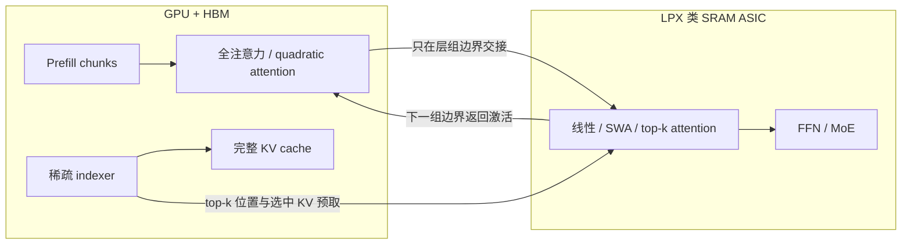

# SQD：按内存足迹拆开次二次注意力 decode

## 本次讲解位置

```text
章节：异构推理
小节：次二次注意力的 decode 切分
知识点：按“状态是否随上下文增长”拆分 quadratic 与 subquadratic 工作
上次：GPU 与 LPU 的 decode 收益边界
下次：SQD 的 top-k 选择缓存、IndexShare 与跨芯片预取
PTX：不适用；本节讨论 roofline、常驻容量和跨芯片数据流
```

## 为什么现在讲这个

前面讨论 GPU 与 LPU 时，切分线通常画在算子类型上：Attention 留 GPU，FFN/MoE 放 SRAM ASIC。这个规则默认 Attention 都持有随上下文增长的 KV，而 FFN 只持有固定权重。

现在的前沿模型大量使用线性注意力、滑动窗口注意力和稀疏 top-k 注意力。它们的后续计算不一定再需要完整 KV，常驻状态也可能与上下文长度无关。继续按“Attention 对 FFN”切，会把本可以搬到 SRAM ASIC 的次二次注意力留在 GPU；反过来，如果只看算子名字而不看 indexer 是否扫描完整 KV，又会把 quadratic 工作错误地送到容量有限的 ASIC。

SQD 解决的就是这个放置问题。它把判断对象从“算子是什么”换成“这段计算的状态是否随上下文增长，以及它能否放进目标硬件”。

## 1. 先建立心智模型

Decoder 的常见工作可以按两个维度观察：

| 工作 | 权重或状态 | 算术强度如何变化 | 是否适合 SRAM ASIC |
|---|---|---|---|
| FFN / MoE | 权重固定，batch 内共享 | batch 增大时，读一次权重可服务更多 token，强度上升 | 通常适合；前提是权重能放进 SRAM |
| 线性 / 滑动窗口注意力 | 状态大小基本固定 | 通常偏低，随上下文增长较慢 | 适合 |
| 稀疏 top-k attention | 只处理固定数量的选中 KV | 单次 attention 偏低 | 适合 |
| 稀疏 attention indexer | 必须扫描完整 KV 才能选 top-k | 随上下文长度增长 | 不适合，留在持有完整 KV 的 GPU |
| 全注意力 | 完整 KV 随 batch 和上下文增长 | 读 KV 的字节量与计算量同步增长 | 不适合容量有限的 ASIC |

SQD 的全名是 **SubQuadratic Disaggregation**。它不再把整个 Attention 当成一个不可拆的整体，而是把 decode 拆成两类：

1. 必须读取完整 KV、状态随上下文增长的 quadratic 部分。
2. 只读取固定工作集、状态不随上下文增长的 subquadratic 部分。

## 2. 三条切分路线

| 方案 | 切分依据 | GPU 侧 | SRAM ASIC 侧 | 主要代价 |
|---|---|---|---|---|
| PD | 请求阶段 | Prefill 或 Decode | 另一阶段 | Decode 池仍要保存完整 KV；跨池复制 KV |
| AFD | 算子类型 | Attention | FFN / MoE | 每层、每个 token 都要搬激活，通信在关键路径上 |
| SQD | 内存足迹与算术强度 | Prefill、完整 KV、全注意力、indexer | 次二次注意力、top-k attention、FFN / MoE | 依赖模型跨层复用索引，ASIC 常驻集可能装不下 |

可以用下面的数据流理解：



边界不是工程上任意选择的。模型训练时决定有多少全注意力层、多少线性层，以及 top-k 选择结果能否跨层复用；部署系统只能沿着这些边界切。

## 3. 两条判据：算术强度和常驻容量

### 判据一：算术强度

Roofline 中的算术强度是：

\[
I=\frac{\text{FLOPs}}{\text{Bytes moved}}
\]

硬件有一个 ridge point。低于它时，kernel 主要受内存带宽限制；高于它时，才有机会吃满计算单元。

| 硬件 | Ridge point | 含义 |
|---|---:|---|
| Rubin GPU，dense FP8 | 758 FLOP/B | 需要很高复用才进入算力受限区 |
| LPX 类 SRAM ASIC | 8.2 FLOP/B | 较低强度的工作更容易接近其设计工作点 |

Decode 大量工作是低算术强度。GPU 即使有很高峰值算力，也可能大部分时间在等数据，Tensor Core 没有对应工作量。SQD 把低强度工作放到 ridge point 更低的 ASIC 上，目标不是获得更高峰值算力，而是减少无用的计算功耗。

FFN 和 Attention 的变化规律不同：

- FFN 权重被整个 batch 共享。batch 增大后，同一份权重服务更多 token，算术强度上升。
- 全注意力为每个请求读取自己的 KV。计算和 KV 流量都随 batch、上下文增长，比值不会因为简单加 batch 而显著改善。

### 判据二：常驻容量

只有算术强度合适还不够，工作集必须真的能放进 SRAM。

| 状态 | 是否随上下文增长 | 是否随 batch 增长 | 能否长期放 SRAM |
|---|---|---|---|
| FFN 权重 | 否 | 否 | 取决于模型大小 |
| 线性 / SWA 状态 | 基本不随上下文增长 | 通常会增长 | 受 batch 和并发数约束 |
| top-k attention 的选中 KV | 只保留固定条数 | 通常增长 | 需要按 batch 预算容量 |
| 完整 KV cache | 是 | 是 | 长上下文下通常不能 |

论文在 GLM-5.2 最大建模 batch 和上下文下，给出的 PD 风格 decode 池 quadratic attention 状态是每个 rank 超过 3 TB。这个数字来自模型化场景，不是所有生产的常态；它说明的是完整 KV 无法整体塞进机架规模的 SRAM。

## 4. SQD 放置规则

SQD 只有两条核心放置规则：

1. **Quadratic attention 留 GPU。** 完整 KV 已经位于 HBM，indexer 需要扫描它，没必要把完整状态复制到 ASIC。
2. **Subquadratic attention 和 FFN 放 SRAM ASIC。** 两者都可以提前计算常驻集，适合固定容量、低功耗的片上 SRAM。

对于不同类型的模型，边界落点不同：

| 模型结构 | 边界 |
|---|---|
| 全注意力层 + 线性/SWA 层混排 | 层与层之间切；全注意力留 GPU，其余连同 FFN 走 ASIC |
| 稀疏 Attention | 算子内部切；indexer 留 GPU，top-k attention 与 FFN 走 ASIC |

第二种最容易被忽略：同一个 Attention 算子内部，前半段是 quadratic 的完整 KV 扫描，后半段是 subquadratic 的 top-k attention。

## 5. Prefill 为什么和全注意力共置

传统 PD 分离把 Prefill 和 Decode 放在不同 GPU 池。SQD 则把 Prefill 与 quadratic decode attention 放在同一块 GPU 上。

| 工作 | 主要资源 |
|---|---|
| Prefill | 大矩阵乘，偏计算密集 |
| Quadratic decode attention | 读 KV，偏内存密集 |

两者的 roofline 位置相反，交错执行可以同时利用 Tensor Core 和 HBM 通路。Prefill 按 chunk 执行，decode 只需要等待一个 chunk 的时间，不必等整个长 prompt 结束。

因此，一个 decode step 的成本更接近：

\[
t_{\text{step}} \approx t_{\text{launch}}+
\max(t_{\text{prefill chunk}},t_{\text{quadratic decode}},t_{\text{ASIC work}})
+t_{\text{exposed transfer}}
\]

这里的关键不是把所有工作并行起来，而是让共置阶段互相填补资源空档，并把跨芯片传输藏进本来就要执行的计算。

## 6. 稀疏 Attention 的 top-k 难点

考虑一个稀疏 Attention：

```text
完整 KV
  -> indexer 扫描完整 KV
  -> 选出 2048 条
  -> 只对这 2048 条做 attention
```

前一步是 quadratic 的，后一步是 subquadratic 的。

如果 ASIC 每层都从头读取完整 KV 来寻找 top-k，跨芯片互联会变成关键路径。因此 SQD 让 GPU 上的 indexer 先产生选择结果，再把被选中的 KV 预取到 ASIC。

### 一个容量例子

文章给出的 MLA 布局是 `512 + 64`，BF16 下每个条目：

\[
(512+64)\times 2=1152\ \text{B}
\]

每次选 2048 条，单请求一层的工作集为：

\[
2048\times1152=2{,}359{,}296\ \text{B}\approx2.26\ \text{MB}
\]

batch 为 32 时：

\[
32\times2.26\approx72.3\ \text{MiB}\approx75.5\ \text{MB}
\]

这个量级可以容纳，但不能每层都临时搬运并暴露全部延迟。

### IndexShare 为什么重要

GLM-5.2 的 IndexShare 每 4 层重新计算一次索引，后续 3 层复用选择结果。这样系统可以在组头得到未来几层需要的地址，提前发起预取。

这里要区分两件事：

- **减少选择计算：** 组头算一次，后续层不重跑 indexer。
- **隐藏 KV 传输：** 后续层仍需自己的数据，但它们提前知道要取哪些位置，可以把传输与本地计算重叠。

IndexShare 减少的是“何时知道地址”的不确定性，不等于后续层的 KV 字节数自动变成零。

实现上还需要三件事配合：

| 机制 | 作用 |
|---|---|
| 异步 post/wait | 把传输包在本地计算之外 |
| 单边 put + doorbell | 避免收发双方互相等待 |
| CUDA graph 固定契约 | 防止 launch 和调度空隙吃掉隐藏窗口 |

如果模型每层都独立重算索引，每一层都会变成没有预取 slack 的组头，SQD 的缓存收益会显著下降。

## 7. 为什么“分离本身”可能是负收益

不同方案的交接频率不同：

| 方案 | 跨边界内容 | 频率 |
|---|---|---|
| PD | KV cache | 每请求一次或阶段切换时 |
| AFD | Attention 与 FFN 的激活 | 每层、每 token，通常双向 |
| SQD | 层组边界的激活与选中 KV | 每几层一次 |

论文对 GLM-5.2 的一个 1M 上下文、8 层窗口给出如下解析轨迹。这里假设每次 crossing 记 20 微秒，AFD 的 8 次交接全部暴露，SQD 的 2 次交接各隐藏 60%：

| 项目 | AFD | SQD |
|---|---:|---:|
| 本地计算基线 | 416 μs | 416 μs |
| Crossing 次数 | 8 | 2 |
| 单次暴露成本 | 20 μs | 8 μs |
| 暴露通信合计 | 160 μs | 16 μs |
| 模型总时间 | 576 μs | 432 μs |

这个例子的含义是：标准 PD 在 1M 工作点上可能只有 `0.96×`，拆分自身没有带来收益；收益来自把 Prefill 与 quadratic attention 共置，以及把 top-k KV 取回藏在计算中。

## 8. 论文证据的边界

| 结论 | 证据类型 |
|---|---|
| 8×B200 代理系统功耗 4.11 kW 对 7.26 kW | 真实执行 |
| Token 能效提升 31%–56% | 真实执行 |
| 保留 63%–97% 的无分离 decode 吞吐 | 真实执行 |
| Rubin + LPX 的 TPS 和延迟提升 | 解析模型 |
| 相对 AFD 提升 1.2–1.5 倍 | 解析模型 |
| GLM-5.2 特定 SLO 区间达到 AFD 的 2.9–3.6 倍 | 解析模型 |
| 1M 上下文下 61%–71% 的能效增益 | 部分工作点超出模型训练位置，属于外推 |

B200 代理机也不是实际 LPX。它把 decode 池限制在 B200 的一部分 SM 上来模拟 SRAM-only ASIC，使用 dummy weights，并排除了真实 HBM refresh 和部分 uncore 功耗。因此，能效实验有价值，但代理忠实度需要独立复核。

适用边界主要有四个：

1. 短上下文收益有限。32K 下文章给出的增益只有 12%–51%，更短上下文未必划算。
2. 搬到 ASIC 的常驻集可能变大。GLM-5.2 和 Nemotron 3 Ultra 的额外常驻集较小，Gemma4 因 FFN 本身较小，常驻集增加到 `3.9×`。
3. 追求极高总吞吐时，GPU-only 的大 batch 方案可能仍然更高。论文自己的模型中，高延迟目标一侧 GPU-only 可以达到 SQD 峰值系统吞吐的 1.1–2.1 倍。
4. SQD 不是纯 GPU 集群上的优化。H800-only 部署没有 LPX 类 SRAM ASIC，不能直接复现该方案；能借鉴的是共置、减少 crossing 和隐藏预取的思路。

## 9. 和投机解码、HiSparse 的关系

| 技术 | 改变的核心量 |
|---|---|
| EAGLE / DFlash 等投机解码 | 每次 target forward 能验证多少个 token |
| HiSparse 等稀疏 KV 方法 | 每次 decode 实际读取和 attention 多少 KV |
| SQD | 剩余 decode 工作放在哪种硬件上执行 |

三者是正交维度，可以组合。文章也把 EAGLE-3 视为互补方案：投机解码在较宽松延迟目标下提高吞吐，SQD 在更紧延迟目标和长上下文下扩大可服务的 batch/SLO 区间。

## 10. 常见误解

| 误解 | 正确理解 | 会导致的错误 |
|---|---|---|
| 次二次 Attention 的所有步骤都便宜 | indexer 仍可能扫描完整 KV | 错误地把 indexer 搬离 KV 所在 GPU |
| SQD 是按 Attention/FFN 切 | SQD 按 quadratic/subquadratic 和常驻足迹切 | 切分边界与模型实际结构不匹配 |
| 跨层索引复用等于跨层 KV 完全共享 | 复用通常只消除重复选择；KV 预取仍需处理 | 低估带宽和缓存容量 |
| 跨芯片传的数据少，所以带宽最重要 | 数据虽少，但 crossing 位于关键路径，延迟更敏感 | 买错 fabric，吞吐被暴露延迟拖垮 |
| 31%–56% token 能效提升等于同等 TPS 提升 | 能效来自代理机实测，TPS 主要来自解析模型 | 把两类数字混成一个结论 |

## 自检

### 问 1：SQD 的核心切分判据是什么？

答：看一段 decode 工作的状态是否随上下文增长，以及它能否放进目标硬件的常驻容量。完整 KV、全注意力和需要扫描完整 KV 的 indexer 留 GPU；固定工作集的次二次 Attention 与 FFN 可以放 SRAM ASIC。

### 问 2：为什么稀疏 Attention 可能要在算子内部切？

答：因为同一个算子中，indexer 必须访问完整 KV，是 quadratic 的；选出 top-k 后的 attention 只访问固定条数，是 subquadratic 的。两部分适合放在不同硬件上。

### 问 3：为什么 Prefill 要和 quadratic decode attention 共置？

答：Prefill 偏计算，quadratic decode attention 偏读 KV，二者占据的主要硬件资源不同。按 chunk 交错执行可以提高利用率，同时避免单独迁移完整 KV。

### 问 4：IndexShare 每 4 层复用选择结果，为什么不等于 KV 流量除以 4？

答：复用解决的是重复计算和地址未知问题，让后续层可以提前预取。后续层仍需要各自 attention 所需的 KV，实际流量取决于缓存命中、层布局和选中位置是否重叠。

### 问 5：这篇文章中哪些结论是实测，哪些是模型推算？

答：8×B200 代理机上的功耗和 token 能效是实测；Rubin + LPX 的 TPS、延迟和相对 AFD 的倍数主要来自解析模型，不能当成已经部署硬件上的观测值。

## 资料

- 原文：[把 decode 的切割线推进注意力内部：SQD 与次二次注意力的异构分离](https://mp.weixin.qq.com/s/qwvcxICm8Cn3FksPAwOF6Q)
- 论文：[Rethinking Heterogeneous System Disaggregation for Subquadratic Attention](https://arxiv.org/abs/2609.13134)
