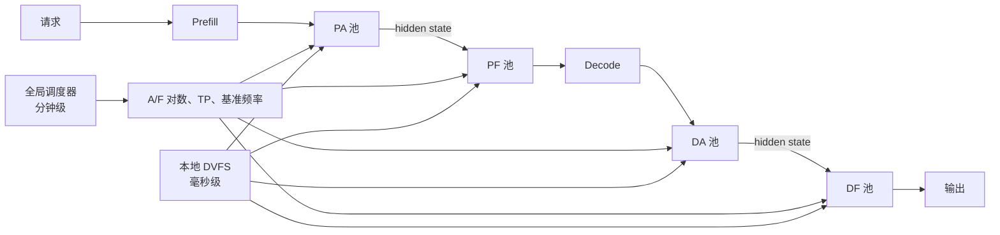

# AFlex：把 Attention 与 FFN 拆成独立的频率控制域

## 本次讲解位置

```text
章节：异构推理
小节：Attention–FFN 资源解耦与动态调频
知识点：AFlex 如何联合优化 A/F 资源配比、TP、DVFS 与流水线深度
上次：SQD 按状态足迹拆分 quadratic 与 subquadratic 工作
下次：AFlex 的 ILP 资源分配、DVFS 窗口与预测误差预算
PTX：不适用；本节讨论推理集群的资源调度、GPU 频率与能耗
```

## 为什么现在讲这个

上一节 SQD 按状态是否随上下文增长来放置工作，重点是不同硬件适合不同的内存足迹。AFlex 讨论的是另一层问题：即使所有设备都是 GPU，只要把 Attention 和 FFN 放进不同资源池，它们也会成为不同的频率控制域。

如果继续把 AFD 理解成“提升吞吐的部署技巧”，就会漏掉一个实际收益：没有变成吞吐的延迟余量，可以换成更低的频率和更小的功耗。反过来，如果只看到“平均 530 MHz”就照搬数字，又会忽略 SLO、硬件频点、切换成本和负载结构。本节要建立的是资源配比与频率调节共同决定能效的判断方法。

## 1. 先建立心智模型

先用一张表把几个容易混淆的方案放到一起：

| 缩写 | 拆分对象 | 解决的问题 |
|---|---|---|
| PD | Prefill / Decode | 两个阶段的 batch 形态和延迟目标不同 |
| AFD | Attention / FFN | 两类算子的资源配比、并行方式和通信画像不同 |
| AFlex | AFD 后各资源池的频率与供给 | 在满足 SLO 时最小化每 token 能耗 |
| SQD | quadratic / subquadratic 工作 | 把不同状态规模的工作放到 GPU 或 SRAM ASIC |

频率控制域可以理解为一组共同接受同一个频率设置的 GPU。NVIDIA 的 NVML 调整的是整张 GPU 的设备频率，不能在同一张卡的 SM 之间分别设置 Attention 和 FFN 频率。因此，AFlex 的独立调频依赖池级资源隔离。

AFlex 把推理数据面分成四个池：

| 池 | 工作 | 主要资源特征 |
|---|---|---|
| PA | Prefill Attention | 长输入时可能成为 prefill 瓶颈 |
| PF | Prefill FFN | 计算密集，但实际频率受流水线瓶颈约束 |
| DA | Decode Attention | 读取 KV，常受内存和访问延迟影响 |
| DF | Decode FFN | Decode 的主要矩阵计算负载之一 |

简化后的数据流是：



这篇论文的关键判断是：AFD 同时提供了两个自由度。

1. 资源自由度：给 Attention 和 FFN 配多少卡、多少组 A/F 流水线、每组使用多大 TP。
2. 频率自由度：每个池在不拖慢全局流水线的前提下可以运行多快。

## 2. 为什么不同池的最优频率不同

GPU 总能耗可以写成：

\[
E=P(f)\times T(f)
\]

`f` 是频率，`P(f)` 是运行功率，`T(f)` 是执行时间。升频会增加功率，但缩短时间，所以总能耗通常呈 U 形：

```text
总能耗
  │
  │ \                  /
  │  \                /
  │   \______________/
  └──────────────────────── 频率
         能耗最低点
```

论文在 A800 上把频率从 210 MHz 提到 1410 MHz，观察到：

| 阶段 | Attention 延迟下降 | FFN 延迟下降 |
|---|---:|---:|
| Decode | 33.0% | 71.5% |
| Prefill | 60.5% | 83.4% |

FFN 对升频更敏感，说明它更接近计算受限；Decode Attention 的收益较低，说明它更多受 KV 读取和内存层级影响。两类算子的能耗最低点因此通常不重合。论文报告 Attention 的最低能耗频率在 63.8% 的配置中低于 FFN，平均相差 429 MHz。

这里还要区分“单个算子的局部最优”和“整条流水线的全局最优”。Coding trace 中，PA 很重，是 Prefill 流水线的瓶颈；PF 只要跟得上 PA，就可以降频而不降低整条流水线的吞吐。因此论文实测 PF 平均只有 452 MHz，而 PA 是 656 MHz。

所以不能只根据 roofline 判断谁应该高频。正确顺序是：

```text
先找流水线瓶颈
-> 保留瓶颈侧满足 SLO 的频率
-> 在非瓶颈侧回收 slack
-> 检查调频开销和通信是否吃回收益
```

## 3. 两级控制面为什么必要

AFlex 面对的操作成本跨越多个数量级：

| 操作 | 开销 | 对调度的影响 |
|---|---:|---|
| TP 布局重配 | 6.8 到 12.6 s | 只能低频执行，不能跟随每个 batch |
| GPU 调频 | 4.7 到 44.1 ms | Decode 若逐 iteration 切换，开销可能吃掉收益 |
| 跨池 hidden state 传输 | Prefill 增加 8 到 79 ms；Decode 增加 3 到 32 ms | 需要流水线重叠或 microbatch 摊销 |
| 全局 ILP 求解 | 8 到 32 卡时约 0.49 到 0.57 s | 放在 300 s 规划窗口中成本很低 |

对照组 SLO 是 P90 TTFT 400 ms、TPOT 120 ms。一次 TP 重配需要 6.8 到 12.6 s，相当于 56.7 到 105 个 TPOT 预算，因此只能由分钟级调度器处理。

### 全局调度器

全局调度器约每 300 秒检查一次：

- P90 SLO 是否恶化；
- Attention 与 FFN 池的利用率是否失衡；
- Prefill 与 Decode 的相位是否偏斜；
- 输入输出长度分布是否偏离上一轮规划。

触发重规划后，它解整数线性规划，决定 A/F 资源对数、TP 度和各池基准频率。抽象目标是在满足延迟约束时最小化能耗：

\[
\min_{\mathbf{x},\mathbf{f}} \frac{E(\mathbf{x},\mathbf{f})}{N_{\text{token}}}
\]

约束包括资源容量、请求吞吐、P90 TTFT 和 P90 TPOT。`x` 包含资源配比和 TP 等离散选择，`f` 包含各池频率。

### 本地 DVFS 控制器

本地控制器在毫秒尺度使用全局规划留下的余量：

- Prefill 每个 batch 选择一次 PA/PF 频率对；
- Decode 按时间窗口调频，窗口长度同时考虑最小窗口和约十次切换成本；
- SLO 仍满足且 batch 变化不大时，不重新搜索；
- 即使找到更省电的频率，也要把切换开销摊回窗口后再判断是否执行。

这是一种带滞回的离散控制。它的目的不是始终追踪瞬时最优频率，而是避免控制动作本身比节省更多。

## 4. 流水线深度也是控制变量

每层 AFD 都包含：

```text
Attention -> hidden state 传输 -> FFN -> 下一层
```

如果一侧快、一侧慢，快的一侧会等待，形成流水线气泡。论文在同构 A/F 供给下观察到 FFN/Attention 延迟比在 0.43 到 5.30 之间漂移，气泡占 pipeline step 的 19.7% 到 75.7%，对应 1.1% 到 30.6% 的能耗损失。

AFlex 根据负载改变微批深度：

| 场景 | 选择 | 原因 | 论文结果 |
|---|---|---|---|
| 低负载 | `M=1` | batch 已很小，继续切分会让 SM 更空 | 每层时间比 `M=2` 少 37.9% |
| 高负载 | `M=2` | 两个微批可以重叠 Attention、传输和 FFN | 气泡减少 65.1%，每层时间减少 20.0% |
| 高负载再分配 | `128 + 256` | 按不等大小对齐两侧耗时 | 气泡再减少 16.1%，每层时间再减少 19.9% |

资源重配还有一个不对称条件。FFN 无状态，可以在下一个 iteration 边界切换 TP 布局；Attention 持有每个序列的 KV cache，活跃序列必须留在原池跑完，只有新序列能进入目标池。增量 resharding 复用已驻留权重后，TP2 升 TP4 少花 52.2% 时间，TP4 降到 TP1 少花 72.3%。

## 5. “平均 530 MHz”到底表示什么

论文的 Coding trace 使用两节点 16 卡 A800，SGLang 与 DistServe 基线一直固定在 1410 MHz。AFlex 的整体平均频率约为 530 MHz，但四个池并不是固定在一个频点：

| 池 | 平均频率 |
|---|---:|
| PA | 656 MHz |
| PF | 452 MHz |
| DA | 616 MHz |
| DF | 580 MHz |

`530 / 1410 = 37.6%`，说明 AFlex 的平均频率只有满频的约 37.6%。但频率下降和能耗下降不能线性换算，因为电压、功率、执行时间和静态功耗都参与其中。

AFlex 最终仍在 SLO 内：

| 指标 | SLO | 实测范围 | 剩余预算 |
|---|---:|---:|---:|
| P90 TTFT | 400 ms | 265 到 302 ms | 98 到 135 ms |
| P90 TPOT | 120 ms | 97 到 102 ms | 18 到 23 ms |

TTFT 还剩约 24.5% 到 33.8% 的预算，TPOT 只剩约 15.0% 到 19.2%。这说明能效收益主要来自把 SLO 余量转成低频运行，而不是让单次请求本身更快。

## 6. 论文结果与证据强度

论文在 A800、Qwen3-32B 和 Mixtral-8×7B 上实现并测量：

| 对比或场景 | 报告结果 |
|---|---|
| 相比 DistServe 的每 token 能耗 | 最多降低 49% |
| 相比 DynamoLLM 的每 token 能耗 | 最多降低 48% |
| 相比每个负载点的最强 baseline | 降低 19.6% 到 46.8% |
| 1 到 4 节点、每节点 8 RPS | 领先不低于 20.2% |
| Mixtral-8×7B | 最多再降低 41.4% |
| Chatbot / RAG | 相对最强 baseline 分别降低 55% / 45% |
| Summary | 收益收窄到 4% 到 19% |
| QA 在 2 RPS | AFlex 约 1.7 J/token，baseline 为 4.9 到 7.4 J/token |

证据可以分成三档：

| 结论 | 证据类型 | 解读 |
|---|---|---|
| 530 MHz、端到端延迟、49% 能耗收益 | SGLang 实现、生产 trace、NVML 实测 | 是论文环境中的较强证据 |
| 资源异构最多降低 48.1% 能耗 | 用频率乘延迟作为能耗代理的模型估算 | 只能判断机会规模 |
| 530 MHz 和倍数可推广到其他 GPU | 跨代际外推 | 不成立，必须重新 profile |

AFlex 在低负载下还能利用 baseline 满频空转的浪费。但 AFlex 自己在 2 RPS 的能耗仍是 16 RPS 的 1.2 到 3.3 倍，说明它缓解了轻载能效塌陷，没有消除它。

## 7. 适用边界

| 条件 | 影响 |
|---|---|
| 硬件固定为 A800 | 频点、功率曲线、NVLink 和计算特性不同，不能直接搬 530 MHz |
| SLO 较宽松 | 有更多延迟余量可换成低频；SLO 收紧后收益下降 |
| Prefill 或 Decode 一侧明显更重 | 非瓶颈侧容易降频；两侧同时吃紧时收益变小 |
| 集群规模有限 | 论文主要实验为两节点 16 卡，扩展实验到四节点 |
| 能接受复杂调度 | 需要 profile、预测器、四个调度进程和跨池通信 |
| 更换 GPU 或模型配置 | 需要重扫 TP、频率、batch、序列长度等 profile 网格 |

当前复现还有两个风险。Prefill 性能预测的误差低于 11%，但 TTFT 预算本身只有数百毫秒，11% 不是小误差；预测器使用离线 profile 训练的梯度提升树。论文说明代码计划到最终版本才开源，因此当前更适合学习系统设计，不能假设存在可直接生产的实现。

## 8. 和 SQD 的关系

AFlex 与 SQD 都在研究“工作应该放到哪种执行域”，但拆分依据不同：

| 技术 | 执行域差异 | 主要目标 |
|---|---|---|
| AFlex | 同类 GPU 的不同算子池、TP 与频率 | 在 GPU 集群内降低能耗 |
| SQD | GPU 与 SRAM ASIC 的不同状态足迹 | 减少不合适的 HBM 搬运和计算功耗 |

可以组合理解：

```text
PD 拆请求阶段
AFD 拆 Attention 与 FFN
AFlex 再拆资源配比和频率控制域
SQD 按状态规模拆异构硬件
```

AFlex 没有直接解决 SQD 的 LPX/SRAM ASIC 放置问题；SQD 也没有回答多个 GPU 池应如何独立调频。两者关心的是不同层的资源匹配。

## 9. 常见误解

| 误解 | 正确理解 | 后果 |
|---|---|---|
| 530 MHz 是所有 GPU 的固定频率 | 530 MHz 是时间与资源上的整体平均，四个池约在 452 到 656 MHz 之间变化 | 会错误设计固定频点策略 |
| Attention 和 FFN 能在同一张卡的不同 SM 上独立调频 | NVML 按 GPU 设备调频，独立频率域需要池级资源隔离 | 方案在硬件控制面无法实现 |
| FFN 计算密集，所以它的频率一定更高 | 实际频率由流水线瓶颈与 SLO slack 决定 | 非瓶颈侧会错过降频机会 |
| 频率降到 37.6%，能耗也降到 37.6% | 能耗由功率与时间共同决定，不能线性换算 | 高估节能收益 |
| 49% 是任意负载下的固定收益 | 它受硬件、SLO、模型、trace 和 baseline 频率策略影响 | 部署后达不到预期 |

## 自检

### 问 1：AFlex 与普通 AFD 的核心区别是什么？

答：普通 AFD 主要拆 Attention 和 FFN 的资源；AFlex 在此基础上把四个算子池作为独立频率控制域，联合选择 A/F 资源配比、TP、基准频率和运行时 DVFS。

### 问 2：为什么 PF 是 Prefill 中最计算密集的算子之一，频率却可能低于 PA？

答：Coding 负载里 PA 是 Prefill 流水线的瓶颈。PF 只要还能跟上 PA，降低 PF 频率不会降低整条流水线的吞吐，因此可以从 PF 回收能耗。

### 问 3：为什么需要分钟级和毫秒级两级控制？

答：TP 重配要数秒，不能在每次 iteration 做；GPU 调频要数毫秒到数十毫秒，也不能无成本地连续切换。全局控制器安排资源和基准频率，本地控制器再在窗口内利用 SLO slack 调频。

### 问 4：AFlex 的 49% 节能是否等于每张 GPU 都固定跑在 530 MHz？

答：不是。530 MHz 是整体平均，四个池有各自频率并随时间变化；49% 是特定 A800 实验、负载和 SLO 下的端到端每 token 能耗结果。

### 问 5：AFlex 与 SQD 分别拆什么？

答：AFlex 拆 GPU 集群内部的 Attention/FFN 资源池与频率控制域；SQD 按状态足迹拆 quadratic/subquadratic 工作，并考虑 GPU 与 SRAM ASIC 的异构放置。

## 资料

- 解读文章：[AFlex：把 Attention 与 FFN 拆成两个调频域](https://mp.weixin.qq.com/s/0_vwtgBUjgRyhycxko8myA)
- 论文：[Energy-Efficient LLM Serving via Disaggregated Attention--FFN and Flexible Frequency Scaling](https://arxiv.org/abs/2608.01891)
- 论文 HTML：[arXiv HTML](https://arxiv.org/html/2608.01891)
- 对照工作：[DistServe](https://arxiv.org/abs/2401.09670)、[DynamoLLM](https://arxiv.org/abs/2408.00741)
