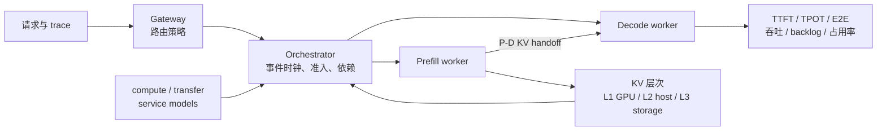

# CPU 离散事件仿真：把 PD、分层 KV 与路由策略组合起来

- 论文：Compositional Performance Modeling of LLM Inference Clusters with Hierarchical KV Caching
- arXiv：[2610.15366](https://arxiv.org/abs/2610.15366)（2026-10-11）
- 公众号解读：[CPU 上仿真 LLM 推理集群，误差 1.34%](https://mp.weixin.qq.com/s/IHmxsWh3O-86QBZSCp0hEQ)

```text
本次讲解位置
章节：inference-scheduling
小节：LLM 推理集群的组合式性能建模
知识点：CPU 离散事件仿真、分层 KV 状态与 1P-1D 标定复用
上次：KV requester 与 victim 的抢占策略
下次：把同一建模方法用于 H800 部署的 profile、请求 trace 与资源队列
PTX：不适用；本节讨论集群级服务时间、KV 可见性和资源排队
```

## 为什么现在讲这个

前面的调度笔记主要讨论单个引擎内部的 token budget、KV 抢占和 worker 选择。到了 PD 分离与分层 KV 场景，只追问“某个请求会不会命中缓存”已经不够：命中后的 KV 位于 GPU、host 还是共享存储，会改变搬运时间；多个请求同时搬 KV 时，还会争抢 H2D/D2H、P-D handoff 和 GPU 执行资源。

这篇论文把两类容易割裂的分析接在一起：

- 算子与传输 profile 给出局部操作要花多久；
- 离散事件调度器根据队列、容量和依赖关系，决定操作什么时候真正开始。

这条路径能解释为什么“缓存命中率提高了”不一定降低端到端延迟，也能避免为每一个 worker 数和拓扑重新拟合整条 E2E 延迟曲线。

## 1. 先把仿真边界说清楚

这里的“CPU 仿真”不是把 CUDA kernel 翻译成 CPU 指令，也不是逐包模拟网络。CPU 只维护请求、worker、虚拟时间、资源队列和 KV 状态；每次操作耗时来自已经拟合好的服务模型。



CPU 仿真速度与模型大小没有直接关系。8B 和 32B 都只是事件和预测函数，不会执行神经网络，因此论文里两种模型的 CPU 仿真时间接近。

### KV 的 L1/L2/L3 指存储层级

| 名称 | 论文中的含义 | 计算能否直接访问 | 典型代价 |
|---|---|---|---|
| L1 | GPU device memory / HBM | 可以 | 容量最紧张，访问最快 |
| L2 | 本机 host DRAM | 不可以，需要 KV 搬运 | 容量较大，增加 H2D/D2H |
| L3 | 共享存储或持久存储 | 不可以 | 容量最大，路径更长且可能跨 worker |

这里的 L1/L2/L3 不是 GPU 内部的 L1/L2 cache。它们描述的是可复用 KV 的驻留位置。

## 2. “组合式”到底组合了什么

系统拆成三层，每层只负责一种判断。

| 层 | 负责的问题 | 典型输入 | 输出 |
|---|---|---|---|
| 策略层 | 这个请求去哪个 worker，KV 是否查找、准入、驱逐、写回或预取 | 请求、会话、负载、容量 | 候选操作 |
| 服务模型 | 某个已获准的操作需要多久 | batch、上下文、payload、路径 | 局部操作时间 |
| 事件调度器 | 操作何时能开始，何时完成，完成后谁可以被唤醒 | 资源队列、依赖、容量预留 | 完成事件与指标 |

策略提出动作，但不能绕过资源和容量检查。例如路由策略把一个请求分给某个 prefill worker，worker 仍要等 GPU、目标 KV 容量和传输资源可用。

这种分工让路由或淘汰策略可以替换，而不必重新拟合所有计算时间。它成立的前提是 worker 的执行配置仍然兼容。

## 3. 局部服务模型

### 3.1 Prefill

对一个 batch，prefill 时间建模为：

\[
t_P=f_P\left(b,\{(q_i,c_i,n_i)\}_{i=1}^{b};\theta_P\right)
\]

| 符号 | 含义 |
|---|---|
| `b` | batch size |
| `q_i` | 本步真正需要执行的 token 数 |
| `c_i` | 已在 device 上、可参与 attention 的上下文 |
| `n_i` | 原始输入长度 |
| `θ_P` | 离线 profile 拟合出的参数 |

`q_i` 和 `c_i` 必须分开。前缀命中后，已缓存 token 不需要重新做线性投影和 MLP，但它们仍然参与后续 token 的 attention，所以不能把命中 token 从上下文长度里直接删掉。

### 3.2 Decode

Decode 按 CUDA graph bucket 建模：

\[
t_D^b=a_g+d_g\sum_{i=1}^{b}\ell_i
\]

`g` 是能容纳 batch 的最小 graph bucket，`a_g` 是固定启动与 bucket 成本，`d_g` 是上下文长度带来的增量。因为 CUDA graph 会按 bucket 补齐 batch，所以 batch size 变化可能产生台阶式成本，而不是逐 token 平滑变化。

### 3.3 KV 与 P-D 传输

传输模型按操作、方向、路径和 payload 分开拟合：

\[
t_X=f_X(\text{operation},\text{source},\text{destination},\text{payload},\text{occupancy})
\]

论文实际测量了：

- prefill GPU 计算；
- decode GPU 计算；
- P-D handoff；
- GPU → host；
- host → GPU。

P-D handoff 的拟合边界是“prefill 完成到 handoff 完成”，因此其中已经包含软件协调，不能把拟合出的速率直接解释成网卡峰值带宽。

论文当前的实验只验证了 GPU 与 host 之间的 P 侧路径。L3 在架构中存在，但实验关闭了 L3。

## 4. KV 状态必须满足的三个不变量

论文把 KV 的逻辑内容与物理副本分开记录。一份逻辑前缀可以有多个物理副本，每个副本有自己的位置、容量、引用和可见状态。

KV 搬运遵守三条规则：

1. **目标容量先预留，再派发**
   - 传输开始前先占用目标端 slot。
   - 避免多个并发请求把同一块空闲显存都当成可用。

2. **源副本使用中受保护**
   - 搬运完成前，源副本不能被驱逐。
   - 引用计数或 pin 必须覆盖整个传输生命周期。

3. **目标副本传输完成后才可见**
   - 计算只能看到完整副本。
   - 不能用“目标地址已分配”代替“数据已到达”。

这三条规则直接决定排队顺序。如果目标容量不足，请求就应该等待，而不是让传输失败后重试；如果源副本正被另一个请求引用，LRU 只能选择其他 victim。

## 5. 一次 host-prefix 命中的数据流

下面是一个教学 trace。事件顺序对应论文机制，时间数字用于说明依赖，不是论文实测值。

条件：

```text
请求输入：5000 token
host 上已有：4900 token 的完整前缀
device 上已有：0 token
本步真正需要 prefill：100 token
host→device 传输时间：2.0 ms
GPU 当前排队等待：1.8 ms
prefill suffix 时间：1.2 ms
P-D handoff 时间：0.6 ms
```

| 虚拟时刻 | 事件 | KV 状态与资源变化 |
|---:|---|---|
| 0.0 ms | 请求到达 Gateway | 尚未分配 device KV |
| 0.2 ms | 请求获准进入 prefill worker | 预留 5000-token 目标容量；源 host 副本加引用 |
| 0.2–2.2 ms | host→device 搬运 4900-token 前缀 | 目标副本不可见；源副本不能驱逐 |
| 2.2 ms | 搬运完成 | 释放源引用；4900 token 目标副本变为可见 |
| 2.2–4.0 ms | GPU 仍在服务前序 batch | 请求保留容量，等待执行资源 |
| 4.0–5.2 ms | 执行 100-token suffix prefill | 使用 4900 token 上下文，只计算 suffix |
| 5.2–5.8 ms | P-D handoff | decode 端需要预留目标容量并等待可见 |
| 5.8 ms 后 | decode worker 执行首轮 | 产生首 token，之后继续 decode |

如果只看“4900 token 命中 host cache”，容易得出“节省了 4900 token 的 prefill”。这段 trace 表明仍需计入 2.0 ms 搬运和 1.8 ms GPU 排队。KV 命中改变的是计算需求与数据位置，不自动消除资源竞争。

## 6. 为什么 1P-1D 标定可以复用到 3P-1D

标定阶段固定模型、硬件、TP、推理引擎和 KV 布局，只改变操作大小、batch 和上下文：

- prefill 改变 suffix、prefix 和 batch 组合；
- decode 改变 batch、上下文和 graph bucket；
- transfer 改变方向、payload 和路径；
- 1P-1D replay 用真实排队与 KV 状态检查这些局部模型如何组合。

换成 3P-1D 时，新增的是 P worker 队列、容量和共享传输资源。局部服务函数继续使用，事件调度器重新计算资源占用和完成顺序。

复用有条件。论文的 profile 与以下配置绑定：

- NVIDIA L20Z；
- Qwen3-8B / Qwen3-32B；
- TP=2；
- SGLang HiCache；
- BF16 KV；
- 64-token page；
- 262144 device KV tokens；
- P 侧 524352 host KV tokens；
- 4096-token prefill chunk；
- 每 worker 最多 32 个 running requests。

换成 H800、不同 TP、不同 kernel 或不同 SGLang 版本时，需要重新建立 profile。可以复用的是建模结构，不是论文里的系数。

## 7. 实验结论

论文在 1P-1D 和 3P-1D 上验证了 Qwen3-8B/32B，负载包括 16 个 QA replay 和 10 个编码会话 replay。

| 指标 | 结果 | 正确口径 |
|---|---:|---|
| QA E2E latency MAPE | 1.34% | QASPER/SQuAD 四组结果的平均；不是所有负载的统一误差 |
| 编码会话 E2E MAPE | 6.36% | 相对 adapted LLMServingSim 的 15.21% |
| Prefix token hit ratio 误差 | ≤ 1.23 pp | 四舍五入前的百分点误差 |
| CPU 仿真加速 | 15.33× | 相对真实 replay；replay 包含预设到达间隔，CPU 时间不含启动与校准 |
| 会话亲和：未缓存输入 | 仿真 -50.3% / -47.7%，实测 -48.2% / -46.1% | 8B / 32B，3P-1D |
| 60 s TTL：KV 占用 | -86.9% / -92.9% | 仿真研究；不是完整真机对照 |

QA 四组的 E2E MAPE 是 1.55%、1.58%、1.06%、1.16%：

\[
\frac{1.55+1.58+1.06+1.16}{4}=1.3375\%\approx1.34\%
\]

这个计算也说明为什么不能只看“1.34%”。编码会话分组误差更高，论文表中大致为 4.88% 到 9.07%。负载更长、突发更强时，排队和 decode 误差更容易放大。

## 8. 两个策略实验分别说明什么

### 会话亲和路由

3P-1D 下，round-robin 会把同一会话的请求分散到不同 P worker，降低前缀复用。会话亲和把同一会话固定到初始 worker，因此未缓存输入明显减少。

但 E2E 延迟几乎不变：8B 的仿真变化是 -0.23%，实测是 +0.44%，方向甚至相反；32B 分别增加 1.21% 和 1.32%。原因是共享 decode worker 的生成需求没有下降。Prefill 重算减少只缓解 P 侧，不必然改善 D 侧瓶颈。

### TTL 保留

给 P 侧 L1/L2 加 60 秒 idle TTL 后，仿真中的 KV 占用大幅下降，但部分前缀在再次使用前已经过期，TTFT 上升 7.4%/3.8%。

这里还要区分“used KV slots”和“allocated GPU memory”。TTL 释放的是缓存占用，GPU 进程预留的显存池不会因此自动缩小。

## 9. 证据强度与适用边界

| 结论 | 证据类型 | 可以怎么用 |
|---|---|---|
| 论文环境下的 E2E、TTFT、TPOT 与吞吐预测 | SGLang 真机 paired replay | 说明该方法在该配置、该负载范围内有效 |
| 1P-1D 标定可复用到 3P-1D | 两种拓扑、两种模型、多个 replay case | 支持兼容 worker 之间的规模扩展 |
| 会话亲和减少未缓存输入 | 预测与真机各测一次，趋势和幅度接近 | 支持策略方向判断，但不是大样本统计 |
| TTL 的占用与 TTFT 权衡 | 仿真参数扫描 | 用于形成候选策略，不能代替上线测量 |
| 跨 H800/H200、TP8、其他 engine 的精度 | 论文未覆盖 | 未知，不能直接搬用误差数字 |

还有几个需要保留的限制：

- 只验证 L20Z、TP2、Qwen3 8B/32B；
- 只验证 1P-1D 和 3P-1D；
- L3 未在实验中启用；
- 编码负载主要覆盖 P 侧 writeback，没有完整验证 L3 retrieval；
- 与 LLMServingSim 的比较使用 adapted baseline，属于两个完整仿真配置的比较；
- QA 的 TPOT 在 8B 上仍是 LLMServingSim 更好；
- 论文没有给出跨配置的置信区间；1.34% 是 MAPE 点估计；
- 真实 replay 包含到达间隔，15.33× 不是 GPU 计算加速比。

## 10. 把这套方法用于自己的部署建模

如果需要估算 H800 或 H200 上 GLM、Qwen 等模型的部署，可以按以下顺序建立自己的模型：

1. 固定硬件、模型、TP、engine、page size 和 graph 配置。
2. 在 1P-1D 上测 prefill 的 token/context 网格、decode 的 graph bucket 与上下文网格。
3. 分别测 P-D handoff、H2D、D2H，并记录 payload 范围和并发数。
4. 建立请求 trace：到达时间、输入长度、复用前缀、输出长度和会话 ID。
5. 用事件调度器维护 worker、KV 容量、引用、预留和传输资源。
6. 在未参与拟合的 worker 数、路由策略和负载上验证，而不是继续拟合 E2E 结果。

静态带宽和 FLOP 计算适合给出资源下界；这套离散事件模型适合回答排队、缓存层级和策略组合会怎样改变实际延迟。两者解决的是不同层次的问题。

## 11. 常见错误与症状

| 错误 | 会观察到什么 | 正确做法 |
|---|---|---|
| 把 CPU 仿真理解成 CPU 执行 LLM | 以为 8B/32B 的仿真时间应差很多 | 仿真执行的是事件与预测函数 |
| 直接把 1.34% 当成通用误差 | 换硬件或负载后仍承诺 1%~2% | 重新 profile 并在目标负载验证 |
| 只按缓存命中率判断收益 | 命中率上升，E2E 不降甚至变慢 | 同时检查搬运、排队和 D 侧瓶颈 |
| 传输前不预留目标容量 | 并发请求互相覆盖或频繁 OOM/重试 | 先 reserve，再 dispatch |
| 目标副本未完成就可见 | 偶发乱码、错误 token 或难复现的数值异常 | 显式 visibility 完成事件 |
| 认为 TTL 会缩小 GPU 显存池 | KV slot 占用下降，但进程显存不变 | 区分 used slots 与 allocated memory |
| 用单一 E2E 拟合替代组件模型 | 换拓扑后必须重新标定 | 分离局部服务时间、资源队列与 KV 状态 |

## 12. 自检

**Q1：论文中的“CPU 仿真比真实回放快 15.33×”是否表示 CPU 算 LLM 比 GPU 快？**

不是。CPU 不执行神经网络，只推进事件和查询服务模型。比较对象是完整 replay，且含请求到达间隔；一次性 profile 和启动成本没有计入 CPU 时间。

**Q2：为什么 host 前缀命中后还要把缓存 token 计入上下文？**

因为不需要重新计算这些 token 的投影和 FFN，不代表它们不参与后续 suffix token 的 attention。Prefill 成本要同时看本步执行 token `q_i` 和已有上下文 `c_i`。

**Q3：三条 KV 不变量分别防止什么错误？**

目标容量预留防止超卖；源副本引用防止搬运中被驱逐；目标副本完成前不可见防止计算读取半成品。

**Q4：为什么 1.34% 不能直接用于 H800 的容量规划？**

它来自 L20Z、TP2、Qwen3、SGLang HiCache 和特定 QA replay。H800 的 kernel、带宽、通信和 engine 配置不同，必须重新校准局部服务模型，并在目标 trace 上验证组合误差。

**Q5：为什么会话亲和降低 prefill 重算，却没有明显降低 E2E？**

共享 decode worker 仍是瓶颈。减少 P 侧工作只影响请求进入 decode 前的阶段，后续生成成本没有同步下降。
