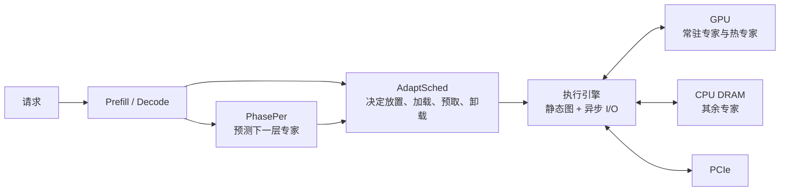

# PDScope：拆开单机 MoE 的 prefill/decode 调度

- 论文：PDScope: Breaking the Prefill-Decode Seesaw for Memory-Bound MoE Inference
- arXiv：[2610.39216](https://arxiv.org/abs/2610.39216)
- 公众号解读：[PDScope：拆掉预填充与解码跷跷板](https://mp.weixin.qq.com/s/2XavjO8WmB9AtnPzI-74JQ)

```text
本次讲解位置
章节：inference-scheduling
小节：显存受限单机上的 MoE 专家调度
知识点：PhasePer、AdaptSched 与跨层异步专家搬运
上次：LLM 推理集群的离散事件建模
下次：TensorRT-LLM 的 ADP router、phase intent 与 dummy request
PTX：不适用；本节讨论 CPU/GPU 层级、PCIe 搬运与推理阶段调度
```

## 为什么现在讲这个

上一篇集群仿真把 P、D worker、KV 层级和服务队列拆成了可组合的模型。本篇把视角缩小到一台 CPU-GPU 主机，研究另一种容量问题：MoE 专家权重放不进 GPU 显存，必须放在主机内存，并在推理过程中不断决定哪些专家留在 GPU、哪些从 CPU 搬入，以及哪些直接在 CPU 上计算。

这个场景的关键矛盾是 prefill 与 decode 对专家搬运的要求相反。如果沿用同一套静态放置或逐层贪心策略，改善一端往往会让另一端变差。理解这一点，可以避免把“专家卸载”简化成“权重复制”，也能看清 PDScope 与 PD 分离、EP、MegaMoE、DeepGEMM 分别处在哪一层。

## 1. 系统边界

PDScope 面向单机、低并发、GPU 显存不足以容纳全部 MoE 专家的部署。专家权重主要驻留在 CPU DRAM，GPU 保留一部分热专家和运行时缓冲。对于调度后留在 CPU 的冷专家，系统可以直接在 CPU 上完成该专家的计算，从而避免一次 PCIe 搬运。



这里有三类资源，任何一项都可能成为瓶颈：

| 资源 | 保存什么 | 主要成本 |
|---|---|---|
| GPU 显存 | 当前层与下一层的热专家、激活和临时缓冲 | 容量有限，扩容意味着卸载其他专家 |
| CPU DRAM | 大部分专家权重 | 容量较大，但访问路径长 |
| PCIe | CPU 与 GPU 之间的专家和激活数据 | 搬运有固定启动成本，并会与推理准备争抢 CPU |

PDScope 不是把 CPU 当成纯存储。CPU 既要维护权重和缓存，也可能执行一部分专家。因此评估这类系统时，CPU 核数、LLC、内存带宽和 PCIe 带宽都会影响结果。

## 2. “跷跷板”来自哪里

MoE 的单个 token 只选中 top-k 专家，但权重搬运与 token 数并不是线性关系。

以 Mixtral-8×7B 为例，单专家约 336 MB，top-2。某个 decode step 如果两个专家都不在 GPU，最粗略的冷缓存上界是：

\[
2 \times 336\ \text{MB}=672\ \text{MB/层}
\]

这 672 MB 只服务一个 token，权重搬运远大于有效计算。

Prefill 一次处理大量 token。假设一层 4096 个 token 最终覆盖全部 8 个专家，那么该层需要搬运：

\[
8 \times 336\ \text{MB}=2688\ \text{MB}
\]

但它服务 4096 个 token，平均到每个 token 的权重流量约为：

\[
\frac{2688}{4096}\approx0.656\ \text{MB/token}
\]

这个简化计算没有计入缓存命中和路由不均，但已经说明了差异：相同的专家加载成本，在 prefill 中被大量 token 摊薄，在 decode 中只能由一个 token 承担。

论文还给出了更直接的测量：

| 测量 | 数值 | 说明 |
|---|---:|---|
| Mixtral 单专家无竞争传输 | 33.5 ms | A100 平台 |
| Mixtral 推理期间单专家传输 | 51.1 ms | CPU 同时承担推理准备，传输被拉长 |
| DeepSeek-V2-Lite 单专家传输 | 1.95 ms → 2.78 ms | 无竞争到推理中的变化 |
| Mixtral 单专家单 token CPU 计算 | 2.88 ms | Intel 6230R |
| Mixtral 单专家单 token CPU 端到端 | 4.25 ms | 计算之外还有缓存加载和调度成本 |
| Mixtral 单专家单 token GPU 计算 | 0.33 ms | RTX 3090 |
| Mixtral 单专家单 token GPU 端到端 | 0.44 ms | kernel 启动与状态检查占了一部分 |

因此，prefill 愿意积极把专家搬上 GPU，让更多 token 进入 GPU 计算；decode 则必须避免无用预取，因为一次传输不可能由后续 token 自然摊薄。

| 阶段 | 工作负载 | 瓶颈 | 调度倾向 |
|---|---|---|---|
| Prefill | 大量 token 并行 | GPU 计算、PCIe、CPU 准备互相竞争 | 多加载，允许用 PCIe 带宽换 GPU 利用率 |
| Decode | 每请求每步一个 token | 专家权重传输、kernel 启动、CPU 调度 | 保守加载，优先消除 I/O 气泡 |

如果只用一套策略，静态放置、按需加载和逐层动态调度都会选择一个固定折中点。它们可能空间上知道“放哪里”，时间上知道“何时取”，但没有把 prefill/decode 当成两类不同工作负载。

## 3. PhasePer：分别预测两个阶段的专家激活

MoE 第 \(i+1\) 层会选哪些专家，要等第 \(i\) 层输出之后才能由真实 gate 决定。PhasePer 利用当前层的完整状态提前预测：

\[
e'_{i}=\operatorname{PhasePer}_{\theta}(a,w_i,e_i)
\]

其中：

| 符号 | 含义 |
|---|---|
| \(a\) | 当前层 attention 之后的 hidden state |
| \(w_i\) | 当前层 gate 路由权重 |
| \(e_i\) | 当前层被选中的专家 |
| \(e'_i\) | 对下一层专家激活的预测 |

预填充和 decode 各有一套训练数据与参数，因为两阶段的 token 数、专家负载偏斜和可容忍误差不同：

- prefill 有大量 token，输入分布更丰富，但专家频率可能严重不均；
- decode 每次只处理一个 token，预测单位更细，更依赖相邻 token 和层间稳定的路由模式；
- 用一套预测器同时拟合两类分布，会让阈值和损失函数都只能折中。

论文还观察到层组效应。Mixtral 的 MoE 层大致可以按路由分布和相邻层 hidden state 相似度分成输入组、中间组和输出组：

- 输入组和输出组的激活偏斜更强、特征噪声更大，预测器较浅；
- 中间组的层间特征更稳定，预测器更深，并加入 gate 作为动态校准信号；
- prefill 的输入/输出组使用频率加权的专家损失叠加 focal loss；decode 的专家不平衡较轻，只保留 focal 项。

推理期间还有在线监控。预测误差在滑动窗口内超过阈值后，会触发一次轻量微调。论文给出的单层预测器大小为 1.2–4.2 MB，前向耗时 0.12–0.48 ms。

预测只影响专家是否提前到位，不改变模型语义。真实 gate 输出后，系统一定以真实 top-k 为准；预测错误带来的是补加载或额外搬运，不会把错误的专家结果写回模型。

## 4. AdaptSched：把当前层和下一层放进同一张账

逐层贪心只看当前层，容易出现两种失效：

- prefill 把 PCIe 带宽花在当前层冷专家上，下一层热专家来不及预取；
- decode 等当前层完全缺专家时才开始取下一层，attention 和 gate 的时间不足以掩盖传输，形成 I/O 气泡。

AdaptSched 同时考虑当前层待执行专家和预测出的下一层专家，把两批专家合并成全局队列，再比较两类完成时间：

- 放在 GPU：包含 I/O 启动延迟、每个专家的 PCIe 传输时间和 GPU 计算时间；
- 留在 CPU：包含 CPU 计算时间，以及等待 attention/其他阶段的时间。

Prefill 阶段先按 token 负载确定哪些专家值得上 GPU，再把全局队列的边界映射回当前层，重新检查当前层是否负载失衡。确定按需加载集合后，剩下的 CPU 计算时间与 GPU 完成时间之差形成可用 I/O 窗口：

\[
T_{\text{gap}}=T_{\text{CPU}}-T_{\text{GPU}}
\]

这个窗口加上 attention 时间，就是下一层最多可以隐藏多少次专家预取。系统再用预测命中率和传输代价判断是否值得发出下一份预取。只有期望收益大于错误预测带来的带宽损失时才执行。

Decode 阶段的专家数少，调度更保守。它先估计当前层中“放在 CPU 上执行”和“搬到 GPU 上执行”的最优分界，再按当前层、下一层相对这个分界的偏离，在加载、预取、卸载和跨层协调之间切换。预取还必须满足一个约束：不能把下一层的 GPU 完成时间拖到比纯 CPU 执行还慢。

论文认为单层前瞻已经足够。两层前瞻只在连续冷层之后突然出现热层等组合下有额外收益，却要同时维护三层预取缓存，吞吐差异也较小。

## 5. 执行引擎：把决策移出关键路径

即使调度决策正确，如果每层都临时分配 pinned memory、注册 buffer、启停 kernel，调度收益也会被运行时开销吃掉。PDScope 把执行拆成草稿和校正两阶段：

1. 第 \(l-1\) 层正在计算时，根据 PhasePer 的结果预编译第 \(l\) 层执行图。
2. 对置信度最高和最低的专家先确定放置与预取。
3. 第 \(l\) 层真实 gate 输出后，用真实路由重新执行 AdaptSched，并覆盖草稿中的预测决策。
4. 静态图按最终决策异步执行，同时继续预测和预编译下一层。

这使预测误差停留在性能层，不会变成执行层的数据依赖错误。系统还做了几项配合优化：

| 机制 | 解决的问题 |
|---|---|
| CPU LLC 预取 | 降低专家权重从 host DRAM 进入可传输状态的延迟 |
| 合并 GPU kernel 提交 | 减少逐专家启动和阶段切换 |
| 预注册 GPU buffer | 避免每次传输都做昂贵的动态注册 |
| 按需加载 ping-pong buffer | 单独服务当前层，避免被预取覆盖 |
| 多块预取 buffer | 为下一层提前搬运，和当前层按需加载解耦 |
| `gate`/`up`/`down` 三路 CUDA stream | 并发搬运一个专家的三个矩阵 |
| pinned memory + async copy | 减少 CPU 参与并提高传输重叠 |

论文报告，在 prefill 阶段使用 AsyncIO 后，PCIe 利用率达到 66%–80%。这里的“无开销执行”应理解为调度与搬运被预编译、缓存和计算重叠隐藏，系统仍然有预测、编译、状态维护和内存带宽成本。

## 6. 一条完整时间线

```text
第 l-1 层正在 GPU 上计算
  ├─ 真实 gate 已得到第 l-1 层路由
  ├─ PhasePer 预测第 l 层专家
  ├─ AdaptSched 选定第 l 层 GPU/CPU 分界
  ├─ 预编译第 l 层草稿图
  └─ 通过预取 buffer 和异步 stream 搬运第 l 层权重

第 l 层开始
  ├─ 真实 gate 产生第 l 层 top-k
  ├─ 用真实 top-k 覆盖草稿
  ├─ 命中专家直接使用
  └─ 未命中专家补加载，或在 CPU 上执行

第 l 层计算期间
  └─ 同时预测、调度并预取第 l+1 层

输出
  └─ 路由语义始终来自真实 gate；预测只影响性能路径
```

这个流水线的核心不是“预测到所有专家”，而是让预测、调度和 I/O 在当前层计算期间滚动前进。

## 7. 实验结果

实验平台为 A100 和 RTX 3090，均为 PCIe 4.0 x16。GPU 显存统一限制在 24 GB，扣除非专家权重与运行时缓冲后，常驻专家可用空间约 5.8–8.7 GB。

主实验包含 Mixtral-8×7B、Qwen3-30B-A3B、DeepSeek-V2-Lite 和 Moonlight-16B-A3B，并与静态放置、按需加载和多类动态调度基线比较。

| 指标 | 论文结果 | 正确理解 |
|---|---:|---|
| Prefill 吞吐 | 2.5–10.3× | 相对不同基线的范围，不是所有模型都达到 10.3× |
| Decode 吞吐 | 2.1–6.1× | 同上，最高值来自特定模型和负载组合 |
| ShareGPT Top-6 命中率 | 96% / 100% / 97% / 99% | DeepSeek / Mixtral / Qwen / Moonlight |
| 291B、batch=1 prefill | 2.69–5.03× | 相对不同基线 |
| 291B、batch=1 decode | 1.26–1.97× | 相对不同基线 |
| 291B、batch=32 prefill | 2.35–5.37× | 相对不同基线 |
| 291B、batch=32 decode | 3.14–5.65× | 相对不同基线 |
| AsyncIO 消融 | prefill 1.67–1.88×，decode 1.34–2.24× | 说明执行引擎本身贡献很大 |

消融结果也说明收益不是预测器单独完成的。热专家表、AsyncIO、PhasePer 与 AdaptSched、静态图和 CPU cache 预取分别贡献了不同幅度，最终吞吐是多层机制共同作用的结果。

## 8. 证据强度与适用边界

PDScope 的主结果依赖以下条件：

- 模型总权重放不进 GPU，但大部分专家可以放进 host DRAM；
- 单机 CPU-GPU 通过 PCIe 连接，PCIe 传输是显著成本；
- 低 batch 或本地助手场景，跨请求并行不足以自然掩盖专家加载；
- 专家路由存在可学习的层间规律，允许预测器获得足够高的命中率；
- CPU 有空闲算力和 LLC 带宽，能执行部分冷专家并准备 I/O；
- 线上数据分布与训练预测器的分布接近，或者能及时在线校正。

以下场景不能直接套用论文倍数：

- 多机 Expert Parallel，专家已经分布在不同 GPU，主要通过 NVLink/RDMA 通信；
- GPU 显存足够大，专家长期驻留，不需要 PCIe 搬运；
- batch 极高，专家权重被大量 token 充分摊薄；
- 路由随机性很强，预测命中率接近随机基线；
- 只优化 KV cache，而专家权重并不构成容量瓶颈。

还要区分容量和性能。PDScope 减少的是 GPU 常驻专家所需的显存以及无效的 PCIe 流量，不会减少 MoE 参数总量，也不会减少 KV cache。它也没有把 prefill 和 decode 部署到不同机器，因此不是 PD 分离。

## 9. 与 EP、MegaMoE、DeepGEMM 的关系

| 技术 | 主要决策 |
|---|---|
| PDScope | 单机 CPU-GPU 层级中，专家放在哪里、何时搬运、是否由 CPU 计算 |
| EP / EPLB | 多 GPU 之间专家如何分区，token 如何路由到对应 rank 的专家 |
| MegaMoE | expert dispatch、pull、combine 与 grouped/MoE GEMM 的任务调度 |
| DeepGEMM | 专家或普通 GEMM 已经在 GPU 上后，kernel 如何执行和优化 |
| HiSparse / KV 优化 | 如何选择、压缩或复用 attention 的 KV，不是专家权重搬运 |

可以用一条简化数据链理解：

```text
PDScope：专家权重何时进入 GPU / 是否在 CPU 执行
   ↓
EP + MegaMoE：token 如何找到专家，跨 rank 如何 dispatch/combine
   ↓
DeepGEMM：local expert GEMM 如何高效计算
```

它们不是互相替代关系。PDScope 的调度结果可以决定哪些专家在当前 device 上有权重；MegaMoE 或 EP 决定 token 如何到达这些专家；DeepGEMM 负责最终矩阵乘。

## 10. 常见误解

| 误解 | 实际情况 |
|---|---|
| PDScope 是 prefill/decode 分离部署 | 它在同一单机系统内为两个阶段采用不同调度策略，没有跨 worker 的 P-D KV handoff |
| CPU 只存权重，不参与计算 | CPU 可以执行冷专家，论文的代价模型同时比较 CPU 与 GPU 完成时间 |
| 预测器决定最终 top-k | 最终 top-k 来自真实 gate；预测只提前安排权重和计算位置 |
| 预测错误会改变输出 | 预测错误只会造成补加载、CPU 执行或额外搬运，除非实现有错误 |
| “无开销”表示没有成本 | 调度和传输成本被预编译、缓存和重叠隐藏，并非物理上消失 |
| 最高 10.3× 适用于所有负载 | 它是论文基线和模型范围内的最高值，换硬件、batch 和模型后需要重新测量 |
| 它可以减少 KV cache | 它处理专家权重容量和 PCIe 搬运，KV 容量是另一条独立路径 |

## 11. 自检

**Q1：为什么同一个专家加载成本在 prefill 和 decode 中的影响不同？**

Prefill 一次处理大量 token，一份专家权重可以在一次加载后服务多个 token；decode 每步只有一个 token，top-k 专家的传输成本只能由这一个 token 承担。

**Q2：PhasePer 已经预测了下一层专家，为什么还需要真实 gate？**

预测只用于提前放置和预取，不能替代模型语义。真实 gate 输出之后必须覆盖草稿路由；预测错误只会影响命中率和延迟。

**Q3：AdaptSched 比逐层贪心多看了什么？**

它把当前层待处理专家和下一层预测专家放进同一个代价模型，同时考虑当前层 GPU 利用率、下一层预取窗口和预测置信度，而不是只最小化当前层的即时完成时间。

**Q4：为什么 AsyncIO 消融的提升也很大？**

专家搬运不仅是纯拷贝，还包括 pinned memory、buffer 注册、kernel 启动和 CPU 调度。预注册 buffer、独立预取空间和多 stream 并发能显著降低这些固定成本。

**Q5：这篇论文能直接说明 8 卡 H200 上 GLM 部署需要多少 GPU 吗？**

不能。论文研究的是 24 GB GPU、单机、PCIe 专家卸载和低 batch 场景。H200 的显存、TP/EP 拓扑、NVLink 与 batch 形态不同，需要用自己的容量和带宽模型重新计算。
