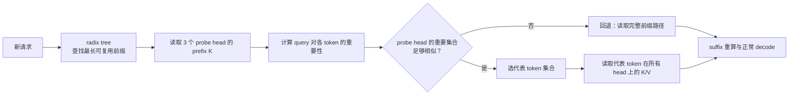

# IMPRESS：从磁盘按重要性加载前缀 KV

- 论文：[IMPRESS: An Importance-Informed Multi-Tier Prefix KV Storage System for Large Language Model Inference](https://www.usenix.org/conference/fast25/presentation/chen-weijian-impress)，FAST'25
- 论文 PDF：[fast25-chen-weijian-impress.pdf](https://www.usenix.org/system/files/fast25-chen-weijian-impress.pdf)
- 公众号解读：[论文洞察：基于重要性感知的多层级前缀 KV Cache 存储系统](https://mp.weixin.qq.com/s/nXlQ8t_7vzoz6d7FzWWOsw)
- 扩展实现：[ISCS-ZJU/HyperInfer](https://github.com/ISCS-ZJU/HyperInfer)，本文核对 commit `91df7a2fc12581c6780a6485c5b50e7fd9ef9d0e`

```text
本次讲解位置
章节：inference-scheduling
小节：分层 KV 与前缀复用
知识点：probe-head 重要 token 识别、KV 重排与 score 缓存
上次：PDScope 的单机 MoE 专家卸载与跨层异步 I/O
下次：MEPIC 的位置无关 chunk 复用，以及“首 block 重算”的精确性边界
PTX：不适用；本节讨论 SSD、CPU、GPU 之间的 KV 数据路径
```

## 为什么现在讲这个

前面的调度笔记已经处理过 KV 容量、抢占和分层搬运，但这还不够。一个请求即使命中了共享前缀，TTFT 也未必下降。完整前缀 KV 可能仍在 SSD；传统做法要先读入所有 head 的 K，才能判断哪些 token 重要，随后再读取重要 token 的 V。这样虽然省掉了重复 prefill 计算，首 token 仍要等待磁盘读取。

IMPRESS 要解决的就是这段 I/O 放大。它用少量 probe head 估计重要 token，再按这个集合加载所有 head 的 K/V。缓存命中率描述复用对象是否存在，有效 I/O 量描述这次请求实际搬了多少数据，两者需要分开看。

## 1. 系统边界

IMPRESS 处理的是**前缀复用时的 TTFT**，尤其当前缀 KV 放不进 GPU 和 CPU、完整副本位于 SSD 时。

它不负责：

- 降低 KV 的总逻辑容量。完整 K/V 仍保存在磁盘上。
- 优化 decode 每一步的稀疏 attention。它主要发生在请求 prefill 阶段。
- 压缩 K/V 的位宽。KV 量化与它是正交优化。
- 替代 radix tree、请求调度或 P/D 分离。它嵌入这些系统完成 KV 查找和加载。

| 层级 | 保存内容 | 在 IMPRESS 中的角色 |
|---|---|---|
| GPU HBM | 模型权重、运行时 KV、热 prefix KV chunk | 离 attention 最近，缓存容量最小 |
| CPU DRAM | 部分 prefix KV chunk | 比 SSD 快，仍需要 H2D 搬运 |
| SSD | 所有 prefix KV chunk 的完整副本 | 容量大，论文场景中的主要 I/O 来源 |



这里的“完整前缀路径”表示放弃近似筛选，回到普通路径，加载所需的完整 K 和重要 V。模型不会因此重新计算整个前缀。

## 2. 问题从哪来

前缀复用看上去只需要取回共享的 8K token 已经算好的 KV，实际仍要经过存储层。

一个 attention layer 的前缀 K 包含：

```text
prefix token 数 × attention head 数 × head_dim
```

传统重要 token 选择需要先计算 query 和所有 head 的 K 的 attention，才能知道哪些 token 重要。于是它必须先读完整的 K。等索引确定后，再只读取重要 token 的 V。这样一来，“只保留重要 V”仍然先从磁盘搬入了所有 K。

论文测得的存储层级延迟关系可以直观写成：

```text
GPU HBM 访问 < CPU DRAM 访问 < SSD 读取 + 软件调度
```

当前缀 KV 的复用路径经过 SSD 时，TTFT 由计算和 I/O 共同决定。论文报告的实验中，KV 加载可以占 TTFT 的 51% 到 98%。IMPRESS 的优化目标是减少这次请求从慢层读取的字节数；磁盘上的完整 KV 集合并不会因此缩小。

## 3. 重要 token 怎么算

对一个 request 的 prefix token 和 suffix query，attention 权重矩阵中，行对应 query，列对应 key/token。某个 head 上 token `j` 的重要性定义为该列对 query 维求和：

\[
s_{h,j}=\sum_i A_{i,h,j}
\]

其中：

- `h` 是 attention head；
- `j` 是 prefix 中的 token 位置；
- `i` 是当前 request 中参与 attention 的 query 位置；
- `A` 是经过 softmax 的 attention weight。

值越大，说明这个 token 对当前 query 越重要。对每个 head 独立做 top-k，就能得到该 head 的候选 token 集合。HyperInfer 的具体实现先用 `torch.sum(attn_weights, 1)` 沿 query 维聚合，再对 prefix 部分取 top-k。

### 3.1 为什么用 probe head

如果每层有 32 个 head，为了知道每个 head 的重要 token，最直接方法是读取 32 个 head 的全部 K。IMPRESS 的观察是：不同 head 的重要 token 集合往往高度相似，因此每层只读取少量 head 的 K 就足以估计共同的 token 子集。

论文使用 3 个 probe head。它们只参与“猜哪些 token 重要”，不替代其他 head 的最终 K/V。确定 token 集合后，系统仍然读取这些 token 在全部 head 上的 K 和 V。

公众号写“随机选取 3 个”，论文实际写的是固定选每层前 3 个。HyperInfer 的默认 `head_ids` 也是 `[0, 1, 2]`。固定选择便于复现，论文的实验结论是选哪 3 个对精度没有明显影响。

## 4. 相似度门控

对两个 probe head 的重要 token 集合 `A`、`B`，Jaccard 相似度为：

\[
J(A,B)=\frac{|A\cap B|}{|A\cup B|}
\]

三个 probe head 会产生三对集合，最终取三对 Jaccard 的平均值：

\[
\bar{J}=\frac{J(A,B)+J(A,C)+J(B,C)}{3}
\]

### 4.1 随机选择的基线

设前缀有 `n` 个 token，每个 head 选 `k` 个 token。令：

\[
p=\frac{k}{n}
\]

如果两个 head 独立随机选择，两个集合的期望 Jaccard 为：

\[
j=\frac{p}{2-p}
\]

IMPRESS 将阈值放在随机基线之上，以减少偶然重合被误判为共享重要集合：

\[
t=j^\alpha,\quad \alpha=0.6
\]

因为 `0 < j < 1` 且 `alpha < 1`，所以 `t > j`。这表示 probe head 的相似度必须明显高于随机重合，才允许用共享 token 集合；否则回退到普通加载路径。

### 4.2 一个完整数值 trace

取：

```text
n = 8 个 prefix token
k = 2 个重要 token/head
alpha = 0.6
```

先算随机基线：

\[
p=\frac{2}{8}=0.25
\]

\[
j=\frac{0.25}{2-0.25}=\frac{0.25}{1.75}=0.142857
\]

再算阈值：

\[
t=0.142857^{0.6}=0.311129
\]

假设三个 probe head 选出的集合是：

```text
H0 = {0, 3}
H1 = {0, 2}
H2 = {0, 3}
```

逐对计算：

| 集合对 | 交集 | 并集 | Jaccard |
|---|---:|---:|---:|
| H0, H1 | `{0}` = 1 | `{0,2,3}` = 3 | 0.333333 |
| H0, H2 | `{0,3}` = 2 | `{0,3}` = 2 | 1.000000 |
| H1, H2 | `{0}` = 1 | `{0,2,3}` = 3 | 0.333333 |

\[
\bar{J}=\frac{0.333333+1+0.333333}{3}=0.555556
\]

因为 `0.555556 >= 0.311129`，这一层接受共享重要集合。按 probe 集合中的出现次数排序：

| token | 出现在几个 probe head | 结果 |
|---|---:|---|
| 0 | 3 | 选中 |
| 3 | 2 | 选中 |
| 2 | 1 | 候选，但排在第 3 |

最终代表集合为 `{0, 3}`。平台实现会把计数最高的 `k` 个 token 作为共享集合；论文的文字描述强调 probe head 的相似集合，也是在利用这种跨 head 的共同排名。

如果 probe 集合变成 `{0,3}`、`{1,4}`、`{2,5}`，三对 Jaccard 都是 0，系统会回退到普通加载路径。

## 5. 实际 I/O 路径

以论文 Figure 9 的 32-head、4-token、选 1 个重要 token 为例。这里把每个 token 在每个 head 上的 K 或 V 看成一个向量。

### 5.1 不使用 probe head

系统先加载全部前缀 K：

```text
32 head × 4 token = 128 个 K 向量
```

计算 attention 后，每个 head 选出 1 个重要 token，再加载这些 token 的 V：

```text
32 head × 1 token = 32 个 V 向量
```

总计：

```text
128 K + 32 V = 160 个向量
```

### 5.2 使用 probe head

先加载 3 个 probe head 的 prefix K：

```text
3 head × 4 token = 12 个 K 向量
```

筛选出 1 个代表 token 后，读取它在所有 head 上的 K 和 V：

```text
2 × 32 head × 1 token = 64 个向量
```

总计：

```text
12 probe K + 64 selected K/V = 76 个向量
```

向量数减少：

\[
\frac{160}{76}=2.105
\]

这个计算只覆盖单层的 K/V 向量数，不能直接当作端到端 TTFT 预测。probe K 需要独立存放；否则为了读取这 3 个 head，系统可能仍要加载包含其他 head 的整块数据，I/O 收益会被 head 维度抵消。

论文为 probe K 单独保留副本，占全部 prefix KV 存储的 1.2%；probe 路径平均增加约 6% 的运行开销；score 和 mapping 等元数据不到 chunk 内存的 0.5%。

## 6. KV reorder：让重要 token 落在更少的 chunk 里

即使准确选中了 25% 的 token，这些 token 也可能分散在每一个 64-token chunk 中。磁盘按 chunk 读取时，系统仍会把大量无关 token 一起读上来，这叫**读放大**。

IMPRESS 定期按 token 的平均重要性重排 KV，并把重要 token 尽量密集地放在前面的 chunk 中。重排只在 radix tree 的**单个 node 内部**进行，不能跨 node。

原因有两个：

1. 一个 radix node 代表一段共享前缀。把不同 node 的 token 混排会破坏前缀树的可搜索结构。
2. 跨 node 打包会把只属于另一个请求的 token 也塞进当前读取范围，增加无关 I/O。

### 6.1 重排和恢复顺序

原始 node：

```text
逻辑 token:   [t0, t1, t2, t3]
重要性:       [0.9, 0.2, 0.2, 0.7]
```

按重要性降序稳定排序，得到存储顺序：

```text
storage_order = [0, 3, 1, 2]
```

实际存到 chunk 中的序列：

```text
reordered_tokens = [t0, t3, t1, t2]
```

但查询和 attention 需要原来的 token 顺序，因此还要保存恢复映射：

```text
restore_mapping[original_pos] = reordered_pos
restore_mapping = [0, 2, 3, 1]
```

于是：

```text
reordered_tokens[restore_mapping]
= [t0, t3, t1, t2][0, 2, 3, 1]
= [t0, t1, t2, t3]
```

存储顺序和恢复映射混用后，张量形状可能仍然正确，但 attention 会取到错误位置的 K/V。

### 6.2 一个 chunk 级别的收益

假设 chunk size 为 2，重要 token 是 `t0` 和 `t3`：

```text
重排前: [t0, t1] [t2, t3]   重要 token 分散在 2 个 chunk
重排后: [t0, t3] [t1, t2]   重要 token 集中在 1 个 chunk
```

磁盘按 chunk 读取，因此这里的收益是一次 chunk 读取。论文报告重排后平均加载的 chunk 数约为原来的 `1 / 1.2`。

## 7. Score-based cache

完整 KV 都在 SSD 上，但 GPU 和 CPU 缓存只能放一部分 chunk。传统 LRU/LFU 只看访问频率，可能把“很热但大部分 token 不重要”的 chunk 留在 GPU。

IMPRESS 给 chunk 计算：

\[
\text{score}=\text{access frequency}\times\text{important ratio}
\]

例：

| chunk | 访问频率 | 重要 token 比例 | score |
|---|---:|---:|---:|
| chunk 1 | 1.5 | 0.5 | 0.75 |
| chunk 2 | 1.0 | 1.0 | 1.00 |

只有一个 GPU 槽位时，选 `chunk 2`。虽然 `chunk 1` 更热，但只有一半内容会在重要 KV 加载路径中被使用。

重要比例是一个在线更新的移动平均，因为同一个 chunk 在不同 query 下的重要 token 集合可能变化。GPU 和 CPU 各用一个最小堆管理最低分 chunk；两者互斥，磁盘保留完整副本，所以从 CPU 驱逐不会丢数据，只是下一次读取会回到更慢的 SSD。

## 8. 可运行模拟

文件：[examples/impress_importance_tiering.py](examples/impress_importance_tiering.py)

```python
#!/usr/bin/env python3
"""CPU-only trace of the core IMPRESS decisions.

The script does not run an LLM or read KV tensors. It reproduces the
decision arithmetic used by the note:

1. estimate the similarity threshold for important-token sets;
2. compare probe-head sets and choose a shared representative set;
3. rank KV chunks by access frequency times important ratio;
4. recover logical token order after one radix-node-local reorder;
5. compare the vector count of the full-K and probe-assisted paths.
"""

from __future__ import annotations

from dataclasses import dataclass
from itertools import combinations
from typing import Iterable


def expected_random_jaccard(k: int, n: int) -> float:
    """Expected Jaccard of two independently chosen k-of-n token sets."""
    if not (1 <= k <= n):
        raise ValueError("require 1 <= k <= n")
    p = k / n
    return p / (2.0 - p)


def similarity_threshold(k: int, n: int, alpha: float = 0.6) -> float:
    """IMPRESS threshold: random-baseline Jaccard raised to alpha."""
    return expected_random_jaccard(k, n) ** alpha


def mean_pairwise_jaccard(token_sets: Iterable[set[int]]) -> float:
    sets = list(token_sets)
    if len(sets) < 2:
        raise ValueError("need at least two probe-head sets")
    values = [
        len(a & b) / len(a | b)
        for a, b in combinations(sets, 2)
        if a or b
    ]
    return sum(values) / len(values)


def shared_probe_tokens(token_sets: Iterable[set[int]], count: int) -> set[int]:
    """Take the tokens that appear in the most probe-head top-k sets."""
    counts: dict[int, int] = {}
    for token_set in token_sets:
        for token in token_set:
            counts[token] = counts.get(token, 0) + 1
    ranked = sorted(counts, key=lambda token: (-counts[token], token))
    return set(ranked[:count])


def chunk_score(access_frequency: float, important_ratio: float) -> float:
    if access_frequency < 0:
        raise ValueError("access_frequency must be non-negative")
    if not 0.0 <= important_ratio <= 1.0:
        raise ValueError("important_ratio must be in [0, 1]")
    return access_frequency * important_ratio


@dataclass(frozen=True)
class ReorderedNode:
    logical_tokens: tuple[str, ...]
    importance: tuple[float, ...]
    storage_order: tuple[int, ...]
    reordered_tokens: tuple[str, ...]
    restore_mapping: tuple[int, ...]

    @classmethod
    def from_node(
        cls,
        logical_tokens: tuple[str, ...],
        importance: tuple[float, ...],
    ) -> "ReorderedNode":
        if len(logical_tokens) != len(importance):
            raise ValueError("token and importance lengths differ")

        # Stable sort keeps the original order when scores tie.
        storage_order = tuple(
            sorted(range(len(logical_tokens)), key=lambda i: (-importance[i], i))
        )
        reordered_tokens = tuple(logical_tokens[i] for i in storage_order)

        # restore_mapping[original_pos] = position in reordered storage.
        restore_mapping_list = [0] * len(logical_tokens)
        for storage_pos, original_pos in enumerate(storage_order):
            restore_mapping_list[original_pos] = storage_pos

        return cls(
            logical_tokens=logical_tokens,
            importance=importance,
            storage_order=storage_order,
            reordered_tokens=reordered_tokens,
            restore_mapping=tuple(restore_mapping_list),
        )

    def restore(self) -> tuple[str, ...]:
        return tuple(
            self.reordered_tokens[storage_pos] for storage_pos in self.restore_mapping
        )


def print_case(label: str, probe_sets: list[set[int]], k: int, n: int) -> None:
    similarity = mean_pairwise_jaccard(probe_sets)
    threshold = similarity_threshold(k, n)
    accepted = similarity >= threshold
    print(f"{label}: probe_sets={probe_sets}")
    print(f"  mean_jaccard={similarity:.6f}, threshold={threshold:.6f}")
    print(f"  use_shared_importance={accepted}")
    if accepted:
        print(f"  shared_tokens={sorted(shared_probe_tokens(probe_sets, k))}")
    else:
        print("  action=fallback: load the full prefix KV set")


def main() -> None:
    n, k, alpha = 8, 2, 0.6
    baseline = expected_random_jaccard(k, n)
    threshold = similarity_threshold(k, n, alpha)
    print("== Similarity gate ==")
    print(f"n={n}, k={k}, p={k / n:.6f}")
    print(f"expected_random_jaccard={baseline:.6f}")
    print(f"threshold={baseline:.6f} ** {alpha} = {threshold:.6f}")

    print_case("similar probes", [{0, 3}, {0, 2}, {0, 3}], k, n)
    print_case("dissimilar probes", [{0, 3}, {1, 4}, {2, 5}], k, n)

    print("\n== Chunk admission ==")
    scores = {
        "chunk1": chunk_score(access_frequency=1.5, important_ratio=0.5),
        "chunk2": chunk_score(access_frequency=1.0, important_ratio=1.0),
    }
    for name, score in scores.items():
        print(f"{name}: score={score:.2f}")
    selected = max(scores, key=scores.get)
    print(f"one GPU slot -> cache {selected}")

    print("\n== Radix-node-local reorder ==")
    node = ReorderedNode.from_node(
        logical_tokens=("t0", "t1", "t2", "t3"),
        importance=(0.9, 0.2, 0.2, 0.7),
    )
    print(f"storage_order={node.storage_order}")
    print(f"reordered_tokens={node.reordered_tokens}")
    print(f"restore_mapping={node.restore_mapping}")
    print(f"restored_tokens={node.restore()}")
    assert node.restore() == node.logical_tokens

    before_chunks = (("t0", "t1"), ("t2", "t3"))
    after_chunks = (
        tuple(node.reordered_tokens[0:2]),
        tuple(node.reordered_tokens[2:4]),
    )
    print(f"chunks_before={before_chunks}")
    print("important t0,t3 touch 2 chunks before reorder")
    print(f"chunks_after={after_chunks}")
    print("important t0,t3 share 1 chunk after reorder")

    print("\n== K/V vector-count model ==")
    tokens, heads, probe_heads = 4, 32, 3
    important_tokens = 1
    full_path = heads * (tokens + important_tokens)
    probe_path = tokens * probe_heads + 2 * important_tokens * heads
    print("full K + selected V = H*(n+k) = "
          f"{heads}*({tokens}+{important_tokens}) = {full_path} vectors")
    print("probe K + selected K/V = n*P + 2*k*H = "
          f"{tokens}*{probe_heads}+2*{important_tokens}*{heads} = {probe_path} vectors")
    print(f"reduction={full_path / probe_path:.3f}x")


if __name__ == "__main__":
    main()
```

代码与机制的对应关系：

| 代码 | 对应机制 |
|---|---|
| `expected_random_jaccard` / `similarity_threshold` | 随机重合基线、`alpha=0.6` 门控和回退条件 |
| `mean_pairwise_jaccard` / `shared_probe_tokens` | probe head 集合相似度与代表 token 合并 |
| `chunk_score` | `access frequency × important ratio` 的 GPU/CPU 缓存准入 |
| `ReorderedNode` | radix node 内重排、存储顺序与逻辑顺序恢复 |
| `full_path` / `probe_path` | 传统路径与 probe 路径的 K/V 向量数对比 |

运行：

```bash
python3 inference-scheduling/examples/impress_importance_tiering.py
```

预期输出：

```text
== Similarity gate ==
n=8, k=2, p=0.250000
expected_random_jaccard=0.142857
threshold=0.142857 ** 0.6 = 0.311129
similar probes: probe_sets=[{0, 3}, {0, 2}, {0, 3}]
  mean_jaccard=0.555556, threshold=0.311129
  use_shared_importance=True
  shared_tokens=[0, 3]
dissimilar probes: probe_sets=[{0, 3}, {1, 4}, {2, 5}]
  mean_jaccard=0.000000, threshold=0.311129
  use_shared_importance=False
  action=fallback: load the full prefix KV set

== Chunk admission ==
chunk1: score=0.75
chunk2: score=1.00
one GPU slot -> cache chunk2

== Radix-node-local reorder ==
storage_order=(0, 3, 1, 2)
reordered_tokens=('t0', 't3', 't1', 't2')
restore_mapping=(0, 2, 3, 1)
restored_tokens=('t0', 't1', 't2', 't3')
chunks_before=(('t0', 't1'), ('t2', 't3'))
important t0,t3 touch 2 chunks before reorder
chunks_after=(('t0', 't3'), ('t1', 't2'))
important t0,t3 share 1 chunk after reorder

== K/V vector-count model ==
full K + selected V = H*(n+k) = 32*(4+1) = 160 vectors
probe K + selected K/V = n*P + 2*k*H = 4*3+2*1*32 = 76 vectors
reduction=2.105x
```

脚本只模拟决策算术，不依赖 GPU、PyTorch 或模型权重。`ReorderedNode.restore()` 里的断言检查了“重排再恢复”的索引不变量；如果换成错误的映射方向，通常会得到 `t0,t2,t3,t1` 一类错误顺序，张量形状仍可能正常。

## 9. 论文结果和适用边界

实验平台：

| 项目 | 配置 |
|---|---|
| GPU | NVIDIA A100 80GB |
| CPU | 2 × AMD EPYC 7763 |
| DRAM | 128GB |
| 存储 | 2TB Intel SSD，实测约 5GB/s |
| 互连 | PCIe 4.0 ×16 |
| 模型 | OPT-6.7B / 13B / 30B；另测 Llama2-7B / 13B |
| 数据集 | PIQA、RTE、COPA、OpenBookQA |
| 前缀 | 平均约 4.8K–5.7K token；OPT-30B 最长约 4K，其余最长约 10K |
| chunk | 64 token |

论文报告的主要结果：

| 指标 | 结果 |
|---|---|
| TTFT | 相对领先方案提升 1.2×–2.8× |
| KV I/O | 减少 1.5×–3.8× |
| 平均精度 | 相比 ReComp 平均下降约 0.2%，对比图中总体小于 1% |
| probe 开销 | 平均约 6% |
| probe K 额外存储 | 全部 prefix KV 的约 1.2% |
| 重排开销 | 离线总执行时间小于 1 分钟 |
| 元数据 | 小于 chunk 内存的 0.5% |

这些数字有明确边界：

1. **它是近似计算。** 论文自己报告，即使重要 token 的 recall 超过 80%，RTE 仍可能下降 5%，SQuAD F1 可能下降 3.3%。平均值好看不能替代任务级正确性验证。
2. **它减少慢层到 GPU 的加载量。** 完整 KV 仍保存在 SSD，容量不会因启用 IMPRESS 而缩小。
3. **它依赖共享前缀和重要 token 的跨 head 相似性。** 如果请求没有可复用前缀，或模型的 head 间差异很大，ITF 的收益会缩小。
4. **实验没有证明 32K 生产负载的收益。** 论文主要在 OPT/Llama2 和约 5K 前缀上验证；MLA、GQA 比例很高的模型、vLLM/SGLang 的动态调度和 32K 上下文需要重新测。
5. **重排是周期性离线操作。** 它适合把长期稳定的平均重要性固化到 chunk 布局，不能保证每个新 query 都得到最优布局。

## 10. 与 HiSparse、普通 prefix cache 的关系

| 技术 | 优化对象 | 主要收益 | 是否减少完整 KV 容量 |
|---|---|---|---|
| 普通 radix prefix cache | 相同前缀的重复计算 | 减少 prefill 计算 | 否 |
| IMPRESS | 从 SSD/CPU 读取前缀 K/V 的字节数 | 降低有磁盘层的 TTFT | 否，完整副本仍在 SSD |
| HiSparse / 稀疏 attention | decode 每步访问哪些 KV block | 降低 decode attention 带宽和计算 | 可能减少运行时驻留需求，但语义不同 |

组合这三个机制时，需要分别维护三类索引：

- radix tree 决定“哪些 token 属于可复用前缀”；
- IMPRESS 决定“这个请求实际需要从慢层读哪些 prefix token/chunk”；
- HiSparse 决定“decode 每一步在已有 KV 上访问哪些 block”。

## 11. 常见错误和可观察症状

| 错误 | 会看到什么 |
|---|---|
| 认为 prefix hit 就等于低 TTFT | 计算日志显示 prefill token 变少，但首 token 仍被 SSD 等待拖住 |
| 为了判断重要性先加载所有 head 的 K | 准确率接近原方案，但 I/O 降低很小，ITF 没有实际收益 |
| 把 probe head 选出的 K 当成所有 head 的 K | 张量仍能算，某些 head 的 attention 明显失真，任务精度下降 |
| 跨 radix node 重排 KV | 新请求无法正确恢复共享前缀，可能加载错误节点的 K/V |
| 只用频率做缓存淘汰 | 热但低重要比例的 chunk 长期占 GPU，重要 chunk 反复从 CPU/SSD 搬入 |
| 相似度低时不回退 | TTFT 可能变好，但输出质量在 head 差异较大的层上下降 |
| 忽略 chunk 粒度 | token 级筛选看起来只读 25%，实际因分散读取仍接近 100% 的 chunk I/O |
| 把 1.2×–2.8× 当成通用吞吐提升 | 在没有 SSD 层、前缀短或复用率低时复现不出论文数字 |

## 12. 自测

**Q1：为什么 IMPRESS 不能只读取 probe head 的 K 就完成所有 head 的 attention？**

A：probe head 用于估计 token 集合。集合确定后仍需读取被选 token 在全部 head 上的 K/V，否则其他 head 没有对应的 key 和 value，attention 结果会改变。

**Q2：`n=8, k=2` 时，随机 Jaccard 基线和阈值分别是多少？**

A：

\[
p=2/8=0.25,\quad j=0.25/(2-0.25)=0.142857
\]

\[
t=j^{0.6}=0.311129
\]

probe 平均相似度只有达到约 `0.311129`，才使用共享重要集合。

**Q3：为什么 KV reorder 不能把属于两个 radix node 的重要 token 合到同一个 chunk？**

A：radix node 的 token 顺序定义了前缀结构。跨 node 重排会改变共享前缀的边界，导致后续请求找不到可复用节点，也会把另一个前缀的无关 KV 拉进当前读取范围。

**Q4：两个 chunk 的访问频率分别是 1.5、1.0，重要比例分别是 0.5、1.0，只有一个 GPU 槽时该缓存谁？**

A：score 分别是 `1.5 × 0.5 = 0.75` 和 `1.0 × 1.0 = 1.0`，应缓存第二个。前者更热，但有一半内容不在重要加载路径中。

**Q5：IMPRESS 能否把 32K 上下文的 KV 总显存需求降低到原来的 25%？**

A：不能这样理解。它只减少请求复用前缀时从慢层读取的数据量。完整 KV 仍保留在磁盘，GPU/CPU 运行时仍需足够空间放置被选中的 K/V 和后续 decode 状态。

## 参考

1. Weijian Chen et al. *IMPRESS: An Importance-Informed Multi-Tier Prefix KV Storage System for Large Language Model Inference*. FAST'25, pp. 187–201.
2. 公众号文章：[论文洞察：基于重要性感知的多层级前缀 KV Cache 存储系统](https://mp.weixin.qq.com/s/nXlQ8t_7vzoz6d7FzWWOsw)。
3. 扩展实现：[ISCS-ZJU/HyperInfer](https://github.com/ISCS-ZJU/HyperInfer)，核对 commit `91df7a2fc12581c6780a6485c5b50e7fd9ef9d0e`；重点路径为 `h2o_flexgen/flexgen/pytorch_backend.py`、`flex_opt.py` 和 `my_pcache_fast.py`。
