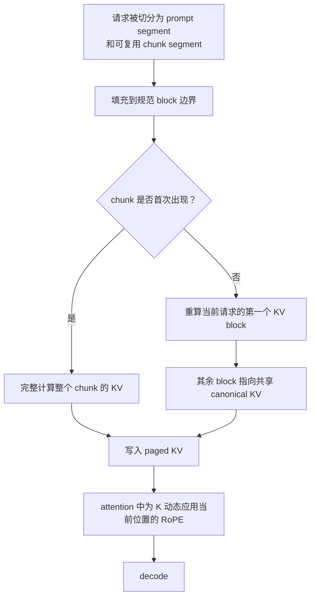

# MEPIC 的 KV 复用：精确计算还是近似计算

- 论文：[MEPIC: Memory Efficient Position Independent Caching for LLM Serving](https://arxiv.org/abs/2512.16822)，arXiv `2512.16822v1`
- PDF：[arxiv.org/pdf/2512.16822](https://arxiv.org/pdf/2512.16822)
- 公众号解读：[论文洞察：位置无关的 KV Cache 高效复用技术](https://mp.weixin.qq.com/s/jwjK_M7iFSiedw6epdUCXQ)

```text
本次讲解位置
章节：inference-scheduling
小节：位置无关 KV Cache 与选择性重算
知识点：MEPIC 的精确性边界、第一个 block 重算和共享 tail
上次：IMPRESS 的 probe-head 重要 token 识别与慢层 I/O
下次：把 radix cache、IMPRESS、MEPIC 和 HiSparse 的索引层级放进同一个请求 trace
运行环境：Python 3.10+，仅使用标准库；不需要 GPU、PyTorch 或模型权重
```

## 结论

MEPIC 的正常复用路径是**近似计算**。

第一次遇到一个 chunk 时，MEPIC 完整计算它的 KV，这一步相对普通 prefill 是精确的。后续请求复用同一个 chunk 时，MEPIC 只重算 chunk 的第一个 KV block，其余 block 使用之前保存的共享 KV。这能够修正一部分上下文边界变化，但没有让后续 block 在完整左侧上下文上重新计算，因此不能保证与逐 token 完整 prefill 数值相同。

论文也明确承认这个取舍：只重算第一个 block 会忽略剩余的 cross-block attention 影响，只在实验使用的 QA 数据集上观察到与基线接近的精度。

## 1. 近似误差从哪里来

一个 token 的 K/V 由三部分共同决定：

```text
当前 token 的内容
+ 它看到的左侧上下文
+ 它在当前序列中的位置
```

不同请求复用同一个文档块时，块里的文字相同，但块前面的系统提示、文档顺序或问题可能不同。因此同一个 token 在新请求里生成的 hidden state、K 和 V 会发生变化。

MEPIC 用两个机制分别处理不同部分：

| 机制 | 能修正什么 | 不能修正什么 |
|---|---|---|
| fused RoPE | 缓存 K 在旧、新绝对位置之间的旋转差异 | 左侧上下文变化造成的 raw K/V 差异 |
| 重算第一个 block | 当前请求在 chunk 左侧边界附近的上下文差异 | 后续 block 已经漏掉的跨 block 上下文 |
| 共享剩余 KV | 避免相同内容的重复 HBM 存储 | 恢复未重算 token 的精确上下文状态 |

RoPE 通常只作用在 Query 和 Key 上，Value 本身不做旋转变换。因此需要动态补位置的是 K。把 K 存成未旋转格式可以解决“同一份 K 绑定绝对位置”的问题，但解决不了 K 的上下文依赖。

## 2. MEPIC 的复用数据流



需要注意公众号里的表述：

> “仅重计算 KV Cache 块的第一个”

这句话容易被理解成“每个 block 重算第一个 token”。论文实际写的是：

> **对每个复用的 chunk，只重算它的第一个 KV block，剩余 block 直接复用。**

若 chunk 有 16 个 block，复用路径是：

```text
block 0：针对当前请求重算
block 1..15：共享上一份 canonical KV
```

block 0 的 KV 是请求相关的，后面的共享 block 必须保持不可变。如果后续需要修改任何共享 block，就需要 copy-on-write，否则会污染其他引用同一物理页的请求。

## 3. 哪些路径精确，哪些路径近似

| 路径 | 数值等价于完整 prefill？ | 原因 |
|---|---:|---|
| 第一次出现，完整计算该 chunk | 是 | 每个 token 都使用当前请求的完整左上下文 |
| 复用 chunk，只重算第一个 block | 否 | 其余 block 的 K/V 来自旧上下文 |
| 复用 chunk，但重算全部 block | 是 | 回到完整 prefill |
| 只做动态 RoPE，不重算任何 token | 否 | 位置修正不等于上下文修正 |
| chunk 前面没有不同上下文，缓存 K/V 也确实相同 | 特殊情况下可以相同 | 需要逐项满足相同内容和上下文，不能作为通用保证 |

在块大小为 `B`、chunk 长度为 `N`、并发引用该 chunk 的请求数为 `R` 时，MEPIC 的简化 block 占用模型是：

\[
\text{blocks}(R)=R+\left(\frac{N}{B}-1\right)
\]

完整重算模型是：

\[
\text{blocks}_{full}(R)=R\frac{N}{B}
\]

代入：

```text
N = 256 token
B = 16 token
R = 8 个请求
```

每个 chunk 有：

\[
N/B=256/16=16\text{ blocks}
\]

完整重算需要：

\[
8\times16=128\text{ blocks}
\]

MEPIC 共享模型需要：

\[
8+(16-1)=23\text{ blocks}
\]

压缩倍数：

\[
128/23=5.565217
\]

HBM 节省比例：

\[
1-23/128=82.03\%
\]

这个结果说明共享收益取决于两个量：

- `B/N` 越小，请求相关的第一个 block 占比越低，节省越多；
- 同时引用同一 chunk 的请求越多，共享 tail 的摊销收益越高。

该模型只解释 block 占用，不是论文实测曲线，也不包含 request-specific prompt、唯一 chunk、缓存淘汰和调度开销。

## 4. 可运行模拟

文件：[examples/mepic_position_independent_kv.py](examples/mepic_position_independent_kv.py)

```python
#!/usr/bin/env python3
"""CPU-only trace of MEPIC reuse exactness and KV block occupancy.

The script models one reusable chunk referenced by several concurrent
requests. It does not execute attention. The vector example isolates two
different effects:

1. fused RoPE can correct the cached key's absolute position;
2. fused RoPE cannot recover K/V changes caused by a different left context.
"""

from __future__ import annotations

from dataclasses import dataclass
from math import ceil, cos, sin


Vector = tuple[float, float]


@dataclass(frozen=True)
class ReusePlan:
    chunk_tokens: int
    block_tokens: int
    active_requests: int

    def __post_init__(self) -> None:
        if min(self.chunk_tokens, self.block_tokens, self.active_requests) <= 0:
            raise ValueError("all dimensions must be positive")
        if self.active_requests < 2:
            raise ValueError("the shared-reuse case needs at least two requests")

    @property
    def blocks_per_chunk(self) -> int:
        return ceil(self.chunk_tokens / self.block_tokens)

    @property
    def full_recompute_blocks(self) -> int:
        return self.active_requests * self.blocks_per_chunk

    @property
    def mepic_blocks(self) -> int:
        # One request-specific first block per request, plus one shared tail.
        return self.active_requests + self.blocks_per_chunk - 1

    @property
    def reduction(self) -> float:
        return self.full_recompute_blocks / self.mepic_blocks

    @property
    def savings_ratio(self) -> float:
        return 1.0 - self.mepic_blocks / self.full_recompute_blocks

    def exact_equivalent(self) -> bool:
        # Reusing KV computed under another left context is approximate.
        return self.blocks_per_chunk == 1


def add(a: Vector, b: Vector) -> Vector:
    return a[0] + b[0], a[1] + b[1]


def scale(a: Vector, factor: float) -> Vector:
    return a[0] * factor, a[1] * factor


def contextual_key(token_value: int, left_context: tuple[int, ...]) -> Vector:
    """Synthetic K before RoPE: token content plus left-context contribution."""
    token = (float(token_value), float(token_value * 2 + 1))
    context = (0.0, 0.0)
    for value in left_context:
        context = add(context, (float(value), float(value + 1)))
    return add(token, scale(context, 0.05))


def apply_rope(key: Vector, position: int) -> Vector:
    angle = position * 0.017
    c, s = cos(angle), sin(angle)
    return key[0] * c - key[1] * s, key[0] * s + key[1] * c


def l1_distance(a: Vector, b: Vector) -> float:
    return abs(a[0] - b[0]) + abs(a[1] - b[1])


def main() -> None:
    plan = ReusePlan(chunk_tokens=256, block_tokens=16, active_requests=8)
    print("== KV block occupancy ==")
    print(f"blocks_per_chunk={plan.blocks_per_chunk}")
    print(f"full_recompute_blocks={plan.full_recompute_blocks}")
    print(f"mepic_blocks={plan.mepic_blocks}")
    print(f"reduction={plan.reduction:.6f}x")
    print(f"hbm_savings={plan.savings_ratio:.2%}")
    print(f"numerically_exact={plan.exact_equivalent()}")

    print("\n== Exactness boundary ==")
    cases = (
        ("first encounter: recompute every block", True),
        ("reuse: first block recomputed, tail shared", False),
        ("all blocks recomputed under current context", True),
    )
    for name, exact in cases:
        print(f"{name}: exact={exact}")

    # Synthetic trace: keep the stale tail K, then rotate it to the new position.
    token_value = 37
    old_context = (1, 2, 3)
    current_context = (2, 5, 7, 11)
    old_position = 16
    new_position = 96

    exact_key = apply_rope(contextual_key(token_value, current_context), new_position)
    position_only = apply_rope(contextual_key(token_value, current_context), old_position)
    position_only = apply_rope(position_only, new_position - old_position)
    reused_tail = apply_rope(contextual_key(token_value, old_context), new_position)

    print("\n== Synthetic key trace ==")
    print(f"exact_vs_position_only_error={l1_distance(exact_key, position_only):.6f}")
    print(f"exact_vs_reused_tail_error={l1_distance(exact_key, reused_tail):.6f}")
    print("position correction removes the RoPE offset only")
    print("the reused tail still carries the old left-context contribution")


if __name__ == "__main__":
    main()
```

代码与机制的对应关系：

| 代码 | 对应机制 |
|---|---|
| `ReusePlan.full_recompute_blocks` | 每个请求完整重算全部 block 的占用 |
| `ReusePlan.mepic_blocks` | 每个请求一个首 block，tail 只保留一份 |
| `ReusePlan.exact_equivalent` | 只有全部 block 都落到当前请求的精确路径才返回 `True` |
| `contextual_key` | 合成 K：token 内容加左侧上下文贡献 |
| `apply_rope` | 把未旋转 K 调整到指定位置 |
| `l1_distance` | 比较精确 K 与“只修位置”的复用 K |

运行：

```bash
python3 inference-scheduling/examples/mepic_position_independent_kv.py
```

预期输出：

```text
== KV block occupancy ==
blocks_per_chunk=16
full_recompute_blocks=128
mepic_blocks=23
reduction=5.565217x
hbm_savings=82.03%
numerically_exact=False

== Exactness boundary ==
first encounter: recompute every block: exact=True
reuse: first block recomputed, tail shared: exact=False
all blocks recomputed under current context: exact=True

== Synthetic key trace ==
exact_vs_position_only_error=0.000000
exact_vs_reused_tail_error=1.943291
position correction removes the RoPE offset only
the reused tail still carries the old left-context contribution
```

`exact_vs_position_only_error=0` 是构造出来的理想值：同一份 raw K 连续旋转到目标位置，位置变换本身没有误差。`exact_vs_reused_tail_error=1.943291` 来自代码里的合成上下文，只用于说明误差来源，不代表 Mistral 或其他真实模型的误差大小。

## 5. 为什么论文仍然报告精度接近

论文的选择性重算策略是：第一次完整计算，后续重算当前 chunk 的第一个 block。它试图用最靠近边界的一个 block 吸收上下文切换造成的主要差异，其余 block 继续复用。

MEPIC 在 SQuAD、NewsQA、NarrativeQA 和 emrQA 上报告了与 CacheBlend、EPIC 接近的 F1 或 Rouge-L。这个结果支持“该近似在测试负载上可用”，不能推导出以下更强的结论：

- 每个 token 的 K/V 与完整 prefill 相同；
- 所有任务的输出都相同；
- 32K 上下文、代码 Agent、多轮工具调用或强推理任务不会累积误差；
- 重算第一个 block 对所有模型架构都足够。

若系统要求可证明的等价性，应该对复用的 chunk 做完整重算，或者在近似路径之外增加可观测的误差检测与回退。MEPIC 论文的主路径没有提供逐请求的精确性证明。

## 6. 常见错误

| 错误理解 | 实际含义 |
|---|---|
| MEPIC 用 fused RoPE 实现了精确的位置无关复用 | fused RoPE 只精确修正显式位置变换，K/V 的上下文差异仍然存在 |
| 每个 block 的第一个 token 会被重算 | 重算单位是每个 chunk 的第一个完整 block |
| 精度接近就等于数值精确 | 近似算法可以保持任务指标接近，但逐元素 K/V 可以不同 |
| NoPE 表示 K 和 V 都不依赖位置 | V 通常本来就不应用 RoPE；K 去掉的是显式旋转，不是上下文依赖 |
| 共享物理页只影响内存管理 | 共享 tail 必须不可变，否则需要 copy-on-write 防止跨请求污染 |

## 7. 自测

**Q1：MEPIC 第一次处理 chunk 时，计算结果是否精确？**

A：在 attention mask、位置映射和 kernel 实现都正确的前提下，完整计算该 chunk 等价于普通 prefill。精确性边界出现在后续复用。

**Q2：只重算第一个 block 后，为什么剩余 block 仍然是近似结果？**

A：剩余 block 的 K/V 在之前上下文中生成。当前请求只重算了第一个 block，没有让后续 token 重新看到当前请求的完整左侧上下文。

**Q3：动态 RoPE 能修正什么？**

A：它能把缓存 K 的绝对位置从旧位置变换到新位置。它不能改变缓存的 raw K 所携带的旧上下文信息。

**Q4：`N=256, B=16, R=8` 时，MEPIC 简化模型为什么从 128 个 block 降到 23 个？**

A：每个请求保留一个首 block，共 `8` 个；chunk 剩余 `16-1=15` 个 block 在所有请求间只保留一份，总计 `8+15=23`。

## 参考

1. Qian Wang et al. *MEPIC: Memory Efficient Position Independent Caching for LLM Serving*. arXiv:2512.16822v1, 2025.
2. 公众号文章：[论文洞察：位置无关的 KV Cache 高效复用技术](https://mp.weixin.qq.com/s/jwjK_M7iFSiedw6epdUCXQ)。
