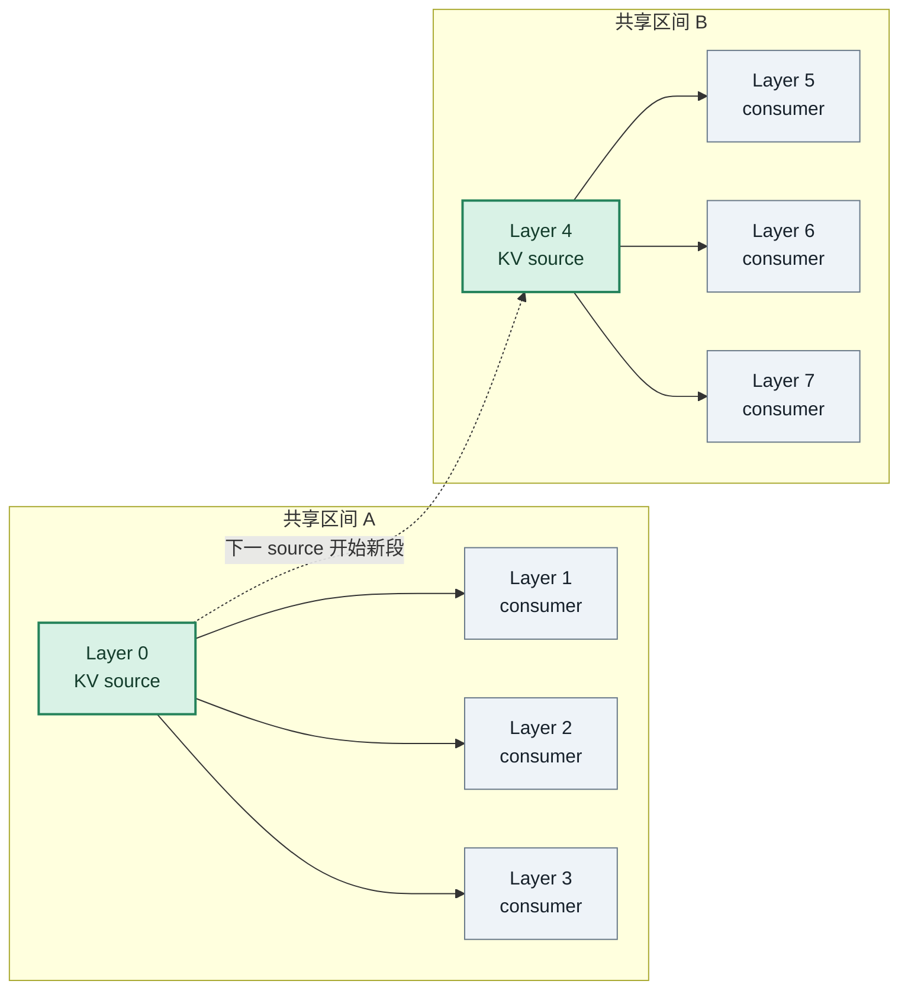
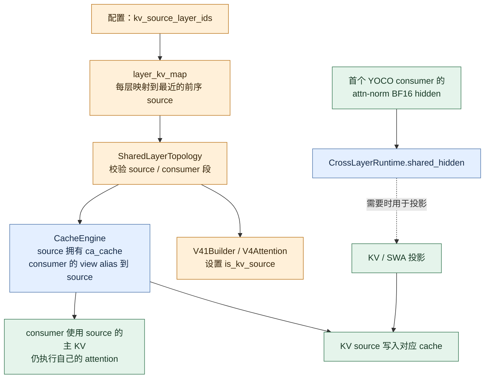

# DeepInfer 执行骨架与 YOCO 跨层 KV 共享

> 本文根据 DeepInfer 源码整理，检查版本：[`774cc244`](https://github.com/deepseek-ai/DeepInfer/tree/774cc244b87cc0eb8d4b94ab9f5de2ab22049f01)。重点是理解离线推理执行链，以及 YOCO 中“哪层拥有 KV、哪些层复用、共享 hidden 从哪里来”。源码中的模型配置决定具体层号；文中的 8 层映射只用于演示规则，不代表 DeepSeek-V4.1-Flash 的真实层配置。

## 本次讲解位置

```text
章节：models/deepinfer
小节：DeepInfer 执行骨架与 YOCO 跨层 KV 共享
知识点：source layer、consumer layer、shared hidden 与 KV cache alias 的区别
上次：DeepInfer 顶层模块与 YOCO 共享缓存的口头梳理
下次：SWA KV miss、窗口截断公式与 bounded replay（见 [swa-bounded-replay.md](swa-bounded-replay.md)）
PTX：不适用
```

## 为什么现在讲这个

我们前面讨论了“共享的 KV cache 到底是第几层的，是不是最后一层生成后给所有层用”。如果不先看清 source 映射，容易把 YOCO 误解成全模型只算一份 KV，或认为它天然来自最后一层。DeepInfer 的实现是由 checkpoint 配置指定多个 KV source，consumer 复用其前方最近的 source；source 层可以是中间层，最后一层也可能只是 consumer。这个区别直接决定 KV cache 的归属、容量估算和跨层数据流。

## 1. 先建立整体心智模型

DeepInfer 是围绕 DeepSeek-V4.1-Flash 等模型的推理运行时。仓库 README 描述了模型算子、调度、并行与采样等能力；开源入口主要是离线推理，README 也明确指出完整生产服务还需要 KV cache 服务、Prefill/Decode 分离和 DP 负载均衡等组件。

本次检查版本的 README 将支持模型列为 DeepSeek-V4.1-Flash，支持 NVIDIA SM100 与 Huawei Ascend 950。功能包括优化算子、Attention DP / balanced CP、MoE EP + EPLB、DSpark/置信度调度验证、异步调度、batch-invariant inference 和确定性采样。它不是只提供模型结构定义的仓库，而是把模型、算子、调度和执行运行时放在同一工程里的推理项目；但“有推理 engine”不等于开源包已经包含生产线上完整的请求接入与跨集群服务层。

从一次离线生成调用看，可以先把执行路径记成：

```text
用户 prompts
   │
   ▼
LLM.generate()
   │  将请求加入引擎，并反复驱动 step
   ▼
LLMEngine.step()
   │  CPU scheduler 选择本轮要运行的序列、构造元数据
   ▼
Worker.execute_model_step()
   │
   ├─ ModelRunner.execute_main_model()
   │    ├─ prepare input metadata
   │    ├─ CUDA Graph replay（满足条件时）
   │    └─ 或直接调用模型 forward
   │
   ├─ sampler：为当前序列取样
   └─ post-process：更新序列状态和输出
```

代码入口可沿着 [`entrypoints/llm.py`](https://github.com/deepseek-ai/DeepInfer/blob/774cc244b87cc0eb8d4b94ab9f5de2ab22049f01/deepinfer/entrypoints/llm.py)、[`engine/llm_engine.py`](https://github.com/deepseek-ai/DeepInfer/blob/774cc244b87cc0eb8d4b94ab9f5de2ab22049f01/deepinfer/engine/llm_engine.py)、[`worker/worker.py`](https://github.com/deepseek-ai/DeepInfer/blob/774cc244b87cc0eb8d4b94ab9f5de2ab22049f01/deepinfer/worker/worker.py) 和 [`worker/model_runner.py`](https://github.com/deepseek-ai/DeepInfer/blob/774cc244b87cc0eb8d4b94ab9f5de2ab22049f01/deepinfer/worker/model_runner.py) 阅读。

模型内部则由 V4 builder 按配置建立 decoder blocks。每个 block 的 attention、MoE/FFN、归一化等照层序运行；跨层共享通过额外的静态拓扑映射和本次 forward 的 runtime 状态实现：

```text
HF / 模型配置
  └─ layer_kv_map / index maps
       └─ SharedLayerTopology（校验并规范化映射）
            ├─ V4Attention：确定本层是 source 还是 consumer
            ├─ CacheEngine：按 layer_kv_map 给层分配或 alias cache view
            └─ CrossLayerRuntime：本次 forward 内暂存 shared hidden 等临时值
```

## 2. 四个容易混淆的概念

| 名称 | 是什么 | 在 DeepInfer 中的例子 |
|---|---|---|
| KV source layer | 为某个共享区间拥有并产生主压缩 KV 的层 | `layer_kv_map[layer] == layer` |
| KV consumer layer | 从映射指定的 source 读取主压缩 KV 的层 | `layer_kv_map[layer] != layer` |
| `shared_hidden` | 跨层暂存的一份 BF16 attention-norm hidden；某些后续路径用它产生需要的投影 | `CrossLayerRuntime.shared_hidden` |
| KV cache alias | 多个逻辑层的 cache view 指向同一份 source cache 存储 | cache engine 按 `layer_kv_map` 建立 `ca_cache` 共享关系 |

因此，`shared_hidden` 不等于 KV cache；“复用 source 层的 KV cache”也不表示 consumer 层不再运行 attention。consumer 仍然执行本层的 query、打分和 attention，只是主压缩 KV 的来源按拓扑共享。SWA、indexer 的 K cache、index/top-k 也有各自的路径和映射，不能把 `layer_kv_map` 误当成所有缓存的唯一映射。

## 3. YOCO 的 source 与 consumer 怎么确定

DeepInfer 将 HF 配置里的 `kv_source_layer_ids` 转为 `layer_kv_map`。映射含义是：**层 `i` 使用哪一个 source 层的值**。省略的层会归到不晚于自己的最近 source。

举一个纯教学用的 8 层例子，source 层设为 0 和 4：

> 源码能确认映射规则，但具体 checkpoint 的 `kv_source_layer_ids` 来自对应 Hugging Face 配置，并未在这份源码仓库中写死。要回答某个 checkpoint 的确切 source 层号，需要读取它实际使用的 `text_config`，不能把下面的 0、4 当成模型实参。



对应关系：

| 层号 `i` | `layer_kv_map[i]` | 解释 |
|---:|---:|---|
| 0 | 0 | 自己是 source，拥有此段的主压缩 KV |
| 1 | 0 | 复用 layer 0 的主压缩 KV |
| 2 | 0 | 复用 layer 0 的主压缩 KV |
| 3 | 0 | 复用 layer 0 的主压缩 KV |
| 4 | 4 | 新 source，开启下一段 |
| 5 | 4 | 复用 layer 4 的主压缩 KV |
| 6 | 4 | 复用 layer 4 的主压缩 KV |
| 7 | 4 | 复用 layer 4 的主压缩 KV，而不是“自动成为最终 KV source” |

最后一行回答了之前关于“最后一层 KV”的问题：**共享来源由配置决定，不由层号最大值决定。** 若配置把最后一层设成 source，它才会成为 source；否则它会按映射复用前方 source。DeepInfer 的映射约束 source 不晚于 consumer，并要求共享区间连续、配置兼容。

## 4. 共享 hidden 与 KV cache 的实际数据流

YOCO consumer 区间由 `n_prefill_layer` 定义，代码中 consumer 范围是 `[n_prefill_layer, num_hidden_layers)`。第一个需要跨层 hidden 的 consumer 会把自己的 attention-norm BF16 hidden 捕获进 `CrossLayerRuntime.shared_hidden`。这份 hidden 后续可供需要的 SWA 或新 KV source 投影使用。

与此同时，主压缩 KV 的 cache ownership 按 `layer_kv_map` 决定。源码里有两层不同的“复用”：

1. **持久 cache 视图**：cache engine 按 `layer_kv_map` 为 consumer alias source 的 `ca_cache`，避免重复拥有同一段主压缩 KV 存储。
2. **本次 prefill 的临时张量**：source 读取/解压出 KV 后放在 `CrossLayerRuntime.loaded_prefill_kv`；同一共享段的 consumer 可继续复用该张量，进入新 source 段时再释放旧段的临时值。

示意如下：



注意，这张图描述的是共享机制，不是每个 consumer 都从 `shared_hidden` 直接拷贝一份最终 KV。source/consumer 关系由映射给出；hidden 是否被捕获、哪条 attention 子路径会消费它，则由 `yoco_shared_hidden_required` 等条件决定。

## 5. 用一段可运行代码复现映射规则

以下脚本是教学示例，完整复现“source 列表中取不晚于当前层的最近 source”这一规则。DeepInfer 自身还会验证共享段和每层配置兼容；本例只展示映射核心。

保存为 `yoco_layer_map_demo.py`：

```python
def source_map(source_ids: list[int], num_layers: int) -> dict[int, int]:
    """Map every layer to its nearest source layer at or before it."""
    sources = sorted(source_ids)
    if not sources:
        raise ValueError("at least one source layer is required")
    if sources[0] < 0 or sources[-1] >= num_layers:
        raise ValueError("source layer is outside the model")

    mapping: dict[int, int] = {}
    for layer in range(sources[0], num_layers):
        eligible_sources = [source for source in sources if source <= layer]
        mapping[layer] = eligible_sources[-1]
    return mapping


def main() -> None:
    num_layers = 8
    kv_source_layer_ids = [0, 4]
    mapping = source_map(kv_source_layer_ids, num_layers)

    print("layer -> kv source")
    for layer, source in mapping.items():
        role = "source" if layer == source else "consumer"
        print(f"{layer} -> {source} ({role})")


if __name__ == "__main__":
    main()
```

运行：

```bash
python3 yoco_layer_map_demo.py
```

预期输出：

```text
layer -> kv source
0 -> 0 (source)
1 -> 0 (consumer)
2 -> 0 (consumer)
3 -> 0 (consumer)
4 -> 4 (source)
5 -> 4 (consumer)
6 -> 4 (consumer)
7 -> 4 (consumer)
```

逐行读第 6 层：source 列表是 `[0, 4]`，不晚于 6 的 source 是 `[0, 4]`，取最后一个即 4，所以 `layer_kv_map[6] = 4`。当第 4 层开始新段时，它自己就是 source，之后直到下一 source 的层都复用它。

## 6. 阅读源码时按这个顺序追

| 要回答的问题 | 源码位置 | 看什么 |
|---|---|---|
| 离线调用如何开始？ | [`entrypoints/llm.py`](https://github.com/deepseek-ai/DeepInfer/blob/774cc244b87cc0eb8d4b94ab9f5de2ab22049f01/deepinfer/entrypoints/llm.py) | `LLM.generate()` 如何提交批量请求 |
| 谁负责本轮调度？ | [`engine/llm_engine.py`](https://github.com/deepseek-ai/DeepInfer/blob/774cc244b87cc0eb8d4b94ab9f5de2ab22049f01/deepinfer/engine/llm_engine.py) | `step()` 与 scheduler 交互 |
| forward、sample 如何串起来？ | [`worker/worker.py`](https://github.com/deepseek-ai/DeepInfer/blob/774cc244b87cc0eb8d4b94ab9f5de2ab22049f01/deepinfer/worker/worker.py) | `execute_model_step()` |
| 模型 forward 如何提交？ | [`worker/model_runner.py`](https://github.com/deepseek-ai/DeepInfer/blob/774cc244b87cc0eb8d4b94ab9f5de2ab22049f01/deepinfer/worker/model_runner.py) | `execute_main_model()`、CUDA Graph 或 eager forward |
| 映射如何从 HF 配置生成？ | [`hugging_face/config.py`](https://github.com/deepseek-ai/DeepInfer/blob/774cc244b87cc0eb8d4b94ab9f5de2ab22049f01/deepinfer/hugging_face/config.py) | `_source_map()`、`layer_kv_map` |
| source/consumer 拓扑如何规范化？ | [`v4_modules/cross_layer.py`](https://github.com/deepseek-ai/DeepInfer/blob/774cc244b87cc0eb8d4b94ab9f5de2ab22049f01/deepinfer/model_executor/models/v4_modules/cross_layer.py) | `SharedLayerTopology`、`CrossLayerRuntime` |
| block 如何知道自己是否为 source？ | [`v4_modules/builder.py`](https://github.com/deepseek-ai/DeepInfer/blob/774cc244b87cc0eb8d4b94ab9f5de2ab22049f01/deepinfer/model_executor/models/v4_modules/builder.py) | `is_kv_source_layer` 的设置 |
| hidden 怎么捕获、attention 怎么使用？ | [`decoder_layer.py`](https://github.com/deepseek-ai/DeepInfer/blob/774cc244b87cc0eb8d4b94ab9f5de2ab22049f01/deepinfer/model_executor/models/decoder_layer.py)、[`v4_modules/attn.py`](https://github.com/deepseek-ai/DeepInfer/blob/774cc244b87cc0eb8d4b94ab9f5de2ab22049f01/deepinfer/model_executor/models/v4_modules/attn.py) | `shared_hidden` 与 source/consumer 分支 |
| cache view 如何按映射共享？ | [`worker/cache_engine.py`](https://github.com/deepseek-ai/DeepInfer/blob/774cc244b87cc0eb8d4b94ab9f5de2ab22049f01/deepinfer/worker/cache_engine.py) | KV cache layout 与 mapped layer id |

## 7. 常见误解

| 误解 | 正确理解 | 读错后会怎样 |
|---|---|---|
| “共享 KV 就是最后一层先算出 KV，再广播给前面各层” | consumer 只映射到不晚于自己的 source；source 可在中间层，数据流随层序向前 | 会画出反向依赖，甚至错误估算需要保留的层数 |
| “shared hidden 就是共享 KV” | 一个是 BF16 hidden 临时值，一个是投影/压缩后的 cache 状态 | 会把 runtime 临时张量和 KV 显存容量混为一谈 |
| “consumer 不再运行 attention” | 复用的是指定 cache 来源；consumer 仍运行本层 query 与 attention 计算 | 会低估每层计算和本层权重开销 |
| “所有 attention cache 都按 `layer_kv_map` 共享” | 主压缩 KV、SWA、index-K、index/top-k 有不同状态与映射 | 容量账目和读写路径会对不上源码 |
| “仓库有离线 generate 就代表完整线上服务已开源” | README 将在线生产所需的 cache system、PD disaggregation、DP load balance 列为未包含项 | 会把 runtime 内核能力误当成全套服务控制面 |

## 自测题

1. 如果 `kv_source_layer_ids = [0, 4]`，第 7 层用哪一层的主压缩 KV？
   - 答：layer 4。第 7 层之前最近的 source 是 4。
2. 第 7 层是不是 source？
   - 答：不是。`layer_kv_map[7] = 4 != 7`，所以它是 consumer。
3. `CrossLayerRuntime.shared_hidden` 是不是第 4 层已经写好的 KV cache？
   - 答：不是。它是首个需要跨层传递的 YOCO consumer 的 attn-norm BF16 hidden；是否用于后续投影取决于路径条件。
4. consumer 复用 KV 后，是否跳过自己的 attention？
   - 答：不跳过。它仍使用自己的 attention 路径，只是主压缩 KV 的存储来源映射到 source。
5. 怎样判断最终 decoder 层是否拥有 KV？
   - 答：查看模型实际配置生成的 `layer_kv_map`。不能仅凭层号判断。

## 本节小结

```text
配置决定 source 层
  -> layer_kv_map 把每个 consumer 指向最近的前序 source
  -> CacheEngine 复用 source 的主压缩 KV cache view
  -> CrossLayerRuntime 单独暂存某些路径需要的 shared hidden
  -> consumer 继续执行自己的 attention
```

记住这条区分就不容易把图画反：**source 决定 cache 从哪层来；consumer 决定哪层读取它；shared hidden 是另一个跨层临时状态。**

## DeepInfer 学习进度

- [x] 执行骨架与 YOCO source / consumer / cache alias
- [x] SWA KV 状态、cache miss、有界重放：[swa-bounded-replay.md](swa-bounded-replay.md)
- [x] Zero-overhead asynchronous scheduling：[zero-overhead-scheduling.md](zero-overhead-scheduling.md)

下一知识点：结合 benchmark 与 Nsight Systems trace 验证 schedule、forward、sample 和 post-process 的真实重叠。
