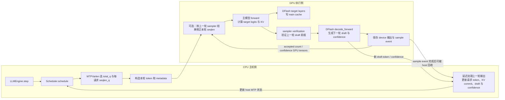
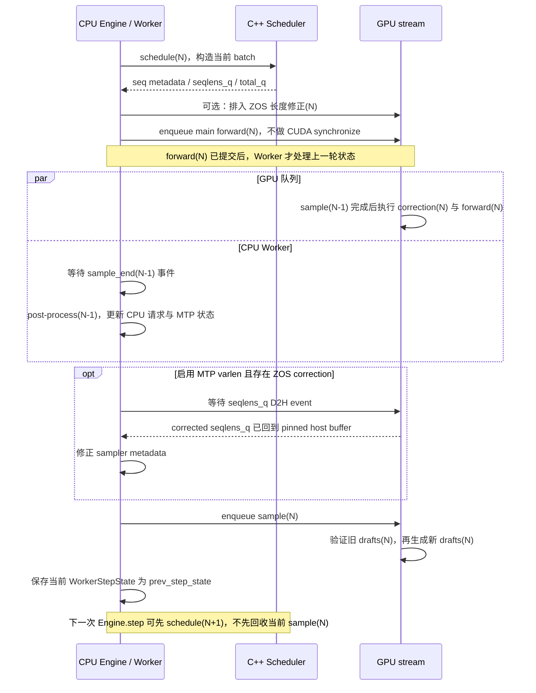

# DeepInfer 的投机解码：DFlash 草稿、Target 验证与动态长度

> 按 DeepInfer 源码版本 [`774ce244`](https://github.com/deepseek-ai/DeepInfer/tree/774ce244b87cc0eb8d4b94ab9f5de2ab22049f01) 整理。这里主要讲 DeepSeek-V4 路径中的 DFlash/DSpark 投机解码，不把它泛化成所有模型都使用同一种 draft 模型。

## 本次讲解位置

```text
章节：models/deepinfer
小节：DFlash speculative decoding 与 confidence-scheduled verification
知识点：草稿如何产生、主模型如何验证、拒绝后如何修正、动态长度如何选
上次：Zero-overhead asynchronous scheduling：CPU 调度与 GPU 执行如何重叠
下次：结合 benchmark 与 Nsight Systems trace 检查调度、forward、sample 的真实成本
PTX：不适用
```

## 为什么现在讲这个

前一节 ZOS 讲的是把 CPU 的 schedule/post-process 尽可能挪出 GPU 关键路径；它没有减少模型必须做的串行 decode 次数。投机解码针对的是另一笔成本：让较轻的 DFlash 预测多个后续 token，再由主模型一次前向验证一段，从而减少“每生成一个 token 都单独跑一次主模型”的次数。把这两层混为一谈，会误以为开了异步调度就等于开了投机解码，或误以为 confidence head 可以替主模型决定 token 对不对。

## 1. 先建立心智模型

把一次投机 decode 想成“先写草稿，再让权威模型校对”：

```text
已确定的上下文
      │
      ├── DFlash 轻量预测头：提出 y1, y2, ..., yK
      │        同时保存每个候选的 draft 分布 Q 和 confidence 估计
      ▼
主模型把 [当前 token, y1, y2, ..., yK] 放进同一次 query 前向
      │        得到每个位置对应的 target 分布 P
      ▼
按顺序验证 draft 前缀：接收、接收、拒绝……
      │
      ├── 遇到首个拒绝：输出已接受前缀 + 一个按残差分布修正的 token
      └── 全部接受：输出全部 draft + 主模型在下一位置采出的 bonus token
```

关键点是：**主模型并行算出一批位置的 logits，逻辑上仍按 token 顺序决定可接受前缀。**后面的草稿即使已经有 logits，如果前面某个 draft 被拒绝，也不能越过它继续输出。

## 2. DeepInfer 里的三种“概率”不要混淆

| 名称 | 从哪里来 | 用来做什么 | 能否决定最终接受/拒绝 |
|---|---|---|---|
| Draft 分布 `Q_i` | DFlash 预测头对第 `i` 个候选位置的 logits | 记录候选 token 的提议概率；拒绝时参与残差采样 | 是，和 target 分布一起进入 rejection sampling |
| Target 分布 `P_i` | 主模型该 query 行的 logits，经 temperature/top-k/top-p 等采样变换后得到 | 提供主模型要保持的输出分布 | 是，构成接受率和拒绝修正分布 |
| Confidence `c_i` | DFlash 的 Confidence Head | 预测候选位置的接受可能性，帮助调度器决定验证预算 | **否**，只是调度估计，不替代真实验证 |

源码中 `DFlash.sample_drafts()` 生成候选 token 和 draft log-probabilities，也生成 confidence；主采样器 `_verification()` 则将主模型 logits 与保存的 draft 信息交给 fused sampling 路径。可沿 [dflash.py](https://github.com/deepseek-ai/DeepInfer/blob/774ce244b87cc0eb8d4b94ab9f5de2ab22049f01/deepinfer/model_executor/models/mtp/dflash.py#L90-L110)、[dflash.py 的 draft sampling](https://github.com/deepseek-ai/DeepInfer/blob/774ce244b87cc0eb8d4b94ab9f5de2ab22049f01/deepinfer/model_executor/models/mtp/dflash.py#L273-L345) 和 [sampler.py 的 verification](https://github.com/deepseek-ai/DeepInfer/blob/774ce244b87cc0eb8d4b94ab9f5de2ab22049f01/deepinfer/model_executor/layers/sampler.py#L410-L480) 对照。

## 3. 标准 rejection sampling 为什么能保持主模型分布

本文用 `P` 表示 target 分布、`Q` 表示 draft 分布。第 `i` 个 draft 取样得到候选 `y_i ~ Q_i` 后，接受概率为：

\[
a_i(y_i)=\min\left(1,\frac{P_i(y_i)}{Q_i(y_i)}\right)
\]

若拒绝，从 target 相对 draft 多出来的概率质量采样：

\[
R_i(v)=\frac{[P_i(v)-Q_i(v)]_+}{\sum_u [P_i(u)-Q_i(u)]_+},\qquad [x]_+=\max(x,0)
\]

直觉上，对任意 token `v`，它通过“draft 被接受”得到的概率质量是 `min(P_i(v), Q_i(v))`；被拒绝后残差补回 `[P_i(v)-Q_i(v)]_+`。两者相加就是 `P_i(v)`。因此这是分布校正，不是简单比较 draft token 和 target 的 argmax。

成立的前提是 `P`、`Q` 与实际采样变换一致，并且拒绝残差实现正确。DeepInfer 代码里用 `DRAFT_PROB_PENALTY = 5e-5` 将 residual 里要扣除的 draft 概率质量乘上略小于 1 的系数，避免有限精度或极端分布下 residual 完全为零；因此源码是对教科书公式做了很小的数值稳健修正，不应把它描述成逐位完全相同的理想公式。源码注释的字母约定与本文相反：源码写 `p=draft、q=target`，并用 `max(q - alpha*p, 0)`；本文写 `P=target、Q=draft`，同一项就是 `max(P - alpha*Q, 0)`。读源码时要对照分布角色，不要只看字母。对应实现见 [common.py](https://github.com/deepseek-ai/DeepInfer/blob/774ce244b87cc0eb8d4b94ab9f5de2ab22049f01/deepinfer/model_executor/layers/tilelang_ops/common.py#L1-L20) 与 [fused_sample.py](https://github.com/deepseek-ai/DeepInfer/blob/774ce244b87cc0eb8d4b94ab9f5de2ab22049f01/deepinfer/model_executor/layers/tilelang_ops/fused_sample.py#L210-L248)。源码对该微小修正给出了分布偏差上界；其 `eps = 1 - exp(-5e-5)` 约为 `5e-5`。

## 4. 一轮 decode 在源码里怎么走

### 4.1 DFlash 提出草稿

DeepInfer 从 checkpoint 里读取主模型之后附加的 `DFlashNextPredictHeadHC` 模块；当前实现明确只接受这一类 speculative head。`DFlash` 由这些额外预测层组成，并复用主模型的一些目标层特征，不是每个 draft token 都完整执行一次主模型。

Decode 时 `run_drafts()` 以每个请求的 `golden_token`（已确定的当前 token）和 `last_valid_offset` 构造 DFlash 输入元数据；`forward_drafts()` 运行 draft layers；`sample_drafts()` 对各 draft 位置取样，并把 token、log-probability 与 confidence 写进 `MTPInfoPool`。它还可以由独立 DFlash CUDA Graph 一次 replay 草稿路径。

```text
模型附加的 DFlash layers
       + 当前 golden token
       + 当前请求的 SWA/cache 元数据
          │
          ▼
   DFlash draft forward
          │
   draft distributions Q1..QK
          ├── 采样得到 y1..yK
          └── Confidence Head 得到 c1..cK
```

模型 checkpoint 中的 `num_nextn_predict_layers` 与这些额外层数校验一致；draft block 最大长度来自 `DEEPINFER_USE_NEXTN_DECODE`。输入元数据构造在 [input_metadata/dflash.py](https://github.com/deepseek-ai/DeepInfer/blob/774ce244b87cc0eb8d4b94ab9f5de2ab22049f01/deepinfer/model_executor/input_metadata/dflash.py#L36-L84)，DFlash 前向和采样在 [dflash.py](https://github.com/deepseek-ai/DeepInfer/blob/774ce244b87cc0eb8d4b94ab9f5de2ab22049f01/deepinfer/model_executor/models/mtp/dflash.py#L225-L376)。

### 4.2 把“当前 token + 草稿”打包给主模型

若本轮要验证 `K` 个 draft，每个请求的 query 行数通常是 `K + 1`：

```text
query row:       0           1          2                 K
输入 token:   当前 token      y1         y2      ...       yK
本行作用:    算 P1 验 y1   算 P2 验 y2   ...   算 PK 验 yK   fresh/bonus
```

第一行输入当前已确定 token，主模型输出的分布用来验证 `y1`；第二行输入 `y1`，输出用来验证 `y2`；依此类推。最后一行没有下一个 draft 要验证，因此它是 fresh row：若前面所有 draft 都通过，就从这里的 target 分布采一个 bonus token；若中间已拒绝，这一行和后续行都不会被该请求采用。

CPU 准备 decode 输入时，源码先拷贝当前真实 token，再把 draft token 填进剩余 query 行，见 [prepare_tensor_input_base.cpp](https://github.com/deepseek-ai/DeepInfer/blob/774ce244b87cc0eb8d4b94ab9f5de2ab22049f01/csrc/engine/input_metadata/prepare_tensor_input_base.cpp#L98-L122)。Sampler 用 `ftp`、`seqlen_q` 等元数据区分每个请求的行，以及哪些行是 verify、哪一行是 fresh，见 [prepare_verification_metadata](https://github.com/deepseek-ai/DeepInfer/blob/774ce244b87cc0eb8d4b94ab9f5de2ab22049f01/deepinfer/model_executor/layers/tilelang_ops/sampler.py#L13-L54) 和 [sampler.py](https://github.com/deepseek-ai/DeepInfer/blob/774ce244b87cc0eb8d4b94ab9f5de2ab22049f01/deepinfer/model_executor/layers/sampler.py#L427-L480)。

### 4.3 顺序接受一个前缀，拒绝处做修正

主模型为 query 行生成 logits 后，sampler 对 verify row 计算 draft token 的接受随机数。行级接受判断可能并行执行；随后 `get_accept_result()` 通过 prefix 状态只保留每个请求的**连续已接受前缀**，第一个拒绝行标为 `is_final`，其后的行被屏蔽。

```text
draft:       y1       y2       y3       y4
接受结果:     ✓        ✓        ✗        ?
输出:        y1       y2       修正 token
丢弃:                           y4 及之后
```

注意，遇到拒绝时并不是把主模型对该位置的一次普通随机采样结果直接拿来顶替；采样器从 `max(P-Q, 0)` 的 residual 分布取 correction token。若整段 draft 都通过，则最后 fresh row 给出 bonus token。最终化逻辑在 [get_accept_result](https://github.com/deepseek-ai/DeepInfer/blob/774ce244b87cc0eb8d4b94ab9f5de2ab22049f01/deepinfer/model_executor/layers/tilelang_ops/sampler.py#L227-L249) 与 [finalize_verification](https://github.com/deepseek-ai/DeepInfer/blob/774ce244b87cc0eb8d4b94ab9f5de2ab22049f01/deepinfer/model_executor/layers/tilelang_ops/sampler.py#L338-L380)。

## 5. 把算法放回 DeepInfer 的真实执行循环

### 本次讲解位置

```text
章节：models/deepinfer
小节：DeepInfer speculative decode 的 Engine / Scheduler / Worker 执行链
知识点：动态 query 长度、target 验证、下一轮 draft、ZOS 跨轮 overlap 与同步点
上次：P/Q rejection sampling 如何接受连续前缀并修正首个拒绝
下次：结合 Nsight Systems trace 验证这条执行链上的真实 GPU 空档
PTX：不适用
```

### 为什么现在讲这个

只知道“draft 先生成、target 再验证”还回答不了实现问题：草稿究竟在哪一轮生成、谁决定本轮验证几个、CPU 什么时候拿到接受结果、ZOS 把哪段 host 工作移出了 GPU 等待路径？这些边界决定了执行图里哪些箭头是数据依赖、哪些只是调度并行。下面按 DeepInfer 的 `LLMEngine.step()`、C++ `Scheduler`、Python `Worker` 和 GPU sampler 把稳态 decode 还原出来。

### 5.1 先看一轮的真实数据与状态回路



这张图表示的是一个稳态循环，不是“CPU 完全不碰结果”。关键状态分两处：GPU 上的 `SamplerOutput` 保存采样 token、已接受长度、预测 draft 和 confidence 等 device 结果；CPU/C++ 的 `Sequence::mtp` 与 sequence token/KV 账本由延迟的 post-process 更新。`MTPInfoPool` 则是 GPU sampler 读写 draft token 与 proposal probability 等信息的设备侧存储。

### 5.2 从 `step()` 到下一轮 draft：按源码顺序走

| 阶段 | 实际动作 | 产物/下一阶段依赖 | 源码 |
|---|---|---|---|
| 1. Engine 调度 | `LLMEngine.step()` 调 `scheduler.schedule()`，之后把 metadata 和 scheduler outputs 交给 Worker | 本轮活跃请求、`seqlen_q/k`、`total_q` | [`llm_engine.py`](https://github.com/deepseek-ai/DeepInfer/blob/774ce244b87cc0eb8d4b94ab9f5de2ab22049f01/deepinfer/engine/llm_engine.py#L881-L885) |
| 2. 选验证预算 | Decode scheduler 调 `MTPVarlen::schedule()`；无 perf curve 时每请求验证已有的全部 draft，有曲线时按预期 token/time 选预算 | 每请求 query 长度；总 query 行数限制本轮 graph size | [`scheduler.hpp`](https://github.com/deepseek-ai/DeepInfer/blob/774ce244b87cc0eb8d4b94ab9f5de2ab22049f01/csrc/engine/scheduler.hpp#L648-L659)、[`mtp_varlen.hpp`](https://github.com/deepseek-ai/DeepInfer/blob/774ce244b87cc0eb8d4b94ab9f5de2ab22049f01/csrc/engine/mtp_varlen.hpp#L150-L267) |
| 3. 拼 query 输入 | 每请求先放一个已确定 token，再把本轮选中的 draft token 顺序放入后续 query 行 | `[当前 token, draft_1, ...]` 进入主模型 | [`prepare_tensor_input_base.cpp`](https://github.com/deepseek-ai/DeepInfer/blob/774ce244b87cc0eb8d4b94ab9f5de2ab22049f01/csrc/engine/input_metadata/prepare_tensor_input_base.cpp#L98-L122) |
| 4. 提交主模型 | Worker 调 `execute_main_model()`；函数明确禁止内部 CUDA synchronize。启用 main CUDA Graph 时 replay 对应 graph，否则走普通 forward | 一批 query 的 target logits；主 KV 更新；DFlash 所需 target feature | [`model_runner.py`](https://github.com/deepseek-ai/DeepInfer/blob/774ce244b87cc0eb8d4b94ab9f5de2ab22049f01/deepinfer/worker/model_runner.py#L307-L335) |
| 5. 更新 DFlash main cache | 主模型 forward 收集目标层特征，forward 尾部调用 `dflash.update_main_cache()`；decode 时这段随主模型 graph 捕获 | 下一次 DFlash draft 所需的主模型特征缓存 | [`deepseek.py`](https://github.com/deepseek-ai/DeepInfer/blob/774ce244b87cc0eb8d4b94ab9f5de2ab22049f01/deepinfer/model_executor/models/deepseek.py#L172-L224) |
| 6. 验证旧 draft | sampler 用主模型 logits 和 `MTPInfoPool` 中的旧 draft 信息做真实 verification，确定连续接受前缀、拒绝修正 token 或 bonus token | `sampled_tokens`、`last_valid_offset`、接受长度 | [`sampler.py`](https://github.com/deepseek-ai/DeepInfer/blob/774ce244b87cc0eb8d4b94ab9f5de2ab22049f01/deepinfer/model_executor/layers/sampler.py#L213-L233)、[`_verification()`](https://github.com/deepseek-ai/DeepInfer/blob/774ce244b87cc0eb8d4b94ab9f5de2ab22049f01/deepinfer/model_executor/layers/sampler.py#L410-L480) |
| 7. 生成新 draft | 同一次 decode sampler 接着以 `sampled_tokens.token_ids`、`last_valid_offset` 调 `mtp_module.decode_forward()` | 下一轮 draft token、proposal probability、confidence | [`sampler.py`](https://github.com/deepseek-ai/DeepInfer/blob/774ce244b87cc0eb8d4b94ab9f5de2ab22049f01/deepinfer/model_executor/layers/sampler.py#L235-L251)、[`dflash.py`](https://github.com/deepseek-ai/DeepInfer/blob/774ce244b87cc0eb8d4b94ab9f5de2ab22049f01/deepinfer/model_executor/models/mtp/dflash.py#L347-L387) |
| 8. 延迟回收 | sample event 完成后，host callback 把结果写回 CPU/C++ sequence 状态；C++ 只追加接受的连续 draft 前缀和最终 sampled token，并按真实产出数 commit KV | 下一轮调度可见的请求状态和新 draft 状态 | [`worker.py`](https://github.com/deepseek-ai/DeepInfer/blob/774ce244b87cc0eb8d4b94ab9f5de2ab22049f01/deepinfer/worker/worker.py#L247-L272)、[`llm_engine.py`](https://github.com/deepseek-ai/DeepInfer/blob/774ce244b87cc0eb8d4b94ab9f5de2ab22049f01/deepinfer/engine/llm_engine.py#L686-L733)、[`scheduler.hpp`](https://github.com/deepseek-ai/DeepInfer/blob/774ce244b87cc0eb8d4b94ab9f5de2ab22049f01/csrc/engine/scheduler.hpp#L955-L1000) |

注意阶段 6 和 7 的先后关系：**先验证旧 draft，得到本轮权威采样 token；再以这个 token 和接受位置生成新 draft。**新 draft 不能提前于它依赖的 target 验证结果产生。DFlash CUDA Graph runner 可以把 `run_drafts()` 路径 capture/replay，但这不改变上述依赖顺序，也不等于它和 target forward 并发运行，见 [`dflash_cuda_graph_runner.py`](https://github.com/deepseek-ai/DeepInfer/blob/774ce244b87cc0eb8d4b94ab9f5de2ab22049f01/deepinfer/worker/dflash_cuda_graph_runner.py#L42-L91)。

### 5.3 MTPVarlen 怎样把候选分配给请求

先区分两个量：`num_seqs` 是当前请求数；`total_q` 是所有请求 query 行数之和。每条请求先保留一行已确定 token，因此初始预算为 `num_seqs`；额外行才是要验证的 draft。

有 decode perf curve 时，源码把候选 draft 的前缀接受率估计从高到低排序。对每个候选总行数 `q`，估计：

\[
E(q)=N+\sum_{j=1}^{q-N} c_{(j)},\qquad
T(q)=T_{base}(G(q))+s\cdot G(q)+T_{sampler},\qquad
R(q)=\frac{E(q)}{T(q)}
\]

其中 `N=num_seqs`，`G(q)` 是能容纳 `q` 行的已 capture graph size，`s` 是 forward time slope。scheduler 选 `R(q)` 最大的 query 总预算，再把新增行分给对应请求。源码按“先选总预算、再分配到每个请求”维护两份 rate queue；ZOS 下 `schedule_cnt/process_cnt` 用来识别 post-process 是否已追上本轮 schedule，因为总预算估计与单请求分配可能拿到不同新旧轮次的 confidence。

一个教学例子：两个请求 A/B，各有两个 draft 前缀估计。A 的单 token confidence 是 `[0.90, 0.67]`，累乘后 prefix rates 为 `[0.90, 0.603]`；B 的单 token confidence 是 `[0.80, 0.50]`，prefix rates 为 `[0.80, 0.40]`。假设当前活跃请求数 `N=2`，性能曲线本轮选择 `total_q=5`，也就是给两个请求基础行之外再加 3 个 draft 行：

| 排名 | 候选前缀 | 估计接受概率 | 是否占用额外 query 行 |
|---:|---|---:|---|
| 1 | A 的第 1 个 draft | 0.900 | 是 |
| 2 | B 的第 1 个 draft | 0.800 | 是 |
| 3 | A 的前 2 个 draft 都通过 | 0.603 | 是 |
| 4 | B 的前 2 个 draft 都通过 | 0.400 | 否 |

于是 `seqlens_q(A)=3`、`seqlens_q(B)=2`，总和为 5。**这个例子只演示预算分配，不代表 DeepInfer 某个 benchmark 的实测值；真实选出的 `total_q` 由启动测得的 decode perf curve 和运行时 sampler 时间共同决定。**如果 perf curve 为空，代码走固定回退：每请求 `1 + draft_tokens.size()`，不做上述最优预算搜索。

### 5.4 ZOS 到底重叠了什么

普通同步路径常会在拿到第 N 轮 GPU 结果之后，才处理第 N 轮 host 状态、再发第 N+1 轮 forward。DeepInfer 的 ZOS 改变了 Worker 内的顺序：**先提交当前主模型 forward，再等待并处理 `prev_step_state`，最后提交当前 sample。**



把时间轴压成两条 lane，可以看到“overlap”具体指什么：

```text
时间 ───────────────────────────────────────────────────────────────────────>

CPU: schedule(N) -> enqueue forward(N) -> wait sample_end(N-1) -> post-process(N-1)
                                         [这段 CPU 回收可与 GPU forward(N) 重叠]
                 -> [varlen 时 wait corrected-q D2H] -> enqueue sample(N) -> schedule(N+1)

GPU: ... -> sample(N-1) -> correction(N) -> forward(N) -> sample(N) -> correction(N+1)...
                                      └──────────────┘
                                      可能覆盖 CPU post-process(N-1)
```

`execute_main_model()` 明确声明不得 CUDA synchronize；`Worker.execute_model_step()` 随后才调用 `_post_process_step(prev_step_state)`。后者会等上一轮 `sample_end_evt`，再做 Python/C++ 回调。因为当前 forward 已经先提交，GPU 可以在旧 sample 结束后继续跑当前 forward，而 CPU 同时处理旧结果。这是**跨 step 的 host/GPU 流水**，不是让同一个 target forward 和它依赖的 DFlash draft 任意并行。

### 5.5 真实同步边界与不能夸大的地方

| 边界 | 作用 | 是否仍可能挡住后续工作 |
|---|---|---|
| `_post_process_step(prev)` 的 `sample_end_evt.synchronize()` | 保证上一轮 GPU sampler 的结果可以被 host callback 安全读取 | 会等前一轮 sample；只是当前 forward 已在这次 wait 前提交，争取把等待藏在 forward 前段 |
| varlen correction 的 `d2h_evt.synchronize()` | host 要用 GPU 修正后的 `seqlens_q` 改 sampler metadata | **会挡住当前 sample 的提交**；D2H 可与前面已提交的 main forward 重叠，但若 correction/拷贝较晚仍会形成 bubble |
| verification 输出到 DFlash draft | `decode_forward()` 需要 `sampled_tokens` 与 `last_valid_offset` | 是算法数据依赖，不能把“下一轮 draft”移到本轮 target verification 之前 |
| main forward 与 DFlash graph replay | 两种 CUDA Graph 分别减少对应路径的 host launch 开销 | graph replay 本身不证明两图重叠；main target forward 先产生 DFlash main cache，sampler verification 后再生成 draft |
| 当前 sample 完成到 host 状态更新 | 将 device 输出转为 scheduler 可用的 accepted token、draft/confidence 状态 | ZOS 把它延迟到下一次 Worker 调用处理，没有取消同步与 host 工作 |

因此读 Nsight Systems 时应验证三件事：`forward(N)` 是否覆盖了 CPU 的 `post-process(N-1)`；`corrected-q` D2H wait 是否在 forward 结束后留下空档；GPU 上 `forward(N)` 与 `sample(N)` 之间是否有 host 提交气泡。不能只看“CUDA Graph 开了”或“worker 返回了”，就推断流水没有空泡。

## 6. 数值执行轨迹

词表用 `A/B/C/D`，以下只演示 rejection sampling，概率按位置分别变化。

| 位置 | Target `P(A,B,C,D)` | Draft `Q(A,B,C,D)` | Draft 提案 | 接受阈值 | 随机数 | 结果 |
|---|---|---|---|---:|---:|---|
| 1 | `(0.1, 0.6, 0.2, 0.1)` | `(0.1, 0.7, 0.1, 0.1)` | `B` | `min(1, 0.6/0.7)=0.857` | `0.2` | 接受 `B` |
| 2 | `(0.1, 0.2, 0.6, 0.1)` | `(0.7, 0.1, 0.1, 0.1)` | `A` | `min(1, 0.1/0.7)=0.143` | `0.8` | 拒绝 `A` |

第二个位置 residual 为：

```text
max(P - Q, 0) = max((0.1, 0.2, 0.6, 0.1) - (0.7, 0.1, 0.1, 0.1), 0)
              = (0, 0.1, 0.5, 0)
residual 总质量 = 0.6
归一化 residual = (0, 1/6, 5/6, 0)
```

若 residual 抽样随机数为 `0.5`，累积分布在 `B` 后为 `1/6`，在 `C` 后为 `1`，所以 correction 是 `C`。这轮输出 `B, C`；后续 draft 全部作废。若所有 draft 都接受，则还要从最后 fresh row 的 target 分布再采一个 bonus token。

## 7. Confidence Head 与动态验证长度

草稿最多能提多少个 token，与本轮值得验证多少个 token，是两件事。DeepInfer 可先生成最大长度的候选，再依据每个候选的预期收益动态决定 query 中放多少个。

### 7.1 Confidence 不是接受判决

Confidence Head 给出每个候选位置的接受率估计 `c_i`。调度侧把它们累乘成“到该位置为止整个 draft prefix 都被接受”的估计：

```text
单位置估计:         c1, c2, c3, ...
前缀估计:      c1, c1*c2, c1*c2*c3, ...
```

这让前缀成功概率随位置不增。`process_MTPInfo()` 负责累乘并保存历史接受率估计；主模型之后仍使用真实的 target/draft 分布做 rejection sampling。对应 [scheduler.hpp](https://github.com/deepseek-ai/DeepInfer/blob/774ce244b87cc0eb8d4b94ab9f5de2ab22049f01/csrc/engine/scheduler.hpp#L1190-L1245)。

### 7.2 调度器在优化什么

如果当前有 `N` 个活跃请求，至少每个请求有一行当前 token；再给草稿位置分配验证预算。粗略地说，候选总 query 大小 `B` 的期望产出是：

\[
E[\text{tokens}] \approx N + \sum_{j=1}^{B-N} c_{(j)}
\]

其中 `c_(j)` 是按收益排序后纳入预算的 draft 前缀接受概率。调度器用启动阶段测得的 `(graph size, forward time)` 曲线，加上运行时采样耗时估计，比较不同预算下的 `期望 token 数 / 估计 step 时间`，选择吞吐估计最高的预算。再把被选中的 draft 行分配回请求，得到每个请求的 `seqlen_q = 1 + 本请求要验证的 draft 数`。

代码可在 [MTPVarlen::schedule()](https://github.com/deepseek-ai/DeepInfer/blob/774ce244b87cc0eb8d4b94ab9f5de2ab22049f01/csrc/engine/mtp_varlen.hpp#L133-L260) 阅读。confidence 与 verify 存在流水延迟：代码区分了用于 batch 总预算的旧一轮估计、用于请求长度分配的较新估计；ZOS 下最新 confidence 尚未返回时，相关长度还会由 GPU TileLang 路径异步修正。性能曲线在启用 CUDA Graph 且打开 varlen 时通过 warmup profile 初始化，见 [base.py](https://github.com/deepseek-ai/DeepInfer/blob/774ce244b87cc0eb8d4b94ab9f5de2ab22049f01/deepinfer/worker/base.py#L270-L286) 与 [model_runner.py](https://github.com/deepseek-ai/DeepInfer/blob/774ce244b87cc0eb8d4b94ab9f5de2ab22049f01/deepinfer/worker/model_runner.py#L562-L610)。若没有 decode perf curve，代码回退为验证已有的全部 draft，而不是做完整的吞吐曲线优化。

### 7.3 配置开关

| 变量 | 含义 | 源码默认/注意事项 |
|---|---|---|
| `DEEPINFER_USE_NEXTN_DECODE` | 每请求最多提议的 draft 数 | 默认 `5`；设 `0` 可关闭 speculative decode |
| `DEEPINFER_ENABLE_MTP_VARLEN` | 依据置信度与性能曲线动态选择验证长度 | 需要显式设为 `1`；要有可用的 decode perf curve 才能按曲线选预算 |

例子：

```bash
# 最多提议 5 个，并启用动态验证长度
DEEPINFER_USE_NEXTN_DECODE=5 DEEPINFER_ENABLE_MTP_VARLEN=1 python your_inference_entry.py

# 关闭 speculative decode
DEEPINFER_USE_NEXTN_DECODE=0 python your_inference_entry.py
```

配置定义见 [environ.py](https://github.com/deepseek-ai/DeepInfer/blob/774ce244b87cc0eb8d4b94ab9f5de2ab22049f01/deepinfer/environ.py#L128-L143)。实际是否走动态长度，还取决于模型含有相应 DFlash head、运行路径和性能曲线可用性。

DeepInfer 的部署 QA 给出 EP64/DP64 benchmark 推算：并发约 `60 sequences/rank` 时，固定验证 5 个 draft 平均验证长度约 `5.00`，动态长度约 `3.58`；平均接受长度近似 `3.30` 对 `3.21`，估算吞吐增益 `+5.4%`。这不是所有 batch、模型或机器都保证获得的提升，也不是本机实测；不同并发点的结果从 `-1.5%` 到 `+11.0%` 不等，说明调度要贴合实际性能曲线。数据在 [inference_deployment_qa.md](https://github.com/deepseek-ai/DeepInfer/blob/774ce244b87cc0eb8d4b94ab9f5de2ab22049f01/doc/inference_deployment_qa.md#L239-L256)。

## 8. 可运行的 rejection sampling 教学代码

下面是标准公式的独立 Python 教学实现，不依赖 PyTorch/CUDA。它用逆 CDF 模拟抽样，演示“接受 draft、首拒绝时从 residual 修正、全接受时额外采 bonus”。它刻意没有加入源码的 `5e-5` 数值 penalty，以便逐项对应标准公式；这与 DeepInfer fused sampler 的浮点实现细节不同。

完整文件也保存在 [`examples/speculative_decode_toy.py`](examples/speculative_decode_toy.py)。

```python
from collections.abc import Sequence


def draw(probs: Sequence[float], u: float) -> int:
    """Draw an index using a uniform u in [0, 1)."""
    if not 0.0 <= u < 1.0:
        raise ValueError("u must be in [0, 1)")
    total = sum(probs)
    if abs(total - 1.0) > 1e-9:
        raise ValueError(f"probabilities must sum to 1, got {total}")
    cumulative = 0.0
    for token_id, probability in enumerate(probs):
        cumulative += probability
        if u < cumulative:
            return token_id
    raise RuntimeError("rounding error: no token selected")


def speculative_step(
    target_dists: Sequence[Sequence[float]],
    draft_dists: Sequence[Sequence[float]],
    draft_tokens: Sequence[int],
    accept_uniforms: Sequence[float],
    residual_uniforms: Sequence[float],
    bonus_uniform: float,
) -> tuple[list[int], str]:
    """Verify a draft prefix and return emitted token IDs plus a short trace."""
    count = len(draft_tokens)
    if len(target_dists) != count + 1:
        raise ValueError("target_dists needs one extra row for the bonus token")
    if not (len(draft_dists) == len(accept_uniforms) == len(residual_uniforms) == count):
        raise ValueError("draft inputs must have one item per proposed token")

    emitted: list[int] = []
    for step, token_id in enumerate(draft_tokens):
        target = target_dists[step]
        draft = draft_dists[step]
        if len(target) != len(draft) or not 0 <= token_id < len(target):
            raise ValueError("distribution sizes or draft token ID are invalid")
        if abs(sum(target) - 1.0) > 1e-9 or abs(sum(draft) - 1.0) > 1e-9:
            raise ValueError("target and draft distributions must sum to 1")
        draft_probability = draft[token_id]
        if draft_probability <= 0.0:
            raise ValueError("draft token must have nonzero probability under Q")

        accept_probability = min(1.0, target[token_id] / draft_probability)
        if accept_uniforms[step] < accept_probability:
            emitted.append(token_id)
            continue

        residual = [max(p - q, 0.0) for p, q in zip(target, draft)]
        residual_mass = sum(residual)
        if residual_mass <= 0.0:
            raise ValueError("residual is empty; standard rejection sampling cannot correct")
        corrected = [weight / residual_mass for weight in residual]
        emitted.append(draw(corrected, residual_uniforms[step]))
        return emitted, f"rejected draft position {step}"

    emitted.append(draw(target_dists[-1], bonus_uniform))
    return emitted, "all drafts accepted; appended bonus token"


def main() -> None:
    vocab = ["A", "B", "C", "D"]
    target = [
        [0.1, 0.6, 0.2, 0.1],
        [0.1, 0.2, 0.6, 0.1],
        [0.1, 0.2, 0.3, 0.4],
    ]
    draft = [
        [0.1, 0.7, 0.1, 0.1],
        [0.7, 0.1, 0.1, 0.1],
    ]
    rejected_tokens, rejected_trace = speculative_step(
        target, draft, [1, 0], [0.2, 0.8], [0.5, 0.5], 0.85
    )
    print("rejection:", [vocab[token] for token in rejected_tokens], "|", rejected_trace)

    all_accept_target = [[0.1, 0.6, 0.2, 0.1], [0.1, 0.2, 0.3, 0.4]]
    all_accept_draft = [[0.1, 0.7, 0.1, 0.1]]
    accepted_tokens, accepted_trace = speculative_step(
        all_accept_target, all_accept_draft, [1], [0.2], [0.5], 0.85
    )
    print("all accepted:", [vocab[token] for token in accepted_tokens], "|", accepted_trace)


if __name__ == "__main__":
    main()
```

运行：

```bash
python3 models/deepinfer/examples/speculative_decode_toy.py
```

预期输出：

```text
rejection: ['B', 'C'] | rejected draft position 1
all accepted: ['B', 'D'] | all drafts accepted; appended bonus token
```

第一种情形位置 0 接受 `B`；位置 1 拒绝 `A`，residual 抽到 `C`，后续 draft 不再输出。第二种情形 draft `B` 被接受，然后从最后一行 target 分布中按 `u=0.85` 抽出 bonus `D`。

## 9. 常见误解与症状

| 误解 | 正确理解 | 会造成什么误读 |
|---|---|---|
| “Confidence 高就直接接受 draft” | confidence 只做调度预算；接受由真实 `P/Q` rejection sampling 决定 | 把预测器误当成正确性机制 |
| “Target 只比较两边 argmax” | 随机采样场景比较候选的概率比，并在拒绝时采 residual | 输出分布不再等价于 target |
| “并行验证就是 draft 全都能输出” | 只输出连续接受前缀；首个拒绝后修正一次并丢弃后续位置 | 输出 token 序列可能跳过被拒绝的位置 |
| “draft 生成 K 个就一定有 K+1 token” | 全接受才有 K 个 draft 加 bonus；有拒绝时只到首拒绝位置 | 高估平均接受长度和吞吐 |
| “打开 varlen 就一定动态选择长度” | 没有可用 decode perf curve 时源码会走固定候选长度回退 | 以为配置名本身保证收益 |
| “speculative decoding 免费” | 减少主模型串行步数，但额外执行 draft、保存分布/元数据和做验证 | 低接受率或小 batch 下可能没有收益 |

## 10. 自测题

1. `P(y)=0.2, Q(y)=0.8` 时 draft token 的接受概率是多少？
   答：`min(1, 0.2/0.8)=0.25`。
2. 第二个 draft 被拒绝后，第三个 draft 通过了，能不能输出第三个？
   答：不能；只能输出首拒绝之前的接受前缀和一个 residual correction。
3. Confidence Head 的 `c_i` 是否直接产生真实接受结论？
   答：不是；它预测接受率供调度器估算收益，真实决定来自 target/draft 分布的采样验证。
4. 所有 `K` 个 draft 都通过时，为什么还会多一个 bonus token？
   答：主模型的打包 query 还包含最后一个 fresh row；从其 target 分布采样可多产出一个 token。
5. `DEEPINFER_ENABLE_MTP_VARLEN=1` 但无 decode perf curve 时会怎样？
   答：`MTPVarlen::schedule()` 回退到验证已生成的全部 draft，不做基于硬件曲线的预算搜索。

## 源码阅读路线

1. [V4 builder 构建 DFlash head](https://github.com/deepseek-ai/DeepInfer/blob/774ce244b87cc0eb8d4b94ab9f5de2ab22049f01/deepinfer/model_executor/models/v4_modules/builder.py#L85-L115)
2. [DFlash draft block 与候选采样](https://github.com/deepseek-ai/DeepInfer/blob/774ce244b87cc0eb8d4b94ab9f5de2ab22049f01/deepinfer/model_executor/models/mtp/dflash.py#L225-L376)
3. [CPU 打包当前 token 与 drafts](https://github.com/deepseek-ai/DeepInfer/blob/774ce244b87cc0eb8d4b94ab9f5de2ab22049f01/csrc/engine/input_metadata/prepare_tensor_input_base.cpp#L98-L122)
4. [Target verification 与 accepted-prefix finalize](https://github.com/deepseek-ai/DeepInfer/blob/774ce244b87cc0eb8d4b94ab9f5de2ab22049f01/deepinfer/model_executor/layers/sampler.py#L410-L550)
5. [动态验证预算](https://github.com/deepseek-ai/DeepInfer/blob/774ce244b87cc0eb8d4b94ab9f5de2ab22049f01/csrc/engine/mtp_varlen.hpp#L133-L260)
