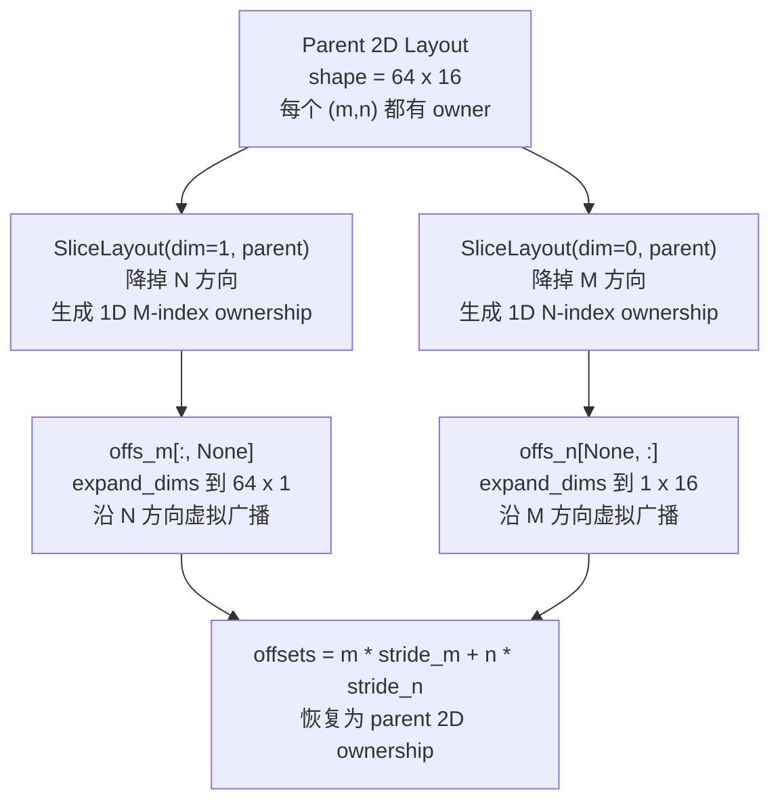

# Triton Gluon 01–02：编程模型与 Layout

## 本次讲解位置

章节：`chapter_gluon_foundations`（算子开发 / Triton Gluon）<br>
小节：Gluon 是什么，以及 tensor 如何映射到 CTA、warp、lane 和 register<br>
知识点：`@gluon.jit`、program/CTA 边界、`BlockedLayout`、`SliceLayout`、shared-memory layout<br>
上次：Triton 高层 tile、broadcasting 与语义差异<br>
下次：用 `cp.async`、TMA 和软件流水把 global-memory 传输移出关键路径<br>
PTX：不指定单条指令；本节建立后续 TMA、WGMMA、tcgen05 所需的布局与作用域基础。

## 为什么现在讲这个

Triton 把 tile 到线程的映射、shared memory 分配和数据搬移都交给编译器。这样写 kernel 很轻松，但当性能瓶颈来自 layout、bank conflict、寄存器压力或异步同步时，用户只能间接影响编译器。

Gluon 把这些问题重新变成源码的一部分：tensor 不但有 shape，还必须说明元素分布；shared memory 要显式分配；异步操作要显式等待。后面的 WGMMA/tcgen05 对 operand layout 有硬约束，如果现在不理解“逻辑元素坐标”和“物理存放位置”的区别，后面看到的限制就只是一串无法推理的规则。

## 心智模型：一个 tensor 是 shape 加 distributed layout

Gluon 沿用 tile-based SPMD，但一个 `program` 对应一个 GPU CTA。一个 Gluon tensor 至少有两层描述：

```text
逻辑视图：shape、dtype、元素坐标
物理视图：每个 register/lane/warp 负责哪些坐标
```

元素分布遵循这个层级：

```text
CTA (program)
  -> warp
     -> lane
        -> register
```

因此“把 tensor 放到寄存器”并不是一个单独动作。更准确地说，`gl.arange(..., layout=...)` 生成坐标，`gl.load(..., layout=...)` 按该 layout 装载，每个线程最终只持有自己拥有的元素。一个逻辑 tile 可以被不同 layout 表示，数值结果可能相同，访存行为和寄存器数量却完全不同。

## Gluon 与 Triton 的关系

| 维度 | Triton | Gluon |
|---|---|---|
| 主机端启动 | `kernel[grid](...)` | `kernel[grid](...)`，接口基本相同 |
| device language | `@triton.jit` | `@gluon.jit` |
| tile 到线程 | 编译器选择 | 用户显式或由受约束 API 推导 |
| shared memory | 编译器管理 | descriptor 显式分配、读写和同步 |
| 异步操作 | 编译器自动流水或手工 `cp.async` | `cp.async`、TMA、MMA 等显式控制 |
| 性能调优粒度 | 较高层的 block、warps、stages | layout、proxy、barrier、buffer、指令 shape |

第一课中的拷贝 kernel 仍然和 Triton 很像；真正的差异从第二课选择 layout 开始。

## `BlockedLayout` 的四个参数

官方最常用的例子是：

```python
gl.BlockedLayout(
    size_per_thread=[2, 4],
    threads_per_warp=[16, 2],
    warps_per_cta=[2, 2],
    order=[1, 0],
)
```

含义如下：

| 参数 | 含义 |
|---|---|
| `size_per_thread` | 一个线程的私有子 tile，这里是 `2 x 4` 个寄存器 |
| `threads_per_warp` | 一个 warp 内线程如何铺开，乘积必须是 32 |
| `warps_per_cta` | 一个 CTA 内 warp 如何铺开；乘上前两层得到 block shape |
| `order` | 维度铺开的优先级；`[1, 0]` 表示先沿第 1 维，即 row-major |

block shape 逐维相乘：

```text
M: 2 * 16 * 2 = 64
N: 4 * 2  * 2 = 16
block shape = [64, 16]
```

### 用具体坐标追踪

只看一个 `2 x 4` 的 thread tile，`order=[1,0]` 时寄存器编号先沿列增长：

```text
[[T0:0, T0:1, T0:2, T0:3],
 [T0:4, T0:5, T0:6, T0:7]]
```

例如：

| 逻辑坐标 | owner |
|---|---|
| `(0, 0)` | thread 0, register 0 |
| `(0, 3)` | thread 0, register 3 |
| `(1, 0)` | thread 0, register 4 |
| `(1, 3)` | thread 0, register 7 |

再看 warp 内的线程 tile，`threads_per_warp=[16,2]`、`order=[1,0]` 会先把相邻线程放在列方向：

```text
[[T0,  T1],
 [T2,  T3],
 ...
 [T28, T29],
 [T30, T31]]
```

把每个 `Tx` 替换成它的 register tile，就得到 warp 覆盖的逻辑元素。再沿 `warps_per_cta=[2,2]` 重复同样的铺法，得到完整 CTA block。这个推导很重要：layout 不是“性能提示”，而是元素所有权的精确定义。

## tile 大于或小于 block 时会发生什么

### 更大的 tensor：block 被重复平铺

设 layout block 是 `[64, 16]`，tensor 是 `128 x 128`。逐维相除：

```text
128 / 64 = 2
128 / 16 = 8
tile count = [2, 8]
```

每个 block 内，一个线程原本拥有 `2 * 4 = 8` 个元素；`order=[1,0]` 下 block 以 row-major 顺序重复：

```text
[[B0,  B1,  B2,  B3,  B4,  B5,  B6,  B7],
 [B8,  B9, B10, B11, B12, B13, B14, B15]]
```

所以每个线程总共有：

```text
8 registers/block * 16 blocks = 128 registers
```

这正是 layout 会直接影响寄存器压力的原因。

### 更小的 tensor：layout 可能要求广播

若 tensor 是 `32 x 8`，而 layout block 仍是 `[64, 16]`，物理存储可能按 `64 * 16 = 1024` 个 register 位置来组织，虽然逻辑上只有 `32 * 8 = 256` 个元素。多余位置通过 broadcast 填充。也就是说，逻辑元素数不等于物理 register 占用数。

## 常见 layout 的分工

| layout | 用途 |
|---|---|
| `BlockedLayout` | 通用 register tile 分布；GEMM 的 global load、elementwise 与普通计算常用 |
| `SliceLayout` | 从一个 parent layout 取某个维度的切片，常用于分别生成 `offs_m`、`offs_n` |
| `SwizzledSharedLayout` | 通用 shared-memory 布局，用 swizzle 降低 bank conflict |
| `NVMMASharedLayout` | Tensor Core operand 需要的 shared layout，也是 TMA 常用 layout |
| `DotOperandLayout` | 某些 MMA 中 register operand 的布局 |
| `DistributedLinearLayout` | 最通用的线性布局，可表达 join/split/reshape/permute 等映射 |

`SliceLayout` 的直观例子是二维 pointer：

```python
offs_m = gl.arange(0, BLOCK_M, layout=gl.SliceLayout(1, layout))
offs_n = gl.arange(0, BLOCK_N, layout=gl.SliceLayout(0, layout))
offsets = offs_m[:, None] * stride_m + offs_n[None, :] * stride_n
```

`[:, None]` 和 `[None, :]` 只负责广播 shape；元素最终由 `layout` 及其 slice 决定。不能把 NumPy 中“数组是什么形状”直接等同于 Gluon 中“谁拥有这些元素”。

## `SliceLayout` 深挖：ownership 不是逻辑下标

### 本次讲解位置

章节：`chapter_gluon_foundations`（算子开发 / Triton Gluon）<br>
小节：`SliceLayout` 与 distributed ownership<br>
知识点：逻辑坐标、物理 owner、降维 ownership、`expand_dims` 虚拟广播<br>
上次：`BlockedLayout` 如何把二维 tile 分给 thread、warp 和 register<br>
下次：用 `cp.async`、TMA 和软件流水把 global-memory 传输移出关键路径<br>
PTX：不指定单条 PTX；对应 thread/register、shared-memory 和 tensor-memory 的映射语义

### 为什么现在讲这个

前面的 `BlockedLayout` 已经说明元素属于哪个 thread/register，但 `SliceLayout` 很容易被误读成“从原始 tensor 里删掉一维”。如果只把 ownership 理解成逻辑下标，就会无法解释为什么 `offs_m` 和 `offs_n` 降成一维后还能无转换地扩回 parent 2D layout，也无法判断广播、重复存储和 `convert_layout` 的成本来自哪里。

这一节要把三件事拆开：

```text
逻辑坐标：       (m, n)
逻辑值：         X[m, n]
物理 ownership： (m, n) -> thread / register / SMEM / TMEM 位置
```

ownership 不是“数据下标本身”，而是“给定一个逻辑坐标，哪个执行资源持有它”的映射。下标回答元素是谁，ownership 回答元素放在哪里。

### 同一个 shape 可以有两种 ownership

考虑同一个 `4 x 4` tensor。它的逻辑坐标完全相同，但下面两种 layout 的存放方式完全不同：

```text
Layout A：row 0 的四个元素都在 T0 的四个寄存器里

                 n=0       n=1       n=2       n=3
m=0            T0:r0     T0:r1     T0:r2     T0:r3


Layout B：row 0 的四个元素分别由四个 lane 持有

                 n=0       n=1       n=2       n=3
m=0            T0:r0     T1:r0     T2:r0     T3:r0
```

两种情况的 `X[0,0]`、`X[0,1]` 等逻辑值相同，shape 也相同，但 ownership 不同。因此 layout 不是数据的替代表达，而是元素到物理资源的映射。

这个映射可以落到不同存储层级：

| 存储层级 | ownership 位置示例 |
|---|---|
| register tile | `thread_id + register_index` |
| shared memory | `CTA + shared-memory offset` |
| tensor memory | `CTA + TMEM lane/column` |
| cluster | `CTA id + local resource` |

### 从二维 ownership 降成一维

设 parent 2D layout 对每个坐标都定义了 owner：

```text
L2D(m, n) = (thread, register)
```

`SliceLayout(dim=1, parent)` 丢掉第 1 维 N，生成 M 方向的一维 ownership：

```text
L1D_M(m) = 原来 L2D(m, 0..N-1) 中沿 N 方向保留的 owner 信息
```

这里的关键不是“把 N 方向的数据删掉”，而是在一维视图中保留足够信息，使之后扩维时能重新得到 parent layout：



`dim` 表示“结果里丢掉哪一维”，不是“保留哪一维”：

| 一维 tensor | layout | 丢掉 | 扩展方向 |
|---|---|---|---|
| `offs_m` | `SliceLayout(dim=1, parent)` | N 维度 | `[BLOCK_M, 1]`，沿 N 广播 |
| `offs_n` | `SliceLayout(dim=0, parent)` | M 维度 | `[1, BLOCK_N]`，沿 M 广播 |

### 用具体 owner 轨迹理解

不要把 `SliceLayout` 简化成“每个 M 索引只属于一个线程”。更准确的做法是先看 parent 对同一行的不同元素分别交给了谁：

```text
(m, 0) -> owner_0(m)
(m, 1) -> owner_1(m)
(m, 2) -> owner_2(m)
(m, 3) -> owner_3(m)
```

`SliceLayout(dim=1, parent)` 会把同一 `m` 在 N 方向上的 owner 信息投影成一维 M 索引的 ownership。如果不同 N 位最终落在不同线程上，这些线程位就会变成广播位；如果它们只是同一线程内的多个 register，对应的重复 register 映射则会被去掉。具体是哪一种，由 parent 的 `size_per_thread`、`threads_per_warp`、`warps_per_cta` 和 `order` 共同决定。

官方 `02-layouts.py` 给出的结论是：对那里使用的 parent `BlockedLayout` 做 `SliceLayout(dim=1)` 后，每个 reduction 结果元素会广播到两个线程。这个例子说明不能把 slice layout 当成普通的 1D blocked layout；它携带着 parent 中被丢掉那一维的所有权关系。

执行：

```python
offs_m = gl.arange(0, BLOCK_M, layout=gl.SliceLayout(dim=1, parent))
offs_m_2d = offs_m[:, None]
```

概念轨迹是：

```text
一维 M index              广播到 N 方向
[M0, M1, M2, M3]   ->    [[M0, M0, M0, M0],
                          [M1, M1, M1, M1],
                          [M2, M2, M2, M2],
                          [M3, M3, M3, M3]]
```

扩展回去时，编译器会为每个 `(m, n)` 重新选择与 parent 对应的 owner。这不是通过 shared memory 把同一个值复制到多个线程，而是编译器在 register ownership 层面插入虚拟 broadcast；只要目标 layout 与 parent 完全兼容，通常不需要显式搬运。

### 常见误解与症状

| 误解 | 实际含义 | 可能症状 |
|---|---|---|
| `SliceLayout` 删掉了原始 tensor 的一维 | 只生成低维 ownership 视图，parent 没被修改 | 误以为数据丢失，后续广播逻辑无法推理 |
| `dim=1` 表示取第 1 维 | 表示结果丢掉第 1 维 | M/N owner 对调，出现布局不兼容或性能下降 |
| shape 相同就代表 layout 相同 | shape 和 owner 是两件事 | 编译器插入 `convert_layout`，经过 SMEM 并产生同步 |
| 广播一定会复制全局数据 | 这里是 register 级虚拟广播 | 把编译期布局展开误判为 HBM 或 SMEM 流量 |
| `[:, None]` 只是补一个维度 | 它还会触发 slice layout 到 parent layout 的扩展 | 忽略 ownership 变化，后面无法解释 MMA operand 约束 |

## 完整可运行小例程：显式 layout 的 1D 拷贝

文件位置：[`operators/code/triton/gluon/tutorials/01-intro.py`](code/triton/gluon/tutorials/01-intro.py) 和 [`02-layouts.py`](code/triton/gluon/tutorials/02-layouts.py)。

下面是完整脚本，要求 CUDA、PyTorch 和带有 Gluon 的 Triton 版本：

```python
from __future__ import annotations

import torch
import triton
from triton.experimental import gluon
from triton.experimental.gluon import language as gl


@gluon.jit
def copy_1d_kernel(in_ptr, out_ptr, n: gl.constexpr, XBLOCK: gl.constexpr):
    layout: gl.constexpr = gl.BlockedLayout([1], [32], [4], [0])
    offsets = gl.program_id(0) * XBLOCK + gl.arange(0, XBLOCK, layout=layout)
    mask = offsets < n
    value = gl.load(in_ptr + offsets, mask=mask, other=0.0)
    gl.store(out_ptr + offsets, value, mask=mask)


def copy_1d(x: torch.Tensor, y: torch.Tensor, block: int = 128) -> None:
    assert x.is_cuda and y.is_cuda
    assert x.numel() == y.numel()
    grid = (triton.cdiv(x.numel(), block),)
    copy_1d_kernel[grid](x, y, x.numel(), block, num_warps=4)


if __name__ == "__main__":
    x = torch.arange(1000, device="cuda", dtype=torch.float32)
    y = torch.empty_like(x)
    copy_1d(x, y)
    torch.testing.assert_close(x, y, atol=0, rtol=0)
    print("copy_1d_ok:", y.sum().item())
```

运行：

```bash
python operators/code/triton/gluon/tutorials/01-intro.py
python operators/code/triton/gluon/tutorials/02-layouts.py
```

上面的自包含脚本预期打印：

```text
copy_1d_ok: 499500.0
```

这个例子里，`XBLOCK=128`、32 lanes/warp、4 warps 正好对应 128 个元素。每个线程负责一个元素，`offsets` 的形状是 128，layout 决定它在线程间怎样分布。

## 用数值轨迹理解 layout 的性能影响

官方 transpose 例子强调：读入和写出的 global-memory 访问方向可能不同，因此一个 layout 对输入合并访问最优，对输出却可能产生很差的 transaction 形状。教程给出的对照是：

| 版本 | 吞吐 |
|---|---:|
| 没有针对输入/输出分别选择合适 layout | `0.774 TB/s` |
| 修正 layout，必要时做 layout conversion | `6.590 TB/s` |

这里不是数学发生了变化，而是每个 warp 发出的内存请求从“跨很远地址的零散访问”变成“连续、合并的访问”。`gl.convert_layout` 的代价是线程间寄存器重排，通常远小于坏 layout 带来的 global-memory 损失。

当两种 layout 实际上等价时，可以用：

```python
value = gl.convert_layout(value, layout_out, assert_trivial=True)
```

`assert_trivial=True` 表示开发者声称转换不需要昂贵的跨线程数据交换；如果布局关系不满足，编译期会报错。这个断言适合保护已经推导清楚的零成本转换。

## 常见错误与症状

| 错误 | 典型症状 | 根因 |
|---|---|---|
| 把 shape 当成 layout | 数值对但带宽远低于预期 | 元素所有权仍由 layout 决定 |
| 用错误的 `order` | shared/global 访问 bank conflict 或 transaction 变差 | 相邻 lane 访问的地址不连续 |
| `threads_per_warp` 乘积不是 32 | 编译失败 | NVIDIA warp 必须是 32 lanes |
| 忘记 `SliceLayout` | 广播出错误 shape 或 layout 冲突 | 两个坐标 tensor 的 rank/parent 不匹配 |
| 误以为 `convert_layout` 永远免费 | 性能下降或编译错误 | 跨 lane/warp 的转换需要 shuffle/shared memory |
| 用广播后的逻辑元素数估算寄存器 | 寄存器溢出或 occupancy 下降 | 小 tensor 也可能按 block 形状物理展开 |
| shared memory 不做 swizzle | bank conflict 严重 | 访问 stride 与 bank 组织冲突 |

## 硬件与验证边界

`01-intro.py` 和基本布局实验需要 CUDA；后续 `03` 以上按 tutorial 的 `skipif` 要求 Ampere、Hopper 或 Blackwell。官方 `02-layouts.py` 的基准值来自论文作者所用 GPU，不是本机测量。

本工作区没有可导入的 Triton runtime，也没有可用 CUDA GPU，因此只能对归档源码做静态检查；只有在目标硬件上运行 `pytest` 或脚本，才能验证实际 layout、bank conflict 和吞吐。

## 自我检查

1. **`gl.BlockedLayout([2,4], [16,2], [2,2], [1,0])` 的 block shape 是多少？**
   - 答：`[2*16*2, 4*2*2] = [64, 16]`。
2. **为什么 `128 x 128` tensor 在 `[64,16]` layout 下，每线程有 128 个寄存器元素？**
   - 答：每个 block 内 thread tile 有 `2*4=8` 个元素；`128x128` 被 `64x16` 平铺成 `2x8=16` 个 block；`8*16=128`。
3. **为什么一个 `32 x 8` tensor 可能占用 `64 x 16` 个物理 register 位置？**
   - 答：layout block 比 tensor 大时需要 broadcast，逻辑元素数不等于物理展开位置数。
4. **逻辑下标和 ownership 的区别是什么，`SliceLayout` 为何能让一维索引扩回二维？**
   - 答：下标是 `(m,n)` 这样的逻辑坐标，ownership 是坐标到 thread/register/SMEM/TMEM 的映射；`SliceLayout` 在降维时保留 parent layout 的 owner 关系，`expand_dims` 再用虚拟广播恢复 parent 2D ownership，因此通常不需要 `convert_layout`。
5. **`convert_layout` 为什么可能值得做？**
   - 答：如果它能避免极差的 global-memory 访问，寄存器重排成本可能远低于访存损失。
