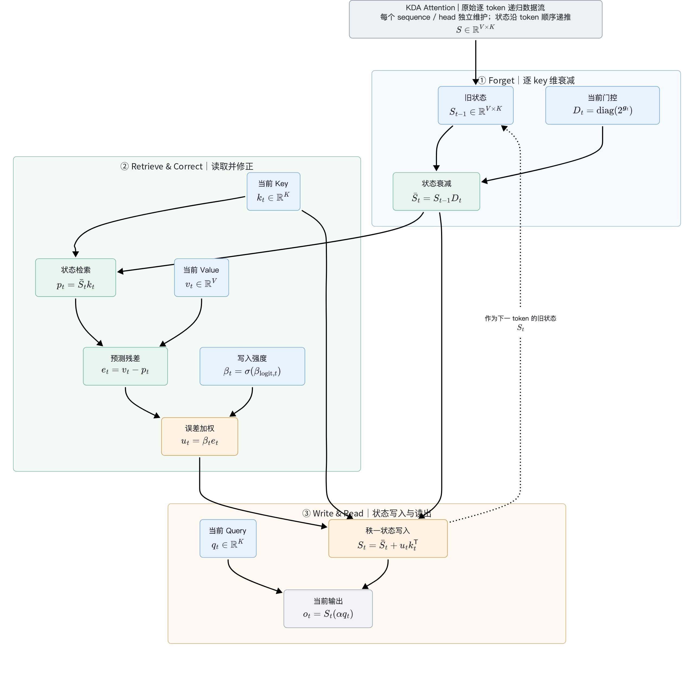

# FlashKDA：从 Delta Rule 到 K1/K2 数据流

> 本笔记对应本机 `/Users/saboxu/Downloads/FlashKDA` 的源码快照 `7afb9f4`（2026-10-19 阅读）。实现会变化；下面的 chunk 大小、数据类型和 warp 映射均以该快照为准。

## 本次讲解位置

```text
章节：算子开发 / 状态空间与线性注意力算子
小节：FlashKDA v1：chunkwise KDA 的 K1 prepare → K2 recurrence
知识点：KDA chunk 内的 L / INV / Mqk，以及跨 chunk recurrent state 如何推进
上次：13-flashmla-sparse-attention-reading-guide.md 的 sparse decode、split-KV 与 softmax merge
下次：沿 K2 MMA warp 的 16×16 tile 深挖 state update、寄存器转置和 TMA pipeline
PTX：不是单条 PTX 指令专题；实现重点是 SM80 16×8×16 BF16 MMA atom 与 SM90 TMA
```

## 为什么现在讲这个

前一节的 FlashMLA 可以把长 KV 分给多个 split，再合并 partial softmax；每个 split 主要是在一组给定 KV 上做 attention。FlashKDA 的困难不同：**序列的状态有时间依赖**，后一块必须接着前一块产生的 state 算，不能把所有 chunk 都当成彼此独立的 attention split。与此同时，chunk 内仍可把 token 维矩阵化并并行计算。

FlashKDA 因此把工作切成两种并行度：K1 让每个 chunk 独立预处理，尽量铺开 token 并行；K2 让每个 `(sequence, head)` CTA 按 chunk 顺序递推 state。理解这项切分，就能避免把它误读成 softmax attention 或“多个 chunk 各算一份最后取平均”，也能解释为什么它用了 TMA / warp specialization，却不需要 FlashMLA 那种 split-softmax 合并。

## 先建立心智模型

把 KDA 想成“每个 head 持有一张可更新的记忆矩阵”，而不是把所有历史 K/V token 永久堆在一个 cache 里：

```text
输入 token (q, k, v, gate, beta)
       │
       ├─ K1：每个 16-token chunk 独立做 gate/decay、构造小矩阵并求 INV
       │       token/chunk 并行；把中间结果写到 workspace
       ▼
       workspace ───────────────┐
                               ▼
初始 state ───────────→ K2：每个 (sequence, head) 按 chunk 串行递推
                               ├─ 用当前 state 算本 chunk 的输出
                               ├─ 更新 state，交给下一个 chunk
                               └─ 写 output / 可选 final_state
```

- **KDA（Kimi Delta Attention）属于 gated delta-rule / linear attention 路线。** 它不是对所有历史 token 做 softmax；长历史的信息由 state 汇总。
- 每个 head 的 state 形状是 `[V, K]`。当前 FlashKDA 限定 `K = V = 128`，所以是 `[128,128]`。
- 一个 CTA 处理 `CHUNK=16` 个连续 token。chunk 内先变成小的 16×16 下三角线性系统；chunk 与 chunk 之间仍然保留 recurrent 顺序。
- `beta` 输入是 sigmoid **之前的 logit**；kernel 内部做 sigmoid。`g` 输入也处于 gate activation 之前，门控还结合 `A_log`、`dt_bias` 和 `lower_bound`。

## API 与边界

仓库 README / `flash_kda/__init__.py` 的接口语义：

| 张量 | 形状 | 类型 / 语义 |
|---|---|---|
| `q, k, v` | `[B,T,H,128]` | BF16；Q/K 会做 L2 normalize |
| `g` | `[B,T,H,128]` | BF16，gate activation 前的输入 |
| `beta` | `[B,T,H]` | BF16 logits，内部 sigmoid |
| `A_log` | `[H]` | FP32 |
| `dt_bias` | `[H,128]` | FP32 |
| `out` | `[B,T,H,128]` | BF16，调用方提供的输出 buffer |
| `initial_state/final_state` | `[B,H,V,K]`，变长时 `[N,H,V,K]` | 可 BF16 / FP32；内部 state 运算驻留 BF16 |
| `cu_seqlens` | `[N+1]` | 可选；提供时要求 `B=1`，定义 N 个变长序列 |

当前代码还要求 CUDA contiguous 张量、CUDA 12.9+、PyTorch 2.4+ 和 SM90+；README 的编译目标例子为 `90a,100a`。**注意**：K1/K2 的 MMA 使用 SM80 风格的 MMA atom，不代表整套 kernel 可在 SM80 运行；当前实现依赖 SM90 TMA 路径。

## 逐 token 公式逐项拆解：从记忆矩阵到当前输出

### 本次讲解位置

```text
章节：算子开发 / 状态空间与线性注意力算子
小节：KDA 原始逐 token 递归
知识点：逐 Key 遗忘、预测残差、门控修正、秩一写入与 Query 读出
上次：K1 prepare → K2 recurrence 的整体数据流与公式图
下次：把逐 token 递归对应到 chunk 内的下三角系统
PTX：本节为数学数据流，不涉及单条 PTX 指令
```

### 为什么现在讲这个

只知道 K1 准备 workspace、K2 推进 state，还无法解释为什么需要严格下三角矩阵，或为什么当前输出包含当前 token 的贡献。先逐项拆开原始递归，明确“先遗忘、用 Key 预测、写入残差、用 Query 读新状态”的顺序，才能区分写入门控与 attention 权重，也能避免把状态的 Key 列衰减写成 Value 行衰减。

> 同步来源：[飞书中的逐 token 公式讲解](https://pcng0ddyhlxs.feishu.cn/wiki/VralwO1dmi4mzAk0Z9kcDdT3nzt#doxcnBrzXyx3EfNAHxjGWiExLvf)，2026-10-19，revision 116。以下图为飞书最终画板的导出版本；正文保留原生 LaTeX 公式。



这一节只解释上图中的原始逐 token 递归，不展开 chunk 并行和 CUDA 优化。核心问题是：当前 token 到来后，KDA 怎样遗忘旧信息、修正记忆，再从记忆里读出结果？

### 1. 先建立直觉：一张从 Key 空间映射到 Value 空间的记忆矩阵

普通 softmax attention 保留历史 Key、Value，让当前 Query 匹配它们。KDA 则把历史信息逐步汇总进固定大小的状态矩阵，而不是把历史 token 原封不动地存下来：

```math
S_{t-1}\in\mathbb{R}^{V\times K}
```

暂时把它理解成一个从 Key 空间映射到 Value 空间的记忆系统：

```math
\underbrace{S_{t-1}}_{V\times K}\underbrace{k}_{K\times 1}=\underbrace{\text{记忆对这个 Key 的 Value 响应}}_{V\times 1}
```

当前 token 带来一个新关联：$`k_t\longleftrightarrow v_t`$。KDA 希望让记忆对当前 Key 的响应更接近当前 Value。这张矩阵是压缩记忆，不是保证精确保存所有历史关联的字典。

### 2. 符号与维度：只看一个 sequence 的一个 head

省略 batch、head 下标；以下向量都按列向量理解。$`K`$ 和 $`V`$ 是维度大小，不是历史 Key、Value 矩阵。

| 符号 | 形状 | 含义 |
| --- | --- | --- |
| $`t`$ | — | 当前 token 的位置 |
| $`q_t`$ | $`K\times 1`$ | 当前 Query，用于最终读出记忆 |
| $`k_t`$ | $`K\times 1`$ | 当前 Key，用于检索和定位写入方向 |
| $`v_t`$ | $`V\times 1`$ | 当前 Value，希望记住的目标内容 |
| $`S_{t-1}`$ | $`V\times K`$ | 处理当前 token 之前的旧记忆 |
| $`\boldsymbol{g}_t`$ | $`K\times 1`$ | 已激活、处于 base-2 指数域的逐 Key 维衰减控制量 |
| $`D_t`$ | $`K\times K`$ | 由保留比例组成的对角矩阵 |
| $`\bar{S}_t`$ | $`V\times K`$ | 已衰减、尚未写入当前信息的记忆 |
| $`p_t,e_t,u_t`$ | $`V\times 1`$ | 分别是预测 Value、预测误差和实际修正向量 |
| $`\beta_t`$ | 标量 | 当前 token 的写入／修正强度 |
| $`S_t`$ | $`V\times K`$ | 处理当前 token 后的新记忆 |
| $`\alpha`$ | 标量 | Query 的缩放系数，对应 API 的 scale |
| $`o_t`$ | $`V\times 1`$ | 当前 token 的最终输出 |

### 3. 第一步：决定旧记忆的各个 Key 维度保留多少

```math
D_t=\operatorname{diag}\!\left(2^{\boldsymbol{g}_t}\right)
```

先对门控向量逐元素取指数，得到每个 Key 维度的保留比例：

```math
d_{t,j}=2^{g_{t,j}}
```

| $`g_{t,j}`$ | $`d_{t,j}`$ | 含义 |
| --- | --- | --- |
| $`0`$ | $`1`$ | 完全保留 |
| $`-1`$ | $`0.5`$ | 保留一半 |
| $`-2`$ | $`0.25`$ | 保留四分之一 |

**这里的门控量已经完成激活和 base-2 指数域转换，不是 API 直接收到的原始 g 输入。**在这条衰减路径中，激活后的门控量非正，保留比例因而不大于 1。自然指数写法与 base-2 写法可以换算，不能把不同指数域中的数值直接混用。

例如，两个 Key 维度的保留比例分别为 0.5、0.25，则 diag 把它们放在对角线上：

```math
2^{\boldsymbol{g}_t}=\begin{bmatrix}0.5\\0.25\end{bmatrix},\qquad D_t=\begin{bmatrix}0.5&0\\0&0.25\end{bmatrix}
```

所以每个 Key 维度可以有不同的遗忘速度。

### 4. 第二步：先衰减旧记忆

```math
\bar{S}_t=S_{t-1}D_t
```

$`S_{t-1}`$ 是旧记忆；$`D_t`$ 是当前 token 决定的保留比例；$`\bar{S}_t`$ 是已经衰减、尚未写入当前信息的记忆。上面的横线只是区分这个中间状态。

因为对角矩阵乘在右侧，所以它缩放状态矩阵的列，即 Key 维度：

```math
\bar{S}_t[i,j]=S_{t-1}[i,j]d_{t,j}
```

```math
\begin{bmatrix}a&b\\c&d\end{bmatrix}\begin{bmatrix}0.5&0\\0&0.25\end{bmatrix}=\begin{bmatrix}0.5a&0.25b\\0.5c&0.25d\end{bmatrix}
```

**在本文的状态布局约定下，这是逐 Key 列衰减，不是逐 Value 行衰减，也不是逐条删除历史 token。**若其他资料使用转置后的状态布局，衰减乘法的左右位置也会相应变化。

### 5. 第三步：用当前 Key 检查记忆已经知道什么

```math
p_t=\bar{S}_t k_t
```

$`p_t`$ 是记忆对当前 Key 的预测 Value。这一步是在问：“拿当前 Key 查询这张记忆，它会给我什么 Value？”

```math
(V\times K)(K\times 1)=V\times 1,\qquad p_t[i]=\sum_{j=1}^{K}\bar{S}_t[i,j]k_t[j]
```

**Key 用来检查当前要写入的关联是否已被记住；Query 用来产生最终输出。**因此这一步是写入前的检索／预测，还不是当前 token 的最终 attention 输出。

### 6. 第四步：计算记忆还缺少什么

```math
e_t=v_t-p_t
```

$`v_t`$ 是当前想写入的目标；$`p_t`$ 是旧记忆已经预测出的内容；$`e_t`$ 是两者的误差，也叫残差。

```math
v_t=\begin{bmatrix}3\\2\end{bmatrix},\quad p_t=\begin{bmatrix}1\\0\end{bmatrix}\quad\Longrightarrow\quad e_t=\begin{bmatrix}2\\2\end{bmatrix}
```

**KDA 写入的是修正量，而不是把整个 Value 再加一遍。**这就是 delta rule 的核心直觉：先预测，再根据预测误差修正记忆。

如果旧记忆已经预测正确，即 $`p_t=v_t`$，则 $`e_t=0`$，无需额外修正；但此前的状态衰减仍然已经发生。

### 7. 第五步：决定这次修正要做多大

```math
\beta_t=\sigma\!\left(\beta_{\mathrm{logit},t}\right),\qquad \sigma(x)=\frac{1}{1+\exp(-x)}
```

sigmoid 把模型输出的原始 logit 转换为介于 0 和 1 之间的写入强度。随后：

```math
u_t=\beta_t e_t
```

实际修正向量等于修正强度乘以预测误差。写入强度接近 0 时只做很小的修正；等于 0.5 时修正一半；接近 1 时做接近完整的修正。

**这是写入门控，不是对历史 token 做 softmax 得到的 attention 权重。**FlashKDA API 接收的是 beta logit，内部执行 sigmoid，不应把已经 sigmoid 的值再次当作 logit 传入。

### 8. 第六步：沿当前 Key 的方向修正记忆

```math
S_t=\bar{S}_t+u_t k_t^{\mathsf{T}}
```

修正向量只有 Value 维度，但我们要更新一张矩阵，因此需要外积：

```math
\underbrace{u_t}_{V\times 1}\underbrace{k_t^{\mathsf{T}}}_{1\times K}=\underbrace{\Delta S_t}_{V\times K},\qquad \Delta S_t[i,j]=u_t[i]k_t[j]
```

```math
u_t=\begin{bmatrix}a\\b\end{bmatrix},\quad k_t=\begin{bmatrix}c\\d\end{bmatrix}\quad\Longrightarrow\quad u_tk_t^{\mathsf{T}}=\begin{bmatrix}ac&ad\\bc&bd\end{bmatrix}
```

$`u_t`$ 决定修正什么 Value 内容；$`k_t`$ 决定沿哪个 Key 方向写入。外积的秩最多为 1，所以图中称为“秩一状态写入”。

为什么这种写入能修正预测？更新后，再用同一个 Key 检索：

```math
S_tk_t=p_t+\beta_t(v_t-p_t)(k_t^{\mathsf{T}}k_t)
```

若当前 Key 理想地归一化为单位向量，即 $`k_t^{\mathsf{T}}k_t=1`$，则：

```math
S_tk_t=p_t+\beta_t(v_t-p_t)=(1-\beta_t)p_t+\beta_t v_t
```

**更新后的预测，是旧预测和新目标之间的一次插值。**写入强度为 0 时保持衰减后的旧预测；为 0.5 时向目标移动一半；为 1 时，理想单位 Key 条件下对当前 Key 的预测直接变成目标 Value。0 和 1 是理解门控的极限情形，不是有限 sigmoid logit 的精确输出。

实际实现的归一化含 epsilon 且使用有限精度，以上是理想数学解释。不同 Key 方向不一定互相正交，更新也可能影响其他 Query／Key 的响应，不能理解成一份互不干扰的精确字典。

### 9. 第七步：用当前 Query 从新记忆中读出结果

```math
o_t=S_t(\alpha q_t)
```

$`S_t`$ 是已经写入当前 token 后的记忆；$`q_t`$ 是当前 Query；$`\alpha`$ 是缩放系数；$`o_t`$ 是最终输出。图中顺序是**先更新状态，再读出当前输出**，因此当前输出可以包含当前 token 刚写入的信息。

把状态更新代入读出式：

```math
o_t=\alpha\bar{S}_tq_t+\alpha u_t(k_t^{\mathsf{T}}q_t)
```

```math
o_t=\underbrace{\alpha\bar{S}_tq_t}_{\text{从衰减后的历史记忆读取}}+\underbrace{\alpha\beta_t e_t(k_t^{\mathsf{T}}q_t)}_{\text{当前修正对输出的贡献}}
```

这里的 $`k_t^{\mathsf{T}}q_t`$ 是熟悉的 Key–Query 匹配项：匹配程度决定当前修正会多大程度影响输出。但这里没有对所有历史 token 做 softmax。

### 10. 完整数值例子：衰减、预测、修正、读出

为方便手算，取 $`K=V=2`$、$`\alpha=1`$。这是说明公式的玩具例子，不是把当前 FlashKDA kernel 的维度限制改成了 2；实际实现仍限定 128 维，scale 也应按调用方设定。

```math
S_{t-1}=\begin{bmatrix}2&0\\0&4\end{bmatrix},\qquad k_t=q_t=\begin{bmatrix}1\\0\end{bmatrix},\qquad v_t=\begin{bmatrix}3\\2\end{bmatrix}
```

```math
\boldsymbol{g}_t=\begin{bmatrix}-1\\-2\end{bmatrix},\qquad \beta_{\mathrm{logit},t}=0
```

先得到保留比例和修正强度：

```math
D_t=\begin{bmatrix}0.5&0\\0&0.25\end{bmatrix},\qquad \beta_t=\sigma(0)=0.5
```

| 步骤 | 计算 | 结果 |
| --- | --- | --- |
| 衰减 | $`\bar{S}_t=S_{t-1}D_t`$ | $`\begin{bmatrix}1&0\\0&1\end{bmatrix}`$ |
| 预测 | $`p_t=\bar{S}_tk_t`$ | $`\begin{bmatrix}1\\0\end{bmatrix}`$ |
| 误差 | $`e_t=v_t-p_t`$ | $`\begin{bmatrix}2\\2\end{bmatrix}`$ |
| 加权 | $`u_t=0.5e_t`$ | $`\begin{bmatrix}1\\1\end{bmatrix}`$ |
| 外积 | $`u_tk_t^{\mathsf{T}}`$ | $`\begin{bmatrix}1&0\\1&0\end{bmatrix}`$ |
| 更新 | $`S_t=\bar{S}_t+u_tk_t^{\mathsf{T}}`$ | $`\begin{bmatrix}2&0\\1&1\end{bmatrix}`$ |
| 读出 | $`o_t=S_tq_t`$ | $`\begin{bmatrix}2\\1\end{bmatrix}`$ |

旧预测是 $`[1,0]^{\mathsf{T}}`$，目标是 $`[3,2]^{\mathsf{T}}`$。修正强度为 0.5，更新后的预测刚好走到中间：$`[2,1]^{\mathsf{T}}`$。而当前 Key 是 $`[1,0]^{\mathsf{T}}`$，因此此次写入只修正状态矩阵第一列。

### 11. 把整套公式压缩成一句话

```math
S_t=S_{t-1}D_t+\beta_t\left(v_t-S_{t-1}D_tk_t\right)k_t^{\mathsf{T}}
```

**新记忆 = 衰减后的旧记忆 + 沿当前 Key 方向写入的、经过门控的预测误差。**随后用当前 Query 从新记忆中读出结果：

```math
o_t=S_t(\alpha q_t)
```

### 12. 三个自检题与答案

**问题 1：衰减门控和写入门控有什么区别？**

答案：$`D_t`$ 控制旧记忆如何遗忘；$`\beta_t`$ 控制当前预测误差的修正幅度。两者不能互相替代。

**问题 2：为什么不直接写入完整的 Value 外积？**

答案：KDA 要修正已有预测，写入的是 $`\beta_t(v_t-p_t)k_t^{\mathsf{T}}`$，不是 $`\beta_t v_tk_t^{\mathsf{T}}`$。如果目标已经被预测正确，当前修正项为零。

**问题 3：预测 Value 和最终输出有什么区别？**

答案：$`p_t`$ 用 Key 从衰减后的旧状态中预测 Value；$`o_t`$ 用 Query 从更新后的新状态中产生输出。它们的输入向量和读取的状态都不同。

## 数学：chunk 内如何变成矩阵乘法

以下把 gate 写成已经激活后的 $`g_{\mathrm{act},t,j}`$，使用 base-2 指数。源码中 gate 预处理等价于（省略 head 下标）：

```math
g_{\mathrm{act},t,j}=g_{\min}\log_2(e)\,\sigma\!\left(e^{A_{\mathrm{log}}}\left(g_{\mathrm{in},t,j}+b_{\mathrm{dt},j}\right)\right)
```

其中 $`g_{\min}`$ 对应 API 的 `lower_bound`，$`b_{\mathrm{dt},j}`$ 对应 `dt_bias`。它是逐 token、逐 Key 维度计算，通常为非正数。于是 $`2^{g_{\mathrm{act},t,j}}`$ 表示 state 在 Key 维度上的保留比例。$`G`$ 表示 chunk 内沿 token 轴的前缀和，$`C=16`$：

```math
G_{t,j}=\sum_{\tau=0}^{t}g_{\mathrm{act},\tau,j},\qquad g_{\mathrm{total},j}=G_{C-1,j}
```

### 补充问答一：gate 激活、base-2 转换与前缀和到底在做什么？

> 补充同步：2026-10-19，飞书 revision 117。[问答一：gate 与前缀和](https://pcng0ddyhlxs.feishu.cn/wiki/VralwO1dmi4mzAk0Z9kcDdT3nzt#doxcnjeMes1JBtRlDAMcUQCQA0g)；[问答二：chunk 与局部位置](https://pcng0ddyhlxs.feishu.cn/wiki/VralwO1dmi4mzAk0Z9kcDdT3nzt#doxcn8GvqsrrjMp1fmrUl3uOIu8)。下文用 $`k`$ 表示 Key 特征维度，对应上文公式中的 $`j`$。

**本次讲解位置：**章节：算子开发／FlashKDA；小节：K1 的 gate 预处理；知识点：单步遗忘与累计遗忘；上次：逐 token 状态递归；下次：理解 chunk 的局部位置与跨 chunk 状态传递；PTX：本节为数学数据流，不涉及单条 PTX 指令。

**为什么现在讲这个：**前面的公式把 Q/K 归一化、beta 激活、gate 激活和前缀和写在一起，容易把 sigmoid 的输出当作保留比例，或在每一步重复使用累计衰减。先区分“本步保留多少”和“从 chunk 入口累计剩多少”，才能正确理解后面的 decay 矩阵。

#### 1. gate 最终决定的是旧记忆各个 Key 列的保留比例

固定一个 sequence 和 head，状态布局为 $`S\in\mathbb R^{V\times K}`$。旧记忆在当前 token 到来时，沿 Key 列衰减：

```math
d_{t,k}=2^{g_{\mathrm{act},t,k}},\qquad D_t=\operatorname{diag}(\boldsymbol d_t),\qquad \bar S_t=S_{t-1}D_t
```

$`t`$ 是 chunk 内的 token 位置；$`k`$ 是 Key 向量的特征维度，不是另一个 token 下标。$`g_{\mathrm{act},t,k}`$ 是保留比例的 base-2 对数，不是保留比例本身。它越负，遗忘越强；越接近零，保留越多。

| 激活后的 gate | 保留比例 | 含义 |
| --- | --- | --- |
| $`0`$ | $`2^0=1`$ | 完全保留 |
| $`-1`$ | $`2^{-1}=0.5`$ | 保留一半 |
| $`-2`$ | $`2^{-2}=0.25`$ | 保留四分之一 |

#### 2. 把大公式拆成四步：调整输入、sigmoid、负遗忘量、换指数域

以下省略 head 下标，并临时引入 $`x_{t,k}`$、$`r_{t,k}`$ 和 $`\ell_{t,k}`$，只为看清中间步骤：

```math
\begin{aligned}x_{t,k}&=e^{A_{\mathrm{log}}}(g_{\mathrm{in},t,k}+b_{\mathrm{dt},k}),\\r_{t,k}&=\sigma(x_{t,k}),\\\ell_{t,k}&=g_{\min}r_{t,k},\\g_{\mathrm{act},t,k}&=\ell_{t,k}\log_2(e).\end{aligned}
```

第一步加偏置、乘正系数；第二步用 sigmoid 得到控制量；第三步乘负的下界，得到自然指数域的遗忘量；第四步把它转换到 base-2，便于实现使用 `exp2`。

| 符号／API | 作用 | 当前实现的共享范围 |
| --- | --- | --- |
| $`g_{\mathrm{in},t,k}`$／`g` | 原始 gate 输入，尚不是保留比例 | 每个 token、head、Key 维度 |
| $`b_{\mathrm{dt},k}`$／`dt_bias` | 平移 sigmoid 输入，改变控制量 | 每个 head、Key 维度，沿 token 共享 |
| $`A_{\mathrm{log}}`$／`A_log` | 取指数得到正系数，调整 sigmoid 对输入的敏感程度 | 每个 head，沿 token 和 Key 维度共享 |
| $`g_{\min}`$／`lower_bound` | 负的自然指数域 gate 下界，限制遗忘量范围 | 本次调用的标量配置 |

**sigmoid 的输出不是保留比例。**在理想数学下，若 $`g_{\min}<0`$，则 $`\ell_{t,k}\in(g_{\min},0)`$，真正的保留比例为 $`e^{\ell_{t,k}}`$，位于 $`(e^{g_{\min}},1)`$；有限精度会产生舍入，极小值还可能下溢。

```math
\boxed{2^{\ell\log_2(e)}=e^{\ell}}
```

**乘以 $`\log_2(e)`$ 只是换指数表示，不是额外遗忘一次。**自然指数域和 base-2 指数域的数值不能直接混用。

#### 3. 用一组真实代入把激活流程算完

为了手算，取以下教学参数；它们不是对默认 kernel 配置的声明：

```math
g_{\mathrm{in}}=0,\quad b_{\mathrm{dt}}=0,\quad A_{\mathrm{log}}=0,\quad g_{\min}=-2
```

```math
\begin{aligned}x&=e^0(0+0)=0,\\r&=\sigma(0)=0.5,\\\ell&=-2\times0.5=-1,\\g_{\mathrm{act}}&=-\log_2(e)\approx-1.442695,\\d&=2^{-\log_2(e)}=e^{-1}\approx0.367879.\end{aligned}
```

结论：这一步，旧记忆的这个 Key 列保留约 36.79%。虽然 sigmoid 给出 0.5，但最终保留比例不是 50%。

#### 4. 前缀和：比例连乘，等价于对数相加

同一个 Key 列连续经过多个 token 的遗忘时，保留比例连续相乘。把比例写成指数，就可以用前缀和表达：

```math
G_{t,k}=\sum_{\tau=0}^{t}g_{\mathrm{act},\tau,k},\qquad 2^{G_{t,k}}=\prod_{\tau=0}^{t}2^{g_{\mathrm{act},\tau,k}}
```

接着上面的例子，假设前三个 token 的输入相同，每一步都保留 $`e^{-1}`$。只跟踪 chunk 入口旧记忆的直接传播，不考虑新写入：

| 局部位置 $`t`$ | 本步 $`g_{\mathrm{act},t,k}`$ | 累计 $`G_{t,k}`$ | 本步保留 | 入口旧记忆累计保留 | 入口元素为 100 时 |
| --- | --- | --- | --- | --- | --- |
| 0 | -1.442695 | -1.442695 | 36.79% | 36.79% | 36.787944 |
| 1 | -1.442695 | -2.885390 | 36.79% | 13.53% | 13.533528 |
| 2 | -1.442695 | -4.328085 | 36.79% | 4.98% | 4.978707 |

$`g_{\mathrm{act},t,k}`$ 管“当前这一步”；$`G_{t,k}`$ 管“从 chunk 入口累计到这一步”。逐 token 递归使用本步 gate，chunk 矩阵化时使用前缀和来组织累计衰减坐标。

**不要在每步递归中对完整状态再乘累计比例。**例如前两步各保留 $`e^{-1}`$，正确累计是 $`e^{-2}`$；若第一步乘 $`e^{-1}`$、第二步错误地乘前缀比例 $`e^{-2}`$，会得到 $`e^{-3}`$，重复衰减了第一步。

对在局部位置 $`s`$ 写入的信息，其后仅由遗忘造成、直到位置 $`t`$ 的保留因子为 $`2^{G_{t,k}-G_{s,k}}`$，其中 $`s\le t`$。它没有经历写入之前的遗忘；后续 delta 修正还可能改变这份信息，因此该因子只描述遗忘部分。

#### 5. Q/K 归一化、beta 和 gate 不是同一个门控

| 操作 | 控制什么 |
| --- | --- |
| Q/K 的 L2 归一化 | 规范向量长度，保留方向；实现含 epsilon 和有限精度 |
| $`\beta_t=\sigma(\beta_{\mathrm{logit},t})`$ | 当前 token 的残差修正／写入强度，一个标量 |
| $`2^{g_{\mathrm{act},t,k}}`$ | 旧记忆在 Key 维度上的保留比例，每个 Key 维度可以不同 |

```math
S_t=\bar S_t+\beta_t(v_t-\bar S_tk_t)k_t^{\mathsf T}
```

gate 管“旧的保留多少”，beta 管“新的残差修正写多少”。两者都使用 sigmoid，但不是同一个量；把 beta 当作旧状态的衰减比例，会改变递归结果。

### 补充问答二：chunk 大小为什么会和时间 t 有关系？

**本次讲解位置：**章节：算子开发／FlashKDA；小节：chunk 的索引与状态边界；知识点：区分 chunk 数量、chunk 大小、局部 token 位置和全局位置；上次：单步 gate 与前缀和；下次：回到 K1 的 decay 矩阵与三角系统；PTX：本节为数学索引，不涉及单条 PTX 指令。

**为什么现在讲这个：**如果把 $`C=16`$ 误读为 16 个 chunk，或把 $`t`$ 当作 GPU 墙钟时间，就无法理解为什么要取前缀和的第 $`C-1`$ 项，也容易在 chunk 边界错误地清空记忆。

#### 1. C 是每个 chunk 的 token 数，不是 chunk 的数量

chunk 是把原始序列中的连续 token 分成小组。取一条长度 $`T=32`$ 的序列，每组放 $`C=16`$ 个 token，则它有两个 chunk：

| 符号 | 含义 | 本例 |
| --- | --- | --- |
| $`T`$ | 一条序列的 token 总数 | 32 |
| $`C`$ | 每个 chunk 的 token 容量 | 16 |
| $`N_{\mathrm{chunks}}`$ | 这条序列的 chunk 数量 | 2 |
| $`c`$ | 当前 chunk 的编号 | 0 或 1 |
| $`t`$ | 当前 token 在 chunk 内的局部位置 | 0 到 15 |
| $`n`$ | token 在这条完整序列中的全局位置 | 0 到 31 |
| $`k`$ | Key 特征维度 | 与 token 位置是不同轴 |

```math
N_{\mathrm{chunks}}=\left\lceil\frac{T}{C}\right\rceil,\qquad n=cC+t,\qquad 0\le t<C
```

这里的“时间”表示 token 的逻辑序列顺序，不是 GPU 的执行耗时。

| chunk 编号 | 原始序列位置 | chunk 内局部位置 |
| --- | --- | --- |
| $`c=0`$ | $`n=0,1,\ldots,15`$ | $`t=0,1,\ldots,15`$ |
| $`c=1`$ | $`n=16,17,\ldots,31`$ | $`t=0,1,\ldots,15`$ |

例如全局位置为 19 的 token：

```math
19=1\times16+3\quad\Longrightarrow\quad c=1,\quad t=3
```

#### 2. 前缀和为什么带 t：走到哪一个 token，就累计到哪里

为了消除歧义，这里把前面省略的 chunk 下标也写出来：

```math
G_{c,t,k}=\sum_{\tau=0}^{t}g_{\mathrm{act},c,\tau,k}
```

固定一个 chunk，局部位置从零开始推进。$`G_{c,3,k}`$ 累计前 4 个 token；$`G_{c,7,k}`$ 累计前 8 个 token；$`G_{c,15,k}`$ 累计整个 16-token chunk。

**不是 chunk 大小随着 t 变化，而是当前 token 在一个固定大小的 chunk 里处于不同位置。**固定的是 $`C`$，变化的是局部位置 $`t`$。

#### 3. 为什么整个 chunk 的 gate 等于最后一个前缀和

```math
g_{\mathrm{total},c,k}=G_{c,C-1,k}=\sum_{\tau=0}^{C-1}g_{\mathrm{act},c,\tau,k}
```

因为下标从零开始，最后一个 token 的位置是 $`C-1`$。对当前实现 $`C=16`$，最后一项是 $`G_{c,15,k}`$，不是第 16 个 chunk，也不是物理时间的第 15 秒。$`g_{\mathrm{total},c,k}`$ 是前缀和最后一项，不是一套新的 gate 激活。

#### 4. 下一个 chunk 的 t 从零开始，但 state 不清零

每个 chunk 在自己的局部坐标中重新计算前缀和；上一个 chunk 的最终状态作为下一个 chunk 的入口状态：

```math
S_{\mathrm{in},c+1}=S_{\mathrm{out},c}
```

```math
S_{\mathrm{out},c}=S_{\mathrm{in},c}\operatorname{diag}\!\left(2^{\boldsymbol g_{\mathrm{total},c}}\right)+\Delta S_c
```

$`\Delta S_c`$ 是包含 chunk 内因果 delta 修正、并换算到 chunk 末尾坐标的写入贡献。入口旧状态的直接传播项乘整个 chunk 的累计保留比例，新写入并不是全部都经历同样的 16 次遗忘。

所以“局部下标与前缀和重新开始”不等于“历史记忆重新开始”。K1 可以并行准备各个 chunk 的 gate 与 workspace；K2 仍在每个 sequence/head 内按 chunk 顺序传递 state。

#### 5. 不满 16 个 token 的尾块怎么理解

例如 $`T=19`$、$`C=16`$，仍有两个 chunk，但第二块只含局部位置 $`t=0,1,2`$ 的三个有效 token。当前实现将尾块无效位置的已激活 gate 填零，零 gate 对应保留比例为 1，不额外遗忘：

```math
g_{\mathrm{act},c,t,k}=0\quad(t\ge3),\qquad G_{c,15,k}=G_{c,2,k}
```

**这里填零的是激活后的 gate，不是把 raw gate 输入填零后再做 sigmoid。**本节前面的数值例子已说明，raw 输入为零仍可能产生非零遗忘量。无效 token 也不会产生有效的新写入。

#### 6. 自检：三个容易混淆的点

问：sigmoid 输出 0.5，旧记忆就保留 50% 吗？答：不是。本例 $`g_{\min}=-2`$ 时，保留比例是 $`e^{-1}\approx36.79\%`$。

问：$`G_{c,3,k}`$ 累计几个 token？沿哪个轴累积？答：固定 chunk 和 Key 维度，沿 token 轴累计局部位置 0、1、2、3，共 4 个 token。

问：$`T=32`$、$`C=16`$ 时，全局位置 19 在哪里？进入第二个 chunk 时要清空 state 吗？答：$`c=1,t=3`$；不能清空 state，第二块继承第一块的最终状态。

**源码对应：**`tests/torch_ref.py` 中 gate activation 对应加 `dt_bias`、计算 `exp(A_log)`、乘 `lower_bound * LOG2E` 与 sigmoid；`g_chunk.cumsum(dim=0)` 沿 token 轴求前缀和，`g_cumsum[-1:]` 取整个 chunk 的累计 gate，尾块通过零初始化的 gate buffer 保持前缀和不变。

### 回到 K1：构造衰减矩阵与三角系统

**回到 K1 原流程：**弄清单步 gate、累计 gate 和局部时间坐标后，再看下一步如何用它们构造不同衰减坐标下的 Q/K 矩阵。

以下乘法和指数都按元素计算，$`\alpha`$ 对应 API 的 `scale`，$`K_{t,j}`$、$`Q_{t,j}`$ 已做 L2 normalize：

```math
\begin{aligned}
(K_{\mathrm{decay}})_{t,j}&=K_{t,j}\,2^{G_{t,j}},\\[0pt]
(Q_{\mathrm{decay}})_{t,j}&=\alpha Q_{t,j}\,2^{G_{t,j}},\\[0pt]
(K_{\mathrm{inv}})_{t,j}&=K_{t,j}\,2^{-G_{t,j}},\\[0pt]
(K_{\mathrm{restored}})_{t,j}&=(K_{\mathrm{inv}})_{t,j}\,2^{g_{\mathrm{total},j}}.
\end{aligned}
```

其中 $`K_{\mathrm{decay}}`$、$`Q_{\mathrm{decay}}`$、$`K_{\mathrm{inv}}`$、$`K_{\mathrm{restored}}`$ 形状都是 $`C\times K=16\times128`$，$`\boldsymbol g_{\mathrm{total}}`$ 是 $`K`$ 维向量。$`K_{\mathrm{restored}}`$ 把 chunk 内逆衰减的 Key 换算到 chunk 末尾 state 的时间坐标。

### 补充问答三：四种 Q/K 变换为什么要计算和保存？

> 补充同步：2026-10-19，飞书 revision 119。[四种 Q/K 变换的含义与保存方式](https://pcng0ddyhlxs.feishu.cn/wiki/VralwO1dmi4mzAk0Z9kcDdT3nzt#doxcnd6UFEm42AmpUk83Z6tvVkc)。下文用 $`k`$ 表示 Key 特征维度，对应上文的 $`j`$；局部时间含义与前一补充问答一致。

**本次讲解位置：**章节：算子开发／FlashKDA；小节：K1 的 Q/K 衰减变换；知识点：入口旧记忆、token 间影响与 chunk 末尾状态的衰减坐标；上次：gate 激活、前缀和与局部时间下标；下次：用这些矩阵构造下三角系统并计算残差修正；PTX：本节解释数学与 workspace 数据流，不展开单条 PTX 指令。

**为什么现在讲这个：**只知道累计 gate 还不能判断一次读取或写入应经历哪一段衰减。若对新写入也乘入口到当前的累计比例，就会让它经历写入前的遗忘；若把逆衰减看成矩阵求逆，或把四份变换都当作历史 KV Cache，也会误读 K1/K2 的分工。

**先记住一句话：它们不是四份历史 KV Cache，而是同一个 chunk 的 Q/K，预先乘好不同的衰减系数，供后面的不同计算使用。**K1 可以在不知道入口 state 内容的情况下，准备这些只依赖本 chunk 输入的变换；K2 再将它们与实际的入口 state 结合。

#### 1. 同一个 K 为什么需要不同版本：传播区间不同

以下固定一个 chunk，省略 chunk、sequence 和 head 下标。$`t`$ 是当前局部 token 位置，$`s`$ 是更早的局部位置，$`k`$ 是 Key 特征维度。$`q_t,k_t\in\mathbb R^{K\times1}`$ 按列向量理解；矩阵 Q/K 的第 t 行分别是它们的转置。

| 要回答的问题 | 遗忘传播区间 | 对应的逐 Key 维因子 |
| --- | --- | --- |
| 当前 token 从 chunk 入口旧记忆读到什么 | 入口到当前 token，包含当前 token 的遗忘 | $`2^{G_{t,k}}`$ |
| 更早 token 的写入对当前 token 有什么影响 | 在 token s 写入后，到 token t | $`2^{G_{t,k}-G_{s,k}}`$ |
| 当前 token 的写入最终传给下一块多少 | 在当前 token 写入后，到 chunk 末尾 | $`2^{g_{\mathrm{total},k}-G_{t,k}}`$ |

**“不同时间坐标”不是移动 token 的位置，也不是 GPU 墙钟时间，而是把不同传播区间的衰减系数提前放进向量。**所有指数都是按 Key 维逐元素计算。

#### 2. K_decay：用当前 Key 查询入口旧记忆，带上入口到当前的衰减

```math
(K_{\mathrm{decay}})_{t,k}=K_{t,k}2^{G_{t,k}}
```

令 $`S_{\mathrm{in}}\in\mathbb R^{V\times K}`$ 为 chunk 入口状态。先只看入口旧记忆的直接传播，不考虑 chunk 内新写入。走到 token t 时，它的贡献为 $`S_{\mathrm{in}}\operatorname{diag}(2^{\boldsymbol G_t})`$。用当前 Key 查询：

```math
S_{\mathrm{in}}\operatorname{diag}(2^{\boldsymbol G_t})k_t=S_{\mathrm{in}}(k_t\odot2^{\boldsymbol G_t})
```

$`\odot`$ 表示逐元素乘法；右侧括号中的列向量就是 $`K_{\mathrm{decay}}`$ 第 t 行的转置。因此无需为每个 token 先生成一份完整的“衰减后状态”，可以把衰减移到 Key 上，再用矩阵乘法统一查询入口 state：

```math
P_{\mathrm{old}}=K_{\mathrm{decay}}S_{\mathrm{in}}^{\mathsf T}\in\mathbb R^{C\times V}
```

它表示各 token 的 Key 从入口旧记忆预测出的 Value，不是最终输出，也还没有包含本 chunk 中更早 token 的新写入影响。后续先形成残差，再通过三角系统把这些因果修正一起解出来。

#### 3. Q_decay：计算入口旧记忆对当前输出的贡献

```math
(Q_{\mathrm{decay}})_{t,k}=\alpha Q_{t,k}2^{G_{t,k}}
```

逻辑与 Key 变换相同，但 Query 用于输出读出，$`\alpha`$ 对应 API 的 scale。单个 token 的入口旧记忆输出贡献是：

```math
o_{\mathrm{old},t}=S_{\mathrm{in}}(\alpha q_t\odot2^{\boldsymbol G_t})
```

整个 chunk 一起计算：

```math
O_{\mathrm{old}}=Q_{\mathrm{decay}}S_{\mathrm{in}}^{\mathsf T}\in\mathbb R^{C\times V}
```

**它只是完整输出中的旧记忆部分。**完整输出还要加上 chunk 内新写入的贡献，即 $`O=O_{\mathrm{old}}+M_{qk}U`$。

#### 4. K_inv：拼出从更早 token 到当前 token 的相对衰减

```math
(K_{\mathrm{inv}})_{s,k}=K_{s,k}2^{-G_{s,k}}
```

**这里 inv 指逆累计衰减系数，不是对 K 矩阵求逆。**一个在 token s 写入的内容，不应该经历写入之前的遗忘。到 token t 时，单由后续遗忘造成的保留比例是：

```math
2^{G_{t,k}-G_{s,k}}=2^{G_{t,k}}2^{-G_{s,k}},\qquad s\le t
```

当前 Query 乘正累计衰减，更早的 Key 乘逆累计衰减，两者相乘就消去了写入前的那段衰减：

```math
(Q_{\mathrm{decay}}K_{\mathrm{inv}}^{\mathsf T})_{t,s}=\alpha\sum_kQ_{t,k}K_{s,k}2^{G_{t,k}-G_{s,k}}
```

这给出更早 token 的实际修正写入，在经过中间遗忘后，对当前 Query 的投影系数。保留下三角，只允许当前 token 读取自己及更早 token 的贡献：

```math
M_{qk}=\operatorname{tril}(Q_{\mathrm{decay}}K_{\mathrm{inv}}^{\mathsf T},0)
```

同样，Key 与 Key 的相对衰减关系用于构造 delta 修正的严格下三角依赖：

```math
L=\operatorname{diag}(\boldsymbol\beta)\operatorname{tril}(K_{\mathrm{decay}}K_{\mathrm{inv}}^{\mathsf T},-1)
```

逆衰减可能使中间数值变大，但它只是因式分解中的补偿项，不意味着真实历史记忆被放大；真正的因果系数包含正、逆累计衰减的组合。$`K_{\mathrm{inv}}`$ 与 $`\mathrm{INV}=(I+L)^{-1}`$ 是两个不同概念。

#### 5. K_restored：把各 token 的实际写入推进到 chunk 末尾

```math
(K_{\mathrm{restored}})_{t,k}=(K_{\mathrm{inv}})_{t,k}2^{g_{\mathrm{total},k}}=K_{t,k}2^{g_{\mathrm{total},k}-G_{t,k}}
```

这次传播区间是“当前 token 写入后，到本 chunk 末尾”。越早的写入，通常经历越多后续遗忘；最后一个有效 token 的写入不再经历本块内的后续遗忘。

**restored 不是说恢复成原始 K，而是把写入贡献换算到 chunk 末尾状态的时间坐标。**令 $`u_t\in\mathbb R^{V\times1}`$ 为实际残差修正向量，它由三角系统求出，不是直接等于原始 Value。将 $`K_{\mathrm{restored}}`$ 第 t 行转成列向量 $`r_t`$，则：

```math
r_t=k_t\odot2^{\boldsymbol g_{\mathrm{total}}-\boldsymbol G_t},\qquad \Delta S=\sum_{t=0}^{C-1}u_tr_t^{\mathsf T}=(K_{\mathrm{restored}}^{\mathsf T}U)^{\mathsf T}
```

其中 U 的第 t 行为 $`u_t^{\mathsf T}`$。每一项是一个 $`V\times K`$ 的外积；全部写入到 chunk 末尾的贡献相加，再加入口旧状态的整块衰减：

```math
S_{\mathrm{out}}=S_{\mathrm{in}}\operatorname{diag}(2^{\boldsymbol g_{\mathrm{total}}})+\Delta S
```

#### 6. 两 token 数值例子：亲手检查不同衰减区间

为了手算，使用一个 Key 特征、两个 token，取 Q/K 都为 1、scale 为 1；这只是数学教学形状，不代表真实 FlashKDA kernel 支持该维度：

```math
K_0=K_1=Q_0=Q_1=1,\qquad\alpha=1,\qquad g_{\mathrm{act},0}=g_{\mathrm{act},1}=-1
```

每个 token 都保留一半，因此：

```math
G_0=-1,\qquad G_1=-2,\qquad g_{\mathrm{total}}=-2
```

| token | $`K_{\mathrm{decay}}`$ | $`Q_{\mathrm{decay}}`$ | $`K_{\mathrm{inv}}`$ | $`K_{\mathrm{restored}}`$ |
| --- | --- | --- | --- | --- |
| 0 | 0.5 | 0.5 | 2 | 0.5 |
| 1 | 0.25 | 0.25 | 4 | 1 |

token 0 的写入对 token 1 的系数：

```math
(Q_{\mathrm{decay}})_1(K_{\mathrm{inv}})_0=0.25\times2=0.5
```

它只经历 token 1 的一次减半。若省略逆累计衰减、直接使用原始 Key，则会错误地得到 0.25，让新写入额外经历写入前的遗忘。

当前 token 对自己输出的系数：

```math
(Q_{\mathrm{decay}})_1(K_{\mathrm{inv}})_1=0.25\times4=1
```

当前写入不应再经历当前 token 写入前的遗忘。到 chunk 末尾，两个写入的保留系数分别为：

```math
(K_{\mathrm{restored}})_0=2\times0.25=0.5,\qquad(K_{\mathrm{restored}})_1=4\times0.25=1
```

完整输出投影矩阵为：

```math
Q_{\mathrm{decay}}K_{\mathrm{inv}}^{\mathsf T}=\begin{bmatrix}1&2\\0.5&1\end{bmatrix},\qquad M_{qk}=\begin{bmatrix}1&0\\0.5&1\end{bmatrix}
```

右上角是未来 token 对过去 token 的影响，必须被因果 mask 去掉。若接着本文原两 token 例子的 $`U=[1,1.5]^{\mathsf T}`$、入口状态 $`S_{\mathrm{in}}=[2]`$，则：

```math
\Delta S=[0.5\times1+1\times1.5]=[2],\qquad S_{\mathrm{out}}=[2\times0.25+2]=[2.5]
```

#### 7. 实际保存在哪里：不是四份矩阵都交给 K2

| 变换量 | 数学用途 | 当前 FlashKDA 的保存／使用方式 |
| --- | --- | --- |
| $`K_{\mathrm{decay}}`$ | 入口旧状态的 Key 预测；参与构造 L | K1 写到全局内存 workspace，K2 读取并与入口 state 相乘 |
| $`Q_{\mathrm{decay}}`$ | 入口旧状态的输出；参与构造 Mqk | K1 写到 workspace，K2 读取并计算旧记忆输出贡献 |
| $`K_{\mathrm{inv}}`$ | 构造相对时间衰减、L、Mqk 与 K_restored | K1 内部中间量，不作为独立 workspace 项交给 K2 |
| $`K_{\mathrm{restored}}`$ | 把实际写入推进到 chunk 末尾 | K1 写到 workspace，K2 读取并计算状态更新 |

四种变换的数学形状都是 $`C\times K=16\times128`$。其中跨 kernel 保存的三份 Q/K 变换矩阵，在当前源码中是 BF16。它们按 head 和 chunk 存放，是本次调用的中间工作区；不作为不断增长的历史 KV Cache 在后续推理调用中保留。

workspace 还保存 $`\boldsymbol g_{\mathrm{total}}`$、$`\mathrm{INV}`$ 和 $`M_{qk}`$，加上上述三份变换矩阵，共六类中间结果：

```math
K_{\mathrm{decay}},\quad Q_{\mathrm{decay}},\quad K_{\mathrm{restored}},\quad\boldsymbol g_{\mathrm{total}},\quad\mathrm{INV},\quad M_{qk}
```

读取流程是 K1 准备并写 workspace，然后 K2 读取；当前 launcher 在同一个 CUDA stream 中按顺序启动两者。workspace 让 K2 无需重复执行 gate 激活、前缀和、变换和三角矩阵预处理。跨 chunk 传递历史记忆的是 state，不是这些变换矩阵。

#### 8. 自检与源码对应

问：$`K_{\mathrm{inv}}`$ 是矩阵 K 的逆吗？答：不是，它是 Key 逐元素乘逆累计衰减；真正的三角矩阵逆是 $`\mathrm{INV}=(I+L)^{-1}`$。

问：最后一个有效 token 的 $`K_{\mathrm{restored}}`$ 为什么等于该 token 的原始归一化 Key？答：此时 $`G_{t,k}=g_{\mathrm{total},k}`$，两者差为零，写入之后没有本块内的后续遗忘；这不意味着所有 token 的 K_restored 都恢复成原始 Key。

问：K2 从 workspace 读取四种 Q/K 变换吗？答：不是，只独立读取其中的 K_decay、Q_decay、K_restored；K_inv 的作用已经体现在 K1 生成的小矩阵与 K_restored 中。

**源码对应：**`tests/torch_ref.py` 的 `k_decayed`、`q_decayed`、`k_inv`、`k_restored` 对应四种变换；后续分别用于 state prediction、output projection、L/Mqk 和 delta state。`csrc/smxx/fwd_launch.cu` 的 workspace 布局有 `ws_kd`、`ws_qd`、`ws_kr`、`ws_gt`、`ws_inv`、`ws_mqk`，没有独立的 K_inv workspace 数组。

### 回到 K1：用变换矩阵构造因果三角系统

下面继续原流程：把不同时间区间的衰减装进 Q/K 之后，再构造 L、INV 与 Mqk，并把 K2 所需的六类结果写入 workspace。

接着构造两个 chunk 矩阵。定义 $`\boldsymbol\beta=(\beta_0,\ldots,\beta_{C-1})^{\mathsf T}`$，其中 $`\beta_t=\sigma(\beta_{\mathrm{logit},t})`$，左乘对角矩阵表示逐 token 行缩放，而非普通矩阵与向量相乘：

```math
\begin{aligned}
L&=\operatorname{diag}(\boldsymbol\beta)\,\operatorname{tril}\!\left(K_{\mathrm{decay}}K_{\mathrm{inv}}^{\mathsf T},-1\right),\\[0pt]
M_{qk}&=\operatorname{tril}\!\left(Q_{\mathrm{decay}}K_{\mathrm{inv}}^{\mathsf T},0\right),\\[0pt]
\mathrm{INV}&=(I+L)^{-1}.
\end{aligned}
```

- $`L`$ 只保留**严格下三角**，因此 token $`t`$ 只依赖 chunk 内更早的 token；它编码了 delta update 的因果依赖。
- $`\mathrm{INV}`$ 把 chunk 内顺序依赖改写成一次小型三角系统求解：$`U=\mathrm{INV}\,\widetilde V`$。$`I+L`$ 是单位下三角矩阵，可以用 forward substitution 求逆／求解。
- $`M_{qk}`$ 保留下三角（含对角），把 chunk 中各 token 的 update 投影到各个 Query 上。

### 补充问答四：为什么需要 $`U=\mathrm{INV}\,\widetilde V`$？

> 补充同步：2026-10-19，飞书 revision 122。[为什么需要 U 的三角修正](https://pcng0ddyhlxs.feishu.cn/wiki/VralwO1dmi4mzAk0Z9kcDdT3nzt#doxcnm1qHSgRhuvPI31g0UfO7Ac)。与飞书新增讲解使用同一份内容；这里用 $`d_k`$、$`d_v`$ 区分特征维度与矩阵名称。

**本次讲解位置：**章节：算子开发／FlashKDA；小节：K2 的 chunk 内残差修正；知识点：从逐 token 递归推导单位下三角系统；上次：四种 Q/K 衰减变换及 workspace 保存方式；下次：用 U 计算输出与 chunk 末尾 state，再映射到 K2 MMA tile；PTX：本节为数学与源码数据流，不展开单条 PTX 指令。

**为什么现在讲这个：**Q/K 变换已经说明一次读写经历哪一段衰减，但没有解释后一个 token 为什么依赖前一个 token 更新后的 state。若把只扣除入口旧状态的残差直接当作实际写入量，就会漏掉本 chunk 内更早更新的预测贡献，得到错误的输出与最终状态。

**先记住一句话：**$`\widetilde V`$ 只减掉了“chunk 入口旧状态”的预测；$`U`$ 还要扣除“本 chunk 内更早 token 的更新”带来的预测。$`\mathrm{INV}`$ 完成的就是这层因果修正，而不是额外的归一化或 softmax。

#### 1. U 是什么：实际写入 state 的残差修正

为避免矩阵名称与维度重名，下文用 $`d_k`$、$`d_v`$ 表示 Key、Value 维度，用 $`C`$ 表示 chunk 内 token 数。它们对应原文形状中的 K、V、C。当前实现完整 chunk 为 $`C=16`$，$`d_k=d_v=128`$；后面的标量手算是缩小的数学例子，不是改动真实 kernel 配置。

每个 $`k_t\in\mathbb R^{d_k}`$ 和 $`v_t\in\mathbb R^{d_v}`$ 都按列向量理解；Key 是 K1 归一化后的 Key，$`\beta_t`$ 是激活后的写入强度。state 的形状沿用本文的 Value × Key 约定：

```math
S_{t-1}\in\mathbb R^{d_v\times d_k},\qquad D_t=\operatorname{diag}\!\left(2^{\boldsymbol g_{\mathrm{act},t}}\right)
```

原始逐 token 更新按“先遗忘 → 预测 → 计算残差 → 写入”的顺序进行：

```math
\overline S_t=S_{t-1}D_t
```

```math
u_t=\beta_t\left(v_t-\overline S_t k_t\right)
```

```math
S_t=\overline S_t+u_tk_t^{\mathsf T}
```

$`\overline S_t k_t`$ 是已有状态根据当前 Key 预测出的 Value；$`u_t`$ 是目标 Value 与这个预测的差，再乘写入强度。真正加到记忆矩阵里的是外积 $`u_tk_t^{\mathsf T}`$，而不是直接把原始 Value 写进去。

把各 token 的修正向量按行堆叠，得到矩阵 U；其中 $`U_{t,:}=u_t^{\mathsf T}`$：

```math
U=\begin{bmatrix}u_0^{\mathsf T}\\u_1^{\mathsf T}\\\vdots\\u_{C-1}^{\mathsf T}\end{bmatrix}\in\mathbb R^{C\times d_v}
```

#### 2. 为什么不能直接用带波浪号的 V？

```math
\widetilde V=\operatorname{diag}(\boldsymbol\beta)\left(V-K_{\mathrm{decay}}S_{\mathrm{in}}^{\mathsf T}\right)
```

$`S_{\mathrm{in}}`$ 是 chunk 开始之前的状态，不是处理当前 token 时已经包含块内更新的状态。因而这一步只从目标 Value 中扣掉了入口旧记忆的预测。

```math
\widetilde v_t=\beta_t\left(v_t-S_{\mathrm{in}}\operatorname{diag}(2^{\boldsymbol G_t})k_t\right)
```

这里定义 $`\widetilde V_{t,:}=\widetilde v_t^{\mathsf T}`$，$`G_{t,k}=\sum_{\tau=0}^{t}g_{\mathrm{act},\tau,k}`$ 是本 chunk 内的累计 gate。入口旧状态到当前 token 的衰减已经包含在正衰减 Key 中。

但当前 token 的实际旧状态还含有 token 0 到前一个 token 在本 chunk 内的写入。这些写入也会根据当前 Key 产生预测，不能被当成“尚未学到的残差”再写一遍。

| 量 | 已经扣掉的预测 | 是否等于实际修正量 |
| --- | --- | --- |
| $`\widetilde v_t`$ | 入口旧状态到当前 token 的预测 | 一般不是；尚未扣掉块内更早更新的贡献 |
| $`u_t`$ | 入口旧状态 + 块内更早更新的全部预测 | 是；这是实际写入强度乘残差 |
| $`u_0=\widetilde v_0`$ | 第一个 token 没有块内更早更新 | 相等；但后续 token 一般不相等 |

#### 3. 更早更新如何影响当前 token：L 的来源

把写入之前的状态展开成两部分，第一部分来自入口旧状态，第二部分来自本 chunk 内更早 token 的修正：

```math
\overline S_t=S_{\mathrm{in}}\operatorname{diag}(2^{\boldsymbol G_t})+\sum_{s=0}^{t-1}u_s k_s^{\mathsf T}\operatorname{diag}\!\left(2^{\boldsymbol G_t-\boldsymbol G_s}\right)
```

更早 token s 的更新写入时是 $`u_sk_s^{\mathsf T}`$，到当前 token t 时经过写入后的相对衰减，再用当前 Key 检索。注意相对衰减从 s 写入之后开始，不重新包含 s 自己写入之前的遗忘。

```math
L_{t,s}=\beta_t\sum_{k=0}^{d_k-1}K_{t,k}K_{s,k}2^{G_{t,k}-G_{s,k}},\qquad s<t
```

对于 $`s\ge t`$，定义 $`L_{t,s}=0`$。因此 L 严格下三角：当前 token 的残差只受块内更早更新影响，不受当前写入或未来 token 影响。

| 系数部分 | 含义 |
| --- | --- |
| $`K_{t,k}K_{s,k}`$ | 更早写入的 Key 与当前 Key 的匹配 |
| $`2^{G_{t,k}-G_{s,k}}`$ | 从 s 写入后到 t 的逐 Key 维衰减 |
| $`\beta_t`$ | 当前 token 对整个残差的写入强度；不是更早 token 的 beta |

这里不再额外乘一次更早 token 的 beta，因为 $`u_s`$ 已经包含自己的写入强度。对应前面保存的小矩阵，就是：

```math
L=\operatorname{diag}(\boldsymbol\beta)\operatorname{tril}\!\left(K_{\mathrm{decay}}K_{\mathrm{inv}}^{\mathsf T},-1\right)
```

把展开后的状态代入原始残差公式，就得到关键递归：

```math
\boxed{u_t=\widetilde v_t-\sum_{s<t}L_{t,s}u_s}
```

减号来自 delta rule：更早写入已经贡献了预测，所以应从当前尚需写入的修正量中扣除；不是把历史贡献继续叠加到目标 Value 上。

#### 4. 把递归移项：为什么出现三角矩阵求逆？

以三个 token 为例，原本需要按顺序计算：

```math
\begin{aligned}u_0&=\widetilde v_0,\\u_1&=\widetilde v_1-L_{1,0}u_0,\\u_2&=\widetilde v_2-L_{2,0}u_0-L_{2,1}u_1.\end{aligned}
```

将右侧更早更新移到左侧，并把列向量转置后按行排起来：

```math
\begin{bmatrix}1&0&0\\L_{1,0}&1&0\\L_{2,0}&L_{2,1}&1\end{bmatrix}\begin{bmatrix}u_0^{\mathsf T}\\u_1^{\mathsf T}\\u_2^{\mathsf T}\end{bmatrix}=\begin{bmatrix}\widetilde v_0^{\mathsf T}\\\widetilde v_1^{\mathsf T}\\\widetilde v_2^{\mathsf T}\end{bmatrix}
```

```math
(I+L)U=\widetilde V
```

这只是逐 token 递归的矩阵表达，不是改变了 KDA 更新规则。求解这个方程得到：

```math
\mathrm{INV}=(I+L)^{-1},\qquad\boxed{U=\mathrm{INV}\,\widetilde V}
```

L 严格下三角，所以 $`I+L`$ 是单位下三角矩阵，对角线全是 1；在精确数学中必定可逆。可以用前向代入求解，不需要通用大矩阵求逆。FlashKDA 则在 K1 准备小型三角逆，供 K2 后续 MMA 使用。

```math
\underbrace{\mathrm{INV}}_{C\times C}\;\underbrace{\widetilde V}_{C\times d_v}=\underbrace{U}_{C\times d_v}
```

左乘表示沿 token 维组合更早行的贡献，并对每个 Value 通道应用同一个因果系统；它不是对 Value 维做归一化，也不是逐元素乘法。

#### 5. 两 token 数值轨迹：多出来的 0.25 到底从哪里来？

沿用原文的标量例子：两个 token，Key、Value 各一个维度。每步旧记忆保留一半，写入强度也为一半：

```math
C=2,\quad d_k=d_v=1,\quad S_{\mathrm{in}}=2,\quad k_0=k_1=1
```

```math
v_0=3,\quad v_1=4,\quad D_0=D_1=0.5,\quad\beta_0=\beta_1=0.5
```

先按真实递归计算 token 0：

```math
\overline S_0=2\times0.5=1,\qquad u_0=0.5(3-1)=1,\qquad S_0=1+1=2
```

再计算 token 1；这里使用的是 token 0 更新后的 state，而不是只使用入口旧 state：

```math
\overline S_1=2\times0.5=1,\qquad u_1=0.5(4-1)=1.5,\qquad S_1=1+1.5=2.5
```

接着比较：如果只扣除入口旧状态，那么入口到两个 token 的累计保留比例分别是 0.5、0.25：

```math
\widetilde V=\begin{bmatrix}0.5(3-2\times0.5)\\0.5(4-2\times0.25)\end{bmatrix}=\begin{bmatrix}1\\1.75\end{bmatrix}
```

第二行得到 1.75，而真正应写入的是 1.5。差的 0.25 来自更早更新：token 0 写入了 1，到 token 1 衰减后剩 0.5；当前 Key 是 1，它贡献 0.5 的额外预测，再乘当前写入强度 0.5，必须多扣掉 0.25。

```math
L_{1,0}=\beta_1 k_1k_0\times0.5=0.5\times1\times1\times0.5=0.25
```

```math
u_1=\widetilde v_1-L_{1,0}u_0=1.75-0.25\times1=1.5
```

| token | 入口旧状态预测 | 更早块内更新预测 | 只减旧状态的修正 | 实际修正 |
| --- | --- | --- | --- | --- |
| 0 | 1 | 0 | 1 | 1 |
| 1 | 0.5 | 0.5 | 1.75 | 1.5 |

对应的小矩阵和乘法为：

```math
L=\begin{bmatrix}0&0\\0.25&0\end{bmatrix},\quad I+L=\begin{bmatrix}1&0\\0.25&1\end{bmatrix},\quad\mathrm{INV}=\begin{bmatrix}1&0\\-0.25&1\end{bmatrix}
```

```math
U=\begin{bmatrix}1&0\\-0.25&1\end{bmatrix}\begin{bmatrix}1\\1.75\end{bmatrix}=\begin{bmatrix}1\\-0.25\times1+1.75\end{bmatrix}=\begin{bmatrix}1\\1.5\end{bmatrix}
```

再用 chunk 末尾公式核对正确与错误两种情况：第一个更新到块末尾保留 0.5，第二个更新没有后续遗忘。

```math
S_{\mathrm{out}}=2\times0.25+0.5\times1+1\times1.5=2.5
```

```math
S_{\mathrm{wrong}}=2\times0.25+0.5\times1+1\times1.75=2.75
```

因此省略三角修正不只是中间量名称不同：它会把块内已有预测又写入一次，让这个例子的最终状态从正确的 2.5 变成 2.75。

#### 6. 为什么 FlashKDA 要这样改写：先准备依赖，再做矩阵计算

```math
\text{逐 token 路径：}\quad u_0\longrightarrow S_0\longrightarrow u_1\longrightarrow S_1\longrightarrow u_2
```

```math
\text{chunk 路径：}\quad(K,\boldsymbol G,\boldsymbol\beta)\longrightarrow L\longrightarrow\mathrm{INV},\qquad(V,S_{\mathrm{in}})\longrightarrow\widetilde V\longrightarrow U
```

原始路径沿 token 时间顺序推进；chunk 路径先把这些依赖装进小型三角矩阵，再将整块残差修正写成矩阵运算，便于用 Tensor Core MMA 处理多个 token 和 Value 通道。

关键边界：$`\mathrm{INV}`$ 只依赖本 chunk 的归一化 Key、gate 和 beta，不依赖入口 state，也不依赖 Value。因此 K1 能按 head × chunk 独立提前准备它；K2 得到当前入口 state 后，再计算带波浪号的 V 和 U，并复用同一个三角逆处理不同 Value tile。

这不表示所有时间步变得独立。块内依赖被编码进 INV，不是被删除；不同 chunk 之间依旧必须先得到上一个 chunk 的输出 state，才能计算下一个 chunk 的入口预测。

数学等价是精确算术中的结论。当前实现有低精度 workspace 与 MMA，中间值舍入会产生数值误差；本节手算与 CPU 检验验证公式及因果关系，不声称在这台机器上运行过真实 FlashKDA GPU kernel。

#### 7. 常见误读与自检

误读一：U 就是原始 V。纠正：U 是预测残差乘 beta，再扣除块内更早更新影响后的实际修正量；把原始 V 直接当 U 会丢掉 delta rule 的纠错。

误读二：带波浪号的 V 已扣掉所有历史预测。纠正：它只扣掉入口旧状态的预测；本例第二行仍是 1.75，而不是正确的 1.5。

误读三：INV 是 K 的矩阵逆、逆 gate 或 softmax 归一化。纠正：它是单位下三角因果系统的逆，跟前面逐元素逆累计衰减的 Key 不是一回事。

问：为什么第一个 token 不需要额外块内修正？答：它没有块内更早 token，所以严格下三角第一行全为零，实际修正等于只减入口旧预测的修正。

问：何时可以直接用 $`U=\widetilde V`$？答：当块内因果耦合全部为零，即 $`L=0`$ 时；一般不能省略三角修正。

问：L 的系数为什么乘当前 token 的 beta，而不是再乘更早 token 的 beta？答：当前 beta 作用于当前整个预测残差；更早 beta 已经包含在更早修正向量里。

问：提前算出 INV 后，所有 chunk 都能独立更新 state 吗？答：不能。INV 不依赖入口状态，但带波浪号的 V 依赖；跨 chunk 的 state 仍按顺序传递。

### 回到 K2：用修正后的 U 计算输出与末尾状态

现在得到的 U 已包含本 chunk 内的递归修正。下面继续原流程：用它产生当前 chunk 的输出，并将各 token 的更新推进到 chunk 末尾，再交给下一个 chunk。

对输入 state $`S`$，参考实现中的核心数据流可以写成：

```math
\begin{aligned}
\widetilde V&=\operatorname{diag}(\boldsymbol\beta)\left(V-K_{\mathrm{decay}}S^{\mathsf T}\right),\\[0pt]
U&=\mathrm{INV}\,\widetilde V,\\[0pt]
O&=Q_{\mathrm{decay}}S^{\mathsf T}+M_{qk}U,\\[0pt]
\Delta S&=\left(K_{\mathrm{restored}}^{\mathsf T}U\right)^{\mathsf T},\\[0pt]
S_{\mathrm{new}}&=S\operatorname{diag}\!\left(2^{\boldsymbol g_{\mathrm{total}}}\right)+\Delta S.
\end{aligned}
```

这里 $`V\in\mathbb R^{C\times V}`$ 是当前 chunk 的 Value 矩阵，$`\widetilde V`$ 对应下面 Python 代码的 `v_adjusted`，$`O`$ 对应 `out_chunk`，$`\Delta S`$ 对应 `delta_state`。

矩阵维度逐项核对：

| 运算 | 左侧形状 | 右侧形状 | 结果形状 |
|---|---|---|---|
| $`K_{\mathrm{decay}}S^{\mathsf T}`$ | $`C\times K`$ | $`K\times V`$ | $`C\times V`$ |
| $`\mathrm{INV}\,\widetilde V`$ | $`C\times C`$ | $`C\times V`$ | $`C\times V`$ |
| $`Q_{\mathrm{decay}}S^{\mathsf T}`$ | $`C\times K`$ | $`K\times V`$ | $`C\times V`$ |
| $`M_{qk}U`$ | $`C\times C`$ | $`C\times V`$ | $`C\times V`$ |
| $`(K_{\mathrm{restored}}^{\mathsf T}U)^{\mathsf T}`$ | $`K\times C`$ | $`C\times V`$ | 转置后 $`V\times K`$ |

所以 $`O`$ 是 $`C\times V`$，更新后的 state 仍为 $`V\times K`$。注意 state 更新里的 $`2^{\boldsymbol g_{\mathrm{total}}}`$ 按 Key 维度缩放，即沿 $`S`$ 的列维广播。

### K1 如何求 16×16 的 INV

当前源码不是旧版 Neumann 级数。它保持 `L` 的 fp32 精度，把 16×16 的 `I+L` 分为两个 8×8 对角块做 FP32 forward substitution，再通过两个 BF16 HMMA 矩阵乘把非对角块合并；最后得到 BF16 `INV`。这样既利用下三角结构，也把矩阵尺寸限制在 16×16。仓库 deep-dive 说明，较大的 chunk 会加重 `exp(cumsum(g))` 的动态范围与矩阵求逆成本；`CHUNK=16` 是本版本的设计选择，不是 KDA 数学要求永远固定 16。

## 从源码看 K1 → workspace → K2

入口在 `csrc/smxx/fwd_launch.cu`：K1 grid 为 `(total_tiles, H)`，K2 grid 为 `(N,H)`；两个 kernel 按顺序在同一 CUDA stream launch。每个 kernel 的 grid 维度就是理解并行度的第一线索。

### K1：每个 chunk 独立 prepare

在 `csrc/smxx/fwd_kernel1.cuh`：

1. **CTA 找到 sequence / chunk。** 定长 batch 直接算映射；变长模式先用 tile prefix，把 `global_tile_idx` 二分映射到 sequence 和局部 chunk。prefix 统计每条序列的 `ceil(seq_len/16)`；`total_tiles` 按上界分配，落到有效 chunk 之外的 CTA 会提前 return。
2. **TMA 把输入 tile 搬到 shared memory。** 一个 K1 CTA 准备一个 head 的一个 16-token 块：Q、K、g、beta 和该 head 的 `dt_bias`。发起 TMA 的是 CTA 线程 0；其余线程可在 TMA 传输期间先算 `exp(A_log)`，随后用 transaction barrier 等待数据可见。
3. **线程做 Q/K L2 normalize 与 gate 前缀和。** K1 的 256 threads 将工作分配到行/列；对每个 key feature 得到长度 16 的 gate prefix `G` 和 `g_total`，尾块无效 token 的 gate 设 0、K 清零。
4. **形成 decay 后的矩阵。** 算出 `K_decay`、`Q_decay`、`K_inv`、`K_restored`。随后一个 warp 算 fp32 `L`，另一个 warp 算 bf16 `Mqk`；按三角形 mask 处理后求 `INV`。
5. **写中间 workspace。** 用 TMA store 输出六项：`K_decay`、`Q_decay`、`K_restored`、`g_total`、`INV`、`Mqk`。K2 不需要重新做门控累积和矩阵逆。

K1 的 shared storage 用 union 覆盖生命周期不重叠的缓冲区：先存 `q/k/g`，随后复用空间存 decay 矩阵和 `L/INV/Mqk`。这是用更复杂的生命周期管理换 shared-memory 容量与 occupancy。

### K2：每个 sequence/head 顺序推进 state

`csrc/smxx/fwd_kernel2.cuh` 的 K2 grid 是 `(N,H)`，每个 CTA 只持有一份 `[128,128]` state，并在 `for (t=0; t<t_tiles; ++t)` 中逐 chunk 循环。当前 chunk 的 state 更新完成前，下个 chunk 不可开始，因此这部分不能简单拆成独立 chunk CTAs。

默认 192 threads 分成三种角色：

| Warp | 数量 | 角色 | 工作 |
|---|---:|---|---|
| MMA | 4 | consumer / compute | 读 shared-memory tiles，做矩阵乘、输出和 state update |
| LOAD_QKG | 1 | producer | 用 TMA 加载 V、beta 和 K1 workspace；初始化时还加载 state |
| STORE | 1 | output consumer | 把 output tile 写回 global memory，并在需要时写 final state |

实际采用 3 个 input stages、2 个 output stages。LOAD warp 通过 `producer_acquire` 取得空 pipeline stage，发起 TMA；MMA warp `consumer_wait` 确认对应数据到 shared memory 后再读，用完后 `consumer_release` 释放 stage。MMA 计算后的 output stage 通过 store pipeline 交给 STORE warp 写回。也就是说，warp specialization 不改变 state 的依赖顺序，而是在一条 CTA 的 chunk 循环里重叠“加载下一份 tile”和“计算当前 tile”。

每个 chunk 在数学上的计算次序是：

```text
读取 V 与 K1 workspace
→ 用当前 state 算旧状态对 V 的预测，并形成 residual
→ 乘 beta，再用 INV 得到 U
→ Q_decay @ state.T + Mqk @ U 得到当前 chunk output
→ K_restored.T @ U 并加上衰减后的 state，得到下一份 state
```

U 会在 MMA 路径的寄存器片段之间转置传递，源码注释说明通过 `MOVM_T` 避免将 U 写回 shared memory 再读出。完整块输出用 TMA store；最后一个不满 16 token 的尾块走手动 store，只写有效行，避免覆盖变长 batch 中下一个 sequence 的数据。若需要 `final_state`，CTA 在所有 chunk 后写最终 state。

### 变长序列的 tile 映射

假设 `cu_seqlens=[0,19,24]`，`CHUNK=16`：第一条序列 19 个 token 对应 2 个 tile，第二条 5 个 token 对应 1 个 tile；prefix 是 `[0,2,3]`。K1 的 `global_tile_idx=2` 落在第二条序列：`seq_idx=1`，`local_t=2-2=0`，`bos=19`，所以它读第二条序列的第一个 chunk `[19,24)`。此例 `total_tiles=ceil(24/16)+2=4` 是上界，`global_tile_idx=3` 映射到第二条序列的局部 chunk 1 后发现越界并退出。K2 则直接由 `blockIdx.x=seq_idx` 选择序列，并对该序列的 chunk 做顺序循环。

## 和 FlashMLA、Triton / TMA 概念对照

| 项目 | FlashKDA（本快照） | FlashMLA sparse decode（前一节） |
|---|---|---|
| 算法 | gated delta-rule / recurrent linear attention | 给定稀疏索引的 softmax attention |
| 长历史表示 | 每个 head 的 `[V,K]` state | KV cache 中显式 token（可 paged/量化） |
| chunk / split | chunk 间有 state 依赖，K2 顺序递推 | KV 可 split，partial softmax 需要合并 |
| 数学核心 | 下三角 `INV`、`U`、state update | softmax score、value reduction、LSE |
| 本仓库实现 | CUTLASS/CuTe CUDA，不是 Triton kernel | 多种 CUDA / 其他平台的 kernel family |

| 硬件机制 | 在 FlashKDA 里是否用到？ | 应如何理解 |
|---|---|---|
| TMA | **是** | K1/K2 对输入、workspace、output、state 建了 TMA descriptor；K2 用 TMA pipeline |
| Warp specialization | **是，K2 明确使用** | 4 MMA + 1 LOAD + 1 STORE warp；K1 则以一个 CTA 内的线程/warp 分工完成 prepare |
| Block cluster / CGA 多 CTA | **没有看到** | grid 中 CTA 彼此独立；源码出现 `ClusterTransactionBarrier` 类型不等于创建了多-CTA cluster |
| PDL | **没有看到** | 两个 kernel 在同一 stream 顺序 launch；本路径未用 programmatic dependent launch |
| TMEM / tcgen05 | **没有看到** | 不要把 Blackwell tcgen05 示例套过来；K2 明确使用 `SM80_16x8x16_F32BF16BF16F32_TN` MMA atom，累加片段走 CUTLASS/CuTe 路径 |

TMA 本身是 SM90 能力，但使用 TMA 不代表一定要 cluster、PDL 或 TMEM。FlashKDA 的重点是：**SM90 TMA 搬运 + shared-memory pipeline + 常规 warp MMA/state recurrence**，而不是 Blackwell multi-CTA/TMEM 数据流。

## 两 token 数值轨迹：亲手算出 output 与新 state

为了能手算，把不支持的真实维度缩成 $`K=V=1`$、$`C=2`$。这里只验证公式的数据流，**不代表 FlashKDA kernel 接受该 shape**。Q/K 已归一化，取：

```math
Q=K=\begin{bmatrix}1\\1\end{bmatrix},\qquad
V=\begin{bmatrix}3\\4\end{bmatrix},\qquad S=\begin{bmatrix}2\end{bmatrix}
```

```math
\boldsymbol g_{\mathrm{act}}=\begin{bmatrix}-1\\-1\end{bmatrix},\qquad
\boldsymbol\beta_{\mathrm{logit}}=\begin{bmatrix}0\\0\end{bmatrix},\qquad \alpha=1
```

先算门控、衰减和 Key 变换：$`\sigma(0)=0.5`$，累计 gate $`G=[-1,-2]^{\mathsf T}`$，$`g_{\mathrm{total}}=-2`$。

| token $`t`$ | $`G_t`$ | $`2^{G_t}`$ | $`2^{-G_t}`$ | $`(K_{\mathrm{decay}})_t`$ | $`(Q_{\mathrm{decay}})_t`$ | $`(K_{\mathrm{inv}})_t`$ | $`(K_{\mathrm{restored}})_t`$ |
|---:|---:|---:|---:|---:|---:|---:|---:|
| 0 | -1 | 0.5 | 2 | 0.5 | 0.5 | 2 | 0.5 |
| 1 | -2 | 0.25 | 4 | 0.25 | 0.25 | 4 | 1 |

接着逐项做小矩阵：

```math
\begin{aligned}
K_{\mathrm{decay}}K_{\mathrm{inv}}^{\mathsf T}&=\begin{bmatrix}1&2\\0.5&1\end{bmatrix},\\[0pt]
L&=\operatorname{diag}(\boldsymbol\beta)\operatorname{tril}\!\left(K_{\mathrm{decay}}K_{\mathrm{inv}}^{\mathsf T},-1\right)=\begin{bmatrix}0&0\\0.25&0\end{bmatrix},\\[0pt]
I+L&=\begin{bmatrix}1&0\\0.25&1\end{bmatrix},\qquad \mathrm{INV}=(I+L)^{-1}=\begin{bmatrix}1&0\\-0.25&1\end{bmatrix},\\[0pt]
M_{qk}&=\operatorname{tril}\!\left(Q_{\mathrm{decay}}K_{\mathrm{inv}}^{\mathsf T},0\right)=\begin{bmatrix}1&0\\0.5&1\end{bmatrix}.
\end{aligned}
```

对旧 state 做 prediction／residual：

```math
\begin{aligned}
K_{\mathrm{decay}}S^{\mathsf T}&=\begin{bmatrix}0.5\\0.25\end{bmatrix}\cdot 2=\begin{bmatrix}1\\0.5\end{bmatrix},\\[0pt]
V-K_{\mathrm{decay}}S^{\mathsf T}&=\begin{bmatrix}3\\4\end{bmatrix}-\begin{bmatrix}1\\0.5\end{bmatrix}=\begin{bmatrix}2\\3.5\end{bmatrix},\\[0pt]
\widetilde V&=\operatorname{diag}(\boldsymbol\beta)\left(V-K_{\mathrm{decay}}S^{\mathsf T}\right)=\begin{bmatrix}1\\1.75\end{bmatrix},\\[0pt]
U&=\mathrm{INV}\,\widetilde V=\begin{bmatrix}1\\-0.25\cdot1+1.75\end{bmatrix}=\begin{bmatrix}1\\1.5\end{bmatrix}.
\end{aligned}
```

最后分别得到输出与状态：

```math
\begin{aligned}
Q_{\mathrm{decay}}S^{\mathsf T}&=\begin{bmatrix}0.5\\0.25\end{bmatrix}\cdot2=\begin{bmatrix}1\\0.5\end{bmatrix},\\[0pt]
M_{qk}U&=\begin{bmatrix}1\\0.5\cdot1+1.5\end{bmatrix}=\begin{bmatrix}1\\2\end{bmatrix},\\[0pt]
O&=\begin{bmatrix}1\\0.5\end{bmatrix}+\begin{bmatrix}1\\2\end{bmatrix}=\begin{bmatrix}2\\2.5\end{bmatrix},\\[0pt]
\Delta S&=\left(K_{\mathrm{restored}}^{\mathsf T}U\right)^{\mathsf T}=\begin{bmatrix}0.5\cdot1+1\cdot1.5\end{bmatrix}=\begin{bmatrix}2\end{bmatrix},\\[0pt]
S_{\mathrm{new}}&=2^{-2}\begin{bmatrix}2\end{bmatrix}+\begin{bmatrix}2\end{bmatrix}=\begin{bmatrix}2.5\end{bmatrix}.
\end{aligned}
```

这条轨迹强调：chunk 第二个 token 的结果已经包含第一个 token 的因果影响（由 $`L`$、$`\mathrm{INV}`$ 编码），而 chunk 结束后产生的 $`S_{\mathrm{new}}=2.5`$ 才交给下一个 chunk。

## 完整可运行示例

脚本 `operators/code/flashkda/kda_scalar_trace.py` 只使用 Python 标准库，可直接运行。以下是完整内容：

```python
#!/usr/bin/env python3
"""A tiny, standard-library-only trace of one FlashKDA chunk recurrence.

This uses K=V=1 and CHUNK=2 to make every intermediate value visible. It is a
mathematical teaching example, not a supported FlashKDA kernel shape.
"""
from math import exp
from typing import List, Sequence

Matrix = List[List[float]]


def transpose(a: Matrix) -> Matrix:
    return [list(row) for row in zip(*a)]


def matmul(a: Matrix, b: Matrix) -> Matrix:
    if not a or not b or len(a[0]) != len(b):
        raise ValueError("incompatible matrix shapes")
    bt = transpose(b)
    return [[sum(x * y for x, y in zip(row, col)) for col in bt] for row in a]


def lower_triangle(a: Matrix, include_diagonal: bool) -> Matrix:
    result: Matrix = []
    for i, row in enumerate(a):
        result.append([
            value if (j <= i if include_diagonal else j < i) else 0.0
            for j, value in enumerate(row)
        ])
    return result


def inverse_unit_lower_from_l(l: Matrix) -> Matrix:
    """Solve (I + L) X = I by forward substitution; L is strict-lower."""
    n = len(l)
    a = [[l[i][j] + float(i == j) for j in range(n)] for i in range(n)]
    inverse = [[0.0 for _ in range(n)] for _ in range(n)]
    for col in range(n):
        for row in range(n):
            rhs = float(row == col) - sum(
                a[row][k] * inverse[k][col] for k in range(row)
            )
            inverse[row][col] = rhs / a[row][row]
    return inverse


def scale_rows(a: Matrix, factors: Sequence[float]) -> Matrix:
    return [[value * factors[i] for value in row] for i, row in enumerate(a)]


def add(a: Matrix, b: Matrix) -> Matrix:
    return [[x + y for x, y in zip(ra, rb)] for ra, rb in zip(a, b)]


def sigmoid(x: float) -> float:
    return 1.0 / (1.0 + exp(-x))


def show(name: str, value: object) -> None:
    print(f"{name} = {value}")


def main() -> None:
    # Two tokens, one key/value feature. q and k are already L2-normalized.
    q: Matrix = [[1.0], [1.0]]
    k: Matrix = [[1.0], [1.0]]
    v: Matrix = [[3.0], [4.0]]
    g_after_activation = [-1.0, -1.0]  # base-2 log decay per token
    beta_logits = [0.0, 0.0]
    state: Matrix = [[2.0]]  # [V, K]
    scale = 1.0

    beta = [sigmoid(x) for x in beta_logits]
    g_cumsum: List[float] = []
    running = 0.0
    for gate in g_after_activation:
        running += gate
        g_cumsum.append(running)
    g_total = g_cumsum[-1]

    decay = [2.0 ** x for x in g_cumsum]
    inverse_decay = [2.0 ** (-x) for x in g_cumsum]
    k_decayed = scale_rows(k, decay)
    q_decayed = [[row[0] * factor * scale] for row, factor in zip(q, decay)]
    k_inv = scale_rows(k, inverse_decay)
    k_restored = scale_rows(k_inv, [2.0 ** g_total] * len(k_inv))

    raw_k_interaction = matmul(k_decayed, transpose(k_inv))
    l = lower_triangle(raw_k_interaction, include_diagonal=False)
    l = scale_rows(l, beta)
    mqk = lower_triangle(matmul(q_decayed, transpose(k_inv)), include_diagonal=True)
    inv = inverse_unit_lower_from_l(l)

    old_state_prediction = matmul(k_decayed, transpose(state))
    residual = [[x - y for x, y in zip(rv, pv)] for rv, pv in zip(v, old_state_prediction)]
    v_adjusted = scale_rows(residual, beta)
    u = matmul(inv, v_adjusted)

    direct_output = matmul(q_decayed, transpose(state))
    correction = matmul(mqk, u)
    output = add(direct_output, correction)

    delta_state_kv = matmul(transpose(k_restored), u)  # [K, V]
    delta_state = transpose(delta_state_kv)             # [V, K]
    decayed_state = scale_rows(state, [2.0 ** g_total])
    next_state = add(decayed_state, delta_state)

    show("beta", [round(x, 6) for x in beta])
    show("g_cumsum", g_cumsum)
    show("k_decayed", k_decayed)
    show("k_inv", k_inv)
    show("k_restored", k_restored)
    show("L", l)
    show("INV", inv)
    show("Mqk", mqk)
    show("v_adjusted", v_adjusted)
    show("U", u)
    show("output", output)
    show("delta_state", delta_state)
    show("next_state", next_state)

    assert output == [[2.0], [2.5]]
    assert next_state == [[2.5]]
    print("trace check: PASS")


if __name__ == "__main__":
    main()
```

运行：

```bash
python3 operators/code/flashkda/kda_scalar_trace.py
```

预期末尾：

```text
output = [[2.0], [2.5]]
delta_state = [[2.0]]
next_state = [[2.5]]
trace check: PASS
```

## 常见误读与可观察后果

1. **把它当作 softmax attention。** FlashKDA 没有对历史 token 的 `QK^T` 做 softmax；它用 `INV` 解 chunk 内 delta-rule 依赖。如果照 softmax 写 reference，输出会在整个序列上系统性不同。
2. **把 chunk 当成可独立的 split-K。** K1 的 prepare 可以并行，但 K2 处理下个 chunk 要等当前 `state_new`。若各 chunk 使用相同初始 state，跨 chunk 输出和 final_state 都会错。
3. **忘记 beta 是 logit。** API 输入 `beta`，内部才 sigmoid；调用前先 sigmoid 会变成 `sigmoid(sigmoid(x))`，更新幅度通常偏小。
4. **把 `g` 当作直接乘法 gate 或自然指数。** 源码先把 gate 参数变换到 base-2 的指数域并沿 token 轴累加。把 `2**G` 写成 `exp(G)` 会改变 decay 强度；不累计则会丢失 chunk 内时间位置。
5. **忽略 state 的转置与维度。** 存储为 `[V,K]`，预测要乘 `S.T`，而 `(K_restored.T @ U)` 结果需转回 `[V,K]`。错了通常会 shape error；非方阵泛化时尤其容易暴露。
6. **认为 TMA 就意味着 block cluster、PDL 或 TMEM。** 这些是不同机制。源码中的 CTA grid 和普通同 stream kernel launches 没有形成多-CTA cluster/PDL；K2 的 MMA 也不是 tcgen05/TMEM。按错误架构去找 barrier 或 profiler 指标，会对不上源码和 Nsight 轨迹。
7. **以为 K1/K2 能合并一定更快。** 仓库作者报告拆分后比早期融合版至少快 15%，原因是 K1 的 chunk 并行度远高于 state recurrence；但这是项目 deep-dive 的 benchmark 结论，不是本机验证结果，也不保证所有 shape 都相同。

## 如何验证与本次边界

在任何有 Python 3 的环境运行上面的纯 Python 标量 trace：

```bash
python3 operators/code/flashkda/kda_scalar_trace.py
```

这只验证本文缩维数学流程的中间结果与自检，不验证 CUDA kernel。FlashKDA 的真实回归入口是其仓库 `bash tests/test.sh`，需要 CUDA 12.9+、PyTorch 2.4+ 和 SM90+ NVIDIA GPU。本次环境为 macOS arm64，且没有 PyTorch、`nvcc` 或 `nvidia-smi`，因此这里完成的是源码静态阅读与 CPU 数学示例验证，**没有声称编译或运行过 FlashKDA GPU kernel**。

主要源码锚点（FlashKDA `7afb9f4`）：

- `flash_kda/__init__.py`：Python API 文档与 workspace 调用。
- `csrc/flash_kda.cpp`：dtype、contiguous、shape、K=128 与 varlen 校验。
- `csrc/smxx/fwd_launch.cu`：workspace / TMA descriptor、tile prefix、K1/K2 grid 与 launch 顺序。
- `csrc/smxx/fwd_kernel1.cuh`：K1 的 varlen tile 映射、TMA 输入、Q/K normalize、gate scan、L/INV/Mqk 和 workspace store。
- `csrc/smxx/fwd_kernel2.cuh`：K2 的 warp roles、state load、TMA pipeline、chunk recurrence、output/state store。
- `tests/torch_ref.py`：可读的 chunk 参考计算与数值约定。
- `docs/20260420-flashkda-v1-deep-dive.md`：CHUNK、K1/K2 分工、精度与性能设计说明。

## 自我检查（含答案）

1. K1 和 K2 分别沿什么维度并行？
   - **答：** K1 的 CTA 对应 head × chunk，可同时 prepare 多个 chunk；K2 的 CTA 对应 sequence × head，chunk 维在 CTA 内顺序递推。
2. `L` 为什么严格下三角，而 `Mqk` 包含对角线？
   - **答：** `L` 表示一个 token 对更早 token 更新的因果依赖；`Mqk` 还要包含当前 token 自身对当前输出的贡献。
3. `INV` 在 `U = INV @ v_adjusted` 里做什么？
   - **答：** 它是 `(I+L)^-1`，将一个 chunk 内的因果三角耦合转换为矩阵形式的解。
4. FlashKDA 是否像 FlashMLA 那样对 split 的 softmax partial 做 merge？
   - **答：** 不做。它不是 softmax attention；K2 通过 state 把 chunk 依赖接起来。
5. 代码中有 TMA、warp specialization，就能推断有 cluster / PDL / TMEM 吗？
   - **答：** 不能。当前路径明确有 TMA 与 K2 warp roles，但没有看到多-CTA cluster、PDL 或 tcgen05/TMEM 使用。

## 进度

已经覆盖：

- [x] KDA 原始逐 token 公式逐项拆解、统一 LaTeX 记号与递归数据流图、2×2 遗忘／残差／秩一更新数值例子。
- [x] gate 激活四步拆解、自然指数与 base-2 换算、前缀和的连乘含义、chunk 数量／大小／局部时间索引与尾块边界。
- [x] K_decay／Q_decay／K_inv／K_restored 的传播区间、相对衰减因式分解、两 token 数值轨迹与 K1/K2 workspace 保存边界。
- [x] U 的实际残差写入含义、入口旧状态与块内更新预测的区别、从逐 token 递归推导单位下三角系统、两 token 修正数值轨迹与省略 INV 的错误结果。
- [x] FlashKDA 的 KDA 数学、16-token chunk 内三角系统、K1 prepare → workspace → K2 recurrent state 的执行数据流及 TMA/warp specialization 边界。

下一知识点：

- [ ] 逐段映射 K2 中 4 个 MMA warps 的 16×16 tile：U 如何留在寄存器里、state 如何分块读改写，以及 input/output pipeline 如何重叠。
